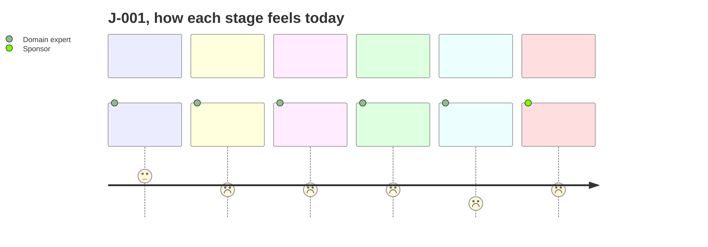
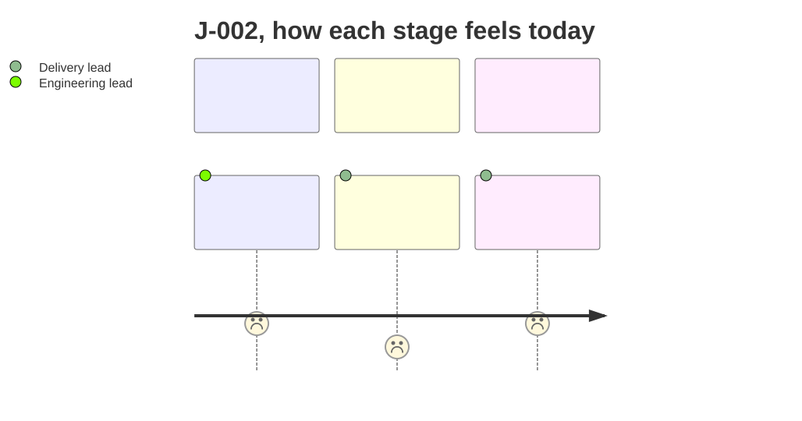

# User journeys

## J-001 - A domain expert reaches an approved PRD whose gaps are known (golden thread)

Persona PER-001. Trigger: they have been asked to specify a product and have
nothing written. Stages ST-001 to ST-006.

| Stage | Actor | Decision |
| --- | --- | --- |
| ST-001 States the idea and the domain | Domain expert | What this is, and the domain's own words |
| ST-002 Taught a section, then interviewed | Domain expert | Have the questions reached the end of what they know |
| ST-003 Reads the draft and its grade | Domain expert | Accept, correct, or refute the grade |
| ST-004 Answers the one question that matters most | Domain expert | Is this section done enough to leave |
| ST-005 Sees what a team could not build | Domain expert | Is it ready for someone who will commit |
| ST-006 Sponsor approves for a release, outside the product | Sponsor | Approve, approve with conditions, or reject |

ST-002 to ST-004 are a loop, run once per section. The loop is the whole
product: the expert is taught, asked, shown a draft, shown a grade, and asked one
more thing.

End state: approved, with or without recorded conditions, at a named version,
every section graded with nothing blocking, every open question with a decider
and a date, and no buildability gap left that is neither closed nor owned.

In release 1, ST-006 happens outside the product. The sponsor reads the root
document or an exported copy and gives a decision. The expert records it in
section 15 under FR-014, with the sponsor's name, role, and date (section 6).

## How each stage feels today

Each stage is scored from 1 (bad) to 5 (good) for how it feels today, without
this product. The scores are the expert's.

| Stage | Score | Pain point behind it |
| --- | --- | --- |
| ST-001 | 3 | None. Stating the idea comes naturally. |
| ST-002 | 2 | Headings filled with adjectives, and software names in place of needs |
| ST-003 | 2 | Cannot tell whether what was written is good |
| ST-004 | 2 | Put down for a week and cannot remember where they were |
| ST-005 | 1 | Nobody says the requirements are untestable until a team tries to build them |
| ST-006 | 2 | The sponsor can only judge whether it reads well |
| ST-009 | 2 | Gaps between two requirements that both looked complete |
| ST-007 | 1 | The workshop invents a backbone in the room |
| ST-008 | 2 | Stories trace to nothing, and constraints arrive late |

The goal deliberately does not claim an engineering lead's confirmation. No stage
in ST-001 to ST-006 puts one in the actor seat, so claiming it would promise
something the release line cannot deliver. A lead's own recorded confirmation is
OUT-004, deferred to release 2 with J-002, where it is stage ST-009.

## J-002 - A delivery lead derives a backlog (not the golden thread)

Persona PER-004, stages ST-009, ST-007, and ST-008. In ST-009 the engineering
lead, PER-002, reads the report of the buildability review and records their own verdict under
TR-006, before the delivery lead takes over. ST-009 was added at 0.8.1, after
ST-008, and ids are never renumbered. Release 1 does not have to complete
this journey (see section 6), but the PRD must carry what it needs, which is what
ST-007 checks.

## What these journeys deliberately do not say

No stage says where the teaching text comes from, how a grade is computed, or
what reviews the set in ST-005. Those are mechanisms. Every stage above names a
person, what they do and see, and what they decide.
