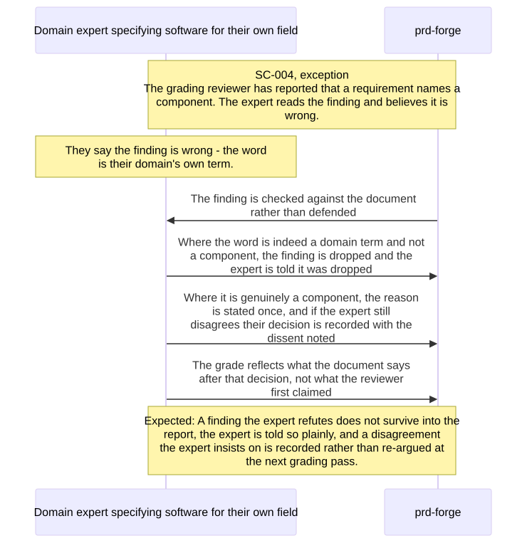
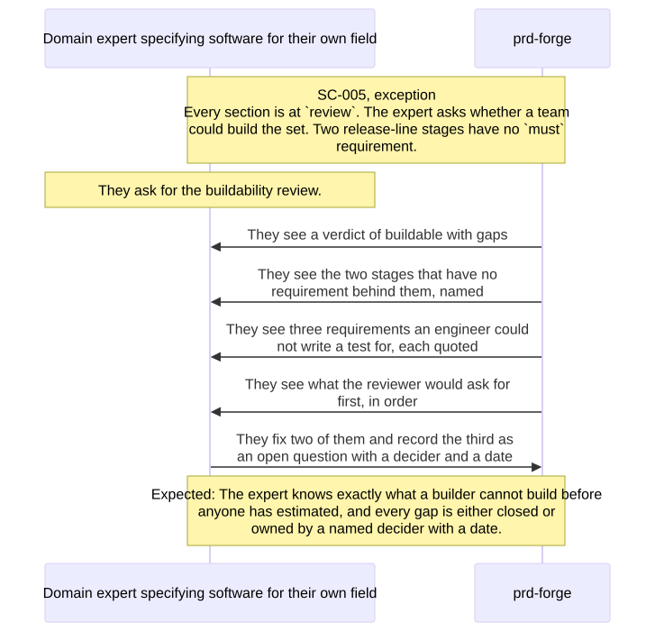
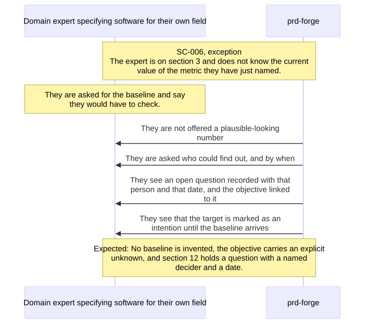

# Scenarios

| ID | Stage | Variant | Priority | What it covers |
| --- | --- | --- | --- | --- |
| SC-001 | ST-002 | happy | must | A section taught, interviewed, drafted, graded, improved |
| SC-002 | ST-004 | alternate | should | Resuming after eight days away |
| SC-003 | ST-002 | exception | must | The expert states a technology |
| SC-004 | ST-003 | exception | should | The expert refutes a finding that the document does not support |
| SC-005 | ST-005 | exception | must | The buildability review finds gaps |
| SC-006 | ST-002 | exception | must | The expert has no baseline for a metric |
| SC-007 | ST-001 to ST-006 | happy | must | One idea, from the first sentence to an approved set |
| SC-008 | ST-003 | exception | should | The expert refutes a finding that the document supports |

SC-007 is the end-to-end acceptance test for release 1: it follows the golden
thread through every release-line stage. SC-001 is the same path inside one
section. SC-005 is the expert's
own run of the buildability review, which is why its persona is PER-001 and not
the engineering lead: no engineering lead is in release 1 at all, per OUT-004.

The priorities follow the requirements. SC-002, SC-004, and SC-008 are
`should`, because FR-015 and FR-016, which they exercise, are `should`.

SC-001 and SC-007 are first use, and SC-002 is a return after time away. No
scenario has two experts on one set at once, which OUT-002 defers to a later
release. A sponsor reading the set while the expert changes it is covered by
FR-014: the change records a new version that the earlier approval does not
cover.

The five exceptions are the ones that decide whether this product is trustworthy.
SC-003 and SC-006 are where a PRD quietly acquires a technology choice
or an invented fact. SC-004 and SC-008 are where the grading either earns the
expert's trust or loses it: a grading pass that cannot be refuted is one
nobody believes.
SC-005 is the moment the product is supposed to pay for itself.

<!-- prd-forge:details -->

## Details

Every item in this document, with each of its fields.

### Scenarios in detail

#### SC-001

**Context:** A freight operations manager is on section 5 of their first PRD. Sections 1 and 4 are drafted and graded. They have 40 minutes before a meeting.

**Journey:** J-001

**Stage:** ST-002

**Stages:** ST-002, ST-003, ST-004

**Persona:** PER-001

**Variant:** happy

**Priority:** must

**Situation:** first-use

**Shown in:** screen

**Lifecycles:** LC-001

**Wireframes:** WF-008

**Trigger:** They say they are ready to do the journeys section.

**Course:**

1. They read eight lines on what a user journey is, why requirements written one at a time miss the steps between them, and what a stage must name
2. They are asked to pick one person and one thing that person is trying to finish
3. They say "a dispatcher getting a late load recovered"
4. They are asked for the big steps, names only, and give five
5. They are asked, per stage, who acts, what they see and what they decide
6. They are asked which journey is the golden thread, and mark this one
7. They see a drafted journey with five stages, and a grade of 78 with no blocking defects
8. They are asked one question - what the dispatcher decides at stage three - and answer it
9. They see the journey re-graded at 88

**Expected outcome:** The journeys section is at status draft with a score of 88 and no blocking defects, one journey is marked as the golden thread, and every stage names an actor and a decision.

#### SC-002

**Context:** The same manager stopped mid-way through section 7 eight days ago. They remember almost nothing about where they were.

**Journey:** J-001

**Stage:** ST-004

**Persona:** PER-001

**Variant:** alternate

**Priority:** should

**Situation:** return

**Shown in:** screen

**Lifecycles:** LC-001

**Wireframes:** WF-010

**Trigger:** They come back and say they want to carry on.

**Course:**

1. They see which sections are done, which are drafted, and which have not been started, with each grade
2. They see that section 7 is at draft with two blocking defects, both named
3. They are not asked any question they have already answered
4. They are asked the next question in section 7, in the vocabulary they gave when they began

**Expected outcome:** Work resumes at the first section that is not yet at review, no earlier answer is requested again, and the domain vocabulary is unchanged.

**Branches from:**

- **Scenario:** SC-007
- **Step:** 5

**Rejoins:** ST-004

#### SC-003

**Context:** A claims manager is answering questions about section 7. They have strong views about how it should be built.

**Journey:** J-001

**Stage:** ST-002

**Persona:** PER-001

**Variant:** exception

**Priority:** must

**Shown in:** conversation

**Trigger:** They say "it should push the decision to the adjuster's phone".

**Course:**

1. They are asked what the adjuster gets from that
2. They say the adjuster is in the field and cannot wait until they are back at a desk
3. They see a requirement recorded as the adjuster being able to act on the claim away from their desk, with criteria about what they can do and see
4. They see that "push to the phone" was kept on a list of candidate architecture decisions, to hand to the engineering lead
5. They are not asked to argue about whether a notification is the right design

**Expected outcome:** The recorded requirement names no technology, the adjuster's need to act on the claim away from a desk is recorded, "push to the phone" appears on the list of candidate architecture decisions, and the expert is not asked to defend or withdraw it.

**Branches from:**

- **Scenario:** SC-007
- **Step:** 3

**Rejoins:** ST-002

#### SC-004

**Context:** A freight operations manager reads the grade of section 7. A finding says that a requirement names a component, "consignment".

**Journey:** J-001

**Stage:** ST-003

**Persona:** PER-001

**Variant:** exception

**Priority:** should

**Shown in:** conversation

**Trigger:** They refute the finding: "consignment" is their domain's word for one shipment, not a part of the product.

**Course:**

1. They see the finding checked against the document
2. They see that the glossary defines "consignment" as a domain term
3. They see the finding dropped, and a line telling them it was dropped
4. They see the grade without that finding

**Expected outcome:** The refuted finding, which the document does not support, is not in the report, the expert sees that it was dropped, and the grade no longer counts it.

**Branches from:**

- **Scenario:** SC-007
- **Step:** 4

**Rejoins:** ST-004

#### SC-008

**Context:** The same manager reads another finding on section 7: a requirement names "the dispatch database", which is a part of the product.

**Journey:** J-001

**Stage:** ST-003

**Persona:** PER-001

**Variant:** exception

**Priority:** should

**Shown in:** conversation

**Trigger:** They refute the finding and say the requirement should keep the words.

**Course:**

1. They see the finding checked against the document, and the document supports it
2. They see the reason stated once
3. They keep their decision, and see it recorded as an objection
4. At the next grading pass, they see no new finding about the same words

**Expected outcome:** The objection and the expert's decision are recorded, the reason is stated only once, and the next grading pass does not raise the same finding as new.

**Branches from:**

- **Scenario:** SC-007
- **Step:** 4

**Rejoins:** ST-004

#### SC-005

**Context:** Every section is at `review`. The expert asks whether a team could build the set. Two release-line stages have no `must` requirement.

**Journey:** J-001

**Stage:** ST-005

**Persona:** PER-001

**Variant:** exception

**Priority:** must

**Shown in:** report

**Wireframes:** WF-009, WF-005

**Trigger:** They ask for the buildability review.

**Course:**

1. They see a verdict of buildable with gaps
2. They see the two stages that have no requirement behind them, named
3. They see three requirements an engineer could not write a test for, each quoted
4. They see what the buildability review would ask for first, in order
5. They write a requirement for one of the two stages, and record the other as an open question with a decider and a date
6. They fix two of the three requirements and record the third as an open question with a decider and a date
7. They see each section they changed go back to draft, to be graded again

**Expected outcome:** Before anyone has estimated, the report names both release-line stages that have no `must` requirement and quotes all three requirements an engineer could not write a test for, and every gap is either closed or owned by a named decider with a date.

**Branches from:**

- **Scenario:** SC-007
- **Step:** 6

**Rejoins:** ST-003

#### SC-006

**Context:** The expert is on section 3 of this PRD and has just named O-002's metric, the median working days from the first interview question to an approval. They do not know today's value.

**Journey:** J-001

**Stage:** ST-002

**Persona:** PER-001

**Variant:** exception

**Priority:** must

**Shown in:** conversation

**Trigger:** They are asked for the baseline and say they would have to check.

**Course:**

1. They are not offered a plausible-looking number
2. They are asked who could find out, and by when
3. They see an open question recorded with that person and that date, as Q-002 is, and the objective linked to it
4. They see that the target is marked as provisional until the baseline arrives

**Expected outcome:** No baseline is invented, O-002 carries an explicit unknown, and section 12 holds a question, Q-002, with a named decider and a date.

**Branches from:**

- **Scenario:** SC-007
- **Step:** 3

**Rejoins:** ST-002

#### SC-007

**Context:** A freight operations manager has an idea for a tool that recovers late loads. They have never written a PRD, and the quarterly planning meeting is one week away.

**Journey:** J-001

**Stage:** ST-001

**Stages:** ST-001, ST-002, ST-003, ST-004, ST-005, ST-006

**Persona:** PER-001

**Variant:** happy

**Priority:** must

**Situation:** first-use

**Shown in:** screen

**Lifecycles:** LC-001

**Wireframes:** WF-007, WF-002, WF-001, WF-008, WF-005, WF-006

**Trigger:** They say they want to turn the idea into a PRD.

**Course:**

1. They state the idea in their own words and name their domain, freight operations
2. They see every section of the new set, each marked as not started
3. For each section, they are taught what it is for, then asked one or two questions at a time
4. After each section, they read the draft as prose and see its grade and every blocking defect by name
5. They answer the one question that most improves each weak section, and see it re-graded
6. With every section at review, they ask for the buildability review and see that no release-line stage lacks a must requirement
7. They set each section final, after its grading pass shows no blocking defect
8. The sponsor reads the root document, sees what is still open and who decides each open item, and approves the set at version 1.0.0, which the expert records in section 15

**Expected outcome:** Every section is at final, every gap the buildability review found is closed or has a named decider and a date, and the change log records the sponsor's approval against a named version.

### Lifecycles in detail

#### LC-001

**Subject:** a section of the PRD

**States:**

- **Name:** pending
  - **Meaning:** Listed in the set and not yet interviewed.
- **Name:** draft
  - **Meaning:** Interviewed and written, and graded or waiting for a grade.
- **Name:** review
  - **Meaning:** Ready for someone other than the expert to read.
- **Name:** final
  - **Meaning:** Set final by the expert under TR-002.

**Initial:** pending

**Final:** final

**Transitions:**

- **From:** pending
  - **To:** draft
  - **When:** The expert finishes the section's interview and it is written
  - **Rule:** The expert decides the interview is finished (TR-008)
  - **By:** PER-001
- **From:** draft
  - **To:** review
  - **When:** The expert accepts the offer of review
  - **Rule:** A grade of 70 or more, zero blocking defects, and a set that checks clean, unless the expert overrides the gate and the override is recorded in section 15
  - **By:** PER-001
- **From:** review
  - **To:** final
  - **When:** The expert sets the section to final
  - **Rule:** The expert's decision under TR-002, after an independent grading pass with zero blocking defects, unless the expert overrides the gate and the override is recorded in section 15. No other approval is needed.
  - **By:** PER-001
- **From:** review
  - **To:** draft
  - **When:** The expert changes the section, because a later section shows it is incomplete
  - **Rule:** The expert's decision under TR-002. The section is graded again before it returns to review.
  - **By:** PER-001
- **From:** final
  - **To:** draft
  - **When:** The expert changes the section after it was set final
  - **Rule:** The expert's decision under TR-002. If the set was approved, the change records a new version that the earlier approval does not cover (FR-014). A section is never retired, because ids are never reused.
  - **By:** PER-001

<!-- /prd-forge:details -->
