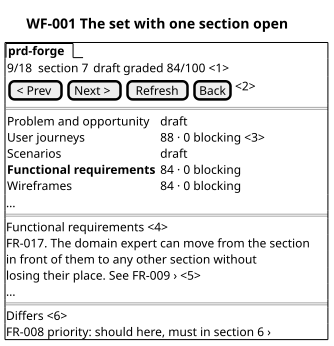
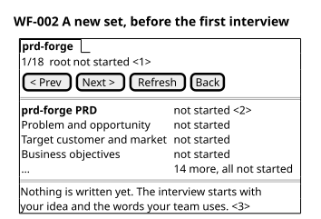
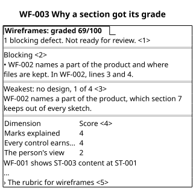
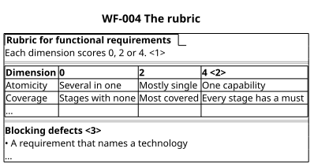
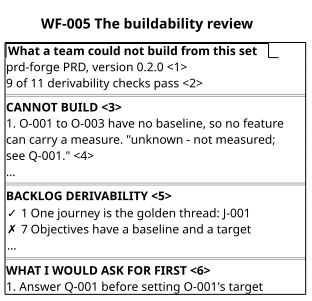
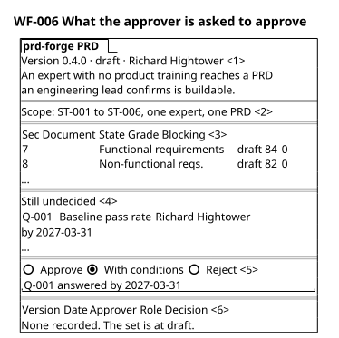
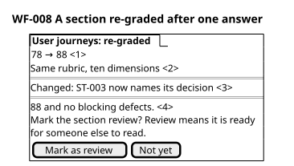
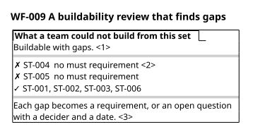
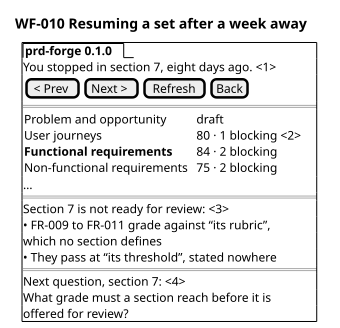

# Wireframes

Every requirement in section 7 whose outcome a person meets on a screen or in a
report is drawn here as a text sketch. Each sketch shows what the person sees and
what they can do there, with the set's own content. None of them decides how
anything looks or how it is built.

Five sketches follow the domain expert through the golden thread: a new set with
nothing started, the set with a section open, why a section got its grade, the
rubric behind it, and a re-grade. Two reports decide whether the set is
buildable: the buildability review and the approval pack. Three smaller sketches
draw the other states: no set at all, which FR-018's third criterion names; the
review that finds gaps, which SC-005 names; and the return after a week away,
which SC-002 names.

The numbered marks in each sketch are explained, in order, by its `shows` list.
Each sketch is also drawn for the printed PRD.

## WF-001 The set with one section open

Illustration, not a design. Illustrates FR-002, FR-008, FR-017, FR-018, and FR-020. PER-001 sees it at ST-003.

The expert reads a drafted section with the whole set beside it. Every graded section shows its score and its blocking count, so what is weak is visible without opening anything. When two places in the set state one id, priority, or link differently, mark 6 lists each difference with both values. The difference drawn is an example, not a fact of this set.

```wireframe
┌─ prd-forge ──────────────────────────────────────────┐
│ 9/18  section 7  draft  graded 84/100 <1>            │
│ [ < Prev ] [ Next > ] [ Refresh ] [ Back ] <2>       │
├──────────────────────────────────────────────────────┤
│   Problem and opportunity      draft                 │
│   …                                                  │
│   User journeys                88 · 0 blocking <3>   │
│   Scenarios                    draft                 │
│   Scope                        draft                 │
│ > Functional requirements      84 · 0 blocking       │
│   Wireframes                   84 · 0 blocking       │
│   …                                                  │
├──────────────────────────────────────────────────────┤
│ Functional requirements <4>                          │
│ ───────────────────────                              │
│ FR-017. The domain expert can move from the section  │
│ in front of them to any other section without        │
│ losing their place. See Q-009 › <5>                  │
│ …                                                    │
├──────────────────────────────────────────────────────┤
│ Differs <6>                                          │
│ FR-020 stage: ST-003 here, ST-002 in section 6 ›     │
└──────────────────────────────────────────────────────┘
```



## WF-002 A new set, before the first interview

Illustration, not a design. Illustrates FR-002, FR-017, and FR-018. PER-001 sees it at ST-001.

At ST-001 the set exists and nothing in it is written. Every section is listed and marked not started, so the expert sees the whole shape of the work before the first question.

```wireframe
┌─ prd-forge ──────────────────────────────────────────┐
│ 1/18  root  not started <1>                          │
│ [ < Prev ] [ Next > ] [ Refresh ] [ Back ]           │
├──────────────────────────────────────────────────────┤
│ > prd-forge PRD                 not started <2>      │
│   Problem and opportunity      not started           │
│   Target customer and market   not started           │
│   Business objectives          not started           │
│   …  14 more, all not started                        │
├──────────────────────────────────────────────────────┤
│ Nothing is written yet. The interview starts with    │
│ your idea and the words your team uses. <3>          │
└──────────────────────────────────────────────────────┘
```



## WF-003 Why a section got its grade

Illustration, not a design. Illustrates FR-009 and FR-017. PER-001 sees it at ST-003.

A score alone does not tell the expert what to fix. This view names each blocking defect and where it is, and names the weakest part, quoting the section.

```wireframe
┌─ Wireframes: graded 69/100 ──────────────────────────┐
│ 1 blocking defect. Not ready for review. <1>         │
├──────────────────────────────────────────────────────┤
│ Blocking <2>                                         │
│ • WF-002 names a part of the product and where       │
│   files are kept. In WF-002, lines 3 and 4.          │
├──────────────────────────────────────────────────────┤
│ Weakest: no design, 1 of 4 <3>                       │
│ WF-002 names a part of the product, which section 7  │
│ keeps out of every sketch.                           │
├──────────────────────────────────────────────────────┤
│ Dimension               Score <4>                    │
│ ──────────────────────────────────────────           │
│ Marks explained         4                            │
│ Every control earns...  4                            │
│ The person's view       2                            │
│   WF-001 shows ST-003 content at ST-001              │
│ …                                                    │
│ › The rubric for wireframes <5>                      │
└──────────────────────────────────────────────────────┘
```



## WF-004 The standard a section is graded against

Illustration, not a design. Illustrates FR-009 and FR-017. PER-001 sees it at ST-003.

A grade against a stated standard is only fair if the expert can read the standard. This is the same rubric the graders used.

```wireframe
┌─ Rubric for functional requirements ─────────────────┐
│ Each dimension scores 0, 2 or 4. <1>                 │
├──────────────────────────────────────────────────────┤
│ Dimension     0           2            4 <2>         │
│ ──────────────────────────────────────────────────   │
│ Atomicity     Several in  Mostly       One           │
│               one         single       capability    │
│ Coverage      Stages      Most         Every stage   │
│               with none   covered      has a must    │
│ …                                                    │
├──────────────────────────────────────────────────────┤
│ Blocking defects <3>                                 │
│ • A requirement that names a technology              │
│ …                                                    │
└──────────────────────────────────────────────────────┘
```



## WF-005 What a team could not build from this set

Illustration, not a design. Illustrates FR-012. PER-001 sees it at ST-005.

The values are prd-forge's own at version 0.4.0, a snapshot. The expert reads this before anyone has estimated anything, while a fix is still a sentence. Every finding quotes the set, so the expert can check it rather than trust it.

```wireframe
┌─ What a team could not build from this set ──────────┐
│ prd-forge PRD 0.4.0. Buildable with gaps. <1>        │
├──────────────────────────────────────────────────────┤
│ Release line <2>                                     │
│ ✓ ST-001  FR-001, FR-002, FR-015                     │
│ ✓ ST-003  FR-008, FR-009, FR-016, FR-017, FR-018     │
│ ✓ ST-006  FR-013, FR-014                             │
│ …                                                    │
├──────────────────────────────────────────────────────┤
│ Cannot write a test from <3>                         │
│ 1. FR-004: "two ways differing in meaning", no judge │
│ 2. FR-014: no test for a rejection                   │
├──────────────────────────────────────────────────────┤
│ Blocked by an open question <4>                      │
│ Q-009 blocks FR-012: which rubric version applies.   │
│ Richard Hightower, by 2027-01-31                     │
├──────────────────────────────────────────────────────┤
│ Ask for first <5>                                    │
│ 1. Who judges FR-004's two meanings                  │
└──────────────────────────────────────────────────────┘
```



## WF-006 What the approver is asked to approve

Illustration, not a design. Illustrates FR-013 and FR-014. PER-003 sees it at ST-006.

The values are prd-forge's own at version 0.4.0, a snapshot. The approver reads one document, not eighteen. It says what they are committing to, what is still open and who owns it, and where their decision is recorded.

```wireframe
┌─ prd-forge PRD ──────────────────────────────────────┐
│ Version 0.4.0 · draft · Richard Hightower <1>        │
│ An expert with no product training reaches a PRD     │
│ an engineering lead confirms is buildable.           │
├──────────────────────────────────────────────────────┤
│ Scope: ST-001 to ST-006, one expert, one PRD <2>     │
├──────────────────────────────────────────────────────┤
│ Sec Document                 State Grade Blocking <3>│
│ ──────────────────────────────────────────────────   │
│ 7   Functional requirements  draft 84    0           │
│ 8   Non-functional reqs.     draft 82    0           │
│ …                                                    │
├──────────────────────────────────────────────────────┤
│ Still undecided <4>                                  │
│ Q-001  Baseline pass rate   Richard Hightower        │
│                             by 2027-03-31            │
│ …                                                    │
├──────────────────────────────────────────────────────┤
│ ( ) Approve  (•) With conditions  ( ) Reject <5>     │
│ [ Q-001 answered by 2027-03-31________________ ]     │
├──────────────────────────────────────────────────────┤
│ Version  Date  Approver  Role  Decision <6>          │
│ None recorded. The set is at draft.                  │
└──────────────────────────────────────────────────────┘
```



## WF-007 Before any set exists

Illustration, not a design. Illustrates FR-018. PER-001 sees it at ST-001.

Before the first interview there is no set to list. The view says so plainly, and a refresh lists every section once the set is written.

```wireframe
┌─ PRD ────────────────────────────────────────────────┐
│ No PRD has been started yet. <1>                     │
│ Ask to start one, and you will be interviewed        │
│ section by section.                                  │
│ [ Refresh ] <2>                                      │
└──────────────────────────────────────────────────────┘
```


## WF-008 A section re-graded after one answer

Illustration, not a design. Illustrates FR-011. PER-001 sees it at ST-004.

After one answer the section is graded again against the same rubric. Both scores are visible, and at 70 or more with no blocking defects the expert is offered review. The values are SC-001's.

```wireframe
┌─ User journeys: re-graded ───────────────────────────┐
│ 78  →  88 <1>                                        │
│ Same rubric, twelve dimensions <2>                   │
├──────────────────────────────────────────────────────┤
│ Changed: ST-003 now names its decision <3>           │
├──────────────────────────────────────────────────────┤
│ 88 and no blocking defects. <4>                      │
│ Mark the section review? Review means it is ready    │
│ for someone else to read.                            │
│ [ Mark as review ]   [ Not yet ]                     │
└──────────────────────────────────────────────────────┘
```



## WF-009 A buildability review that finds gaps

Illustration, not a design. Illustrates FR-012. PER-001 sees it at ST-005.

SC-005 is the review that finds work missing: two release-line stages have no must requirement behind them. The gaps are named first, before anything else in the review.

```wireframe
┌─ What a team could not build from this set ──────────┐
│ Buildable with gaps. <1>                             │
├──────────────────────────────────────────────────────┤
│ ✗ ST-004  no must requirement <2>                    │
│ ✗ ST-005  no must requirement                        │
│ ✓ ST-001, ST-002, ST-003, ST-006                     │
├──────────────────────────────────────────────────────┤
│ Each gap becomes a requirement, or an open question  │
│ with a decider and a date. <3>                       │
└──────────────────────────────────────────────────────┘
```



## WF-010 Resuming a set after a week away

Illustration, not a design. Illustrates FR-002, FR-009, FR-015, FR-017, and FR-018. PER-001 sees it at ST-004.

SC-002 is the expert who returns after eight days and remembers nothing. The values are prd-forge's own at version 0.1.0, when section 7 scored 84 with two blocking defects: a grade of 70 or more that is still not offered as ready.

```wireframe
┌─ prd-forge 0.1.0 ────────────────────────────────────┐
│ You stopped in section 7, eight days ago. <1>        │
│ [ < Prev ] [ Next > ] [ Refresh ] [ Back ]           │
├──────────────────────────────────────────────────────┤
│   Problem and opportunity      draft                 │
│   User journeys                80 · 1 blocking <2>   │
│ > Functional requirements      84 · 2 blocking       │
│   Non-functional requirements  75 · 2 blocking       │
│   …                                                  │
├──────────────────────────────────────────────────────┤
│ Section 7 is not ready for review: <3>               │
│ • FR-009 to FR-011 grade against "its rubric",       │
│   which no section defines                           │
│ • They pass at "its threshold", stated nowhere       │
├──────────────────────────────────────────────────────┤
│ Next question, section 7: <4>                        │
│ What grade must a section reach before it is         │
│ offered for review?                                  │
└──────────────────────────────────────────────────────┘
```


