# Decision rights and trust rules

| ID | Decision | Decider | Agent may decide | Never delegated |
| --- | --- | --- | --- | --- |
| TR-001 | Approve a PRD for a release | PER-003 | no | yes |
| TR-002 | Set a section to final | PER-001 | no | yes |
| TR-003 | Produce a section's score and findings | PER-001 | **yes** | no |
| TR-004 | Decide scope | PER-001 | no | yes |
| TR-005 | State a domain fact as true | PER-001 | no | yes |
| TR-006 | Judge buildability, and report the gaps | PER-002 | **yes** | no |
| TR-007 | Decide the domain's own terms | PER-001 | no | yes |
| TR-008 | Decide a section's interview is finished | PER-001 | no | yes |
| TR-009 | Decide a section may be left at draft | PER-001 | no | yes |
| TR-010 | Decide the set is ready to offer for approval | PER-001 | no | yes |
| TR-011 | Decide a backlog can be mapped | PER-004 | **yes** | no |
| TR-012 | Decide which epics come first | PER-004 | no | yes |
| TR-013 | Accept or correct a drafted section | PER-001 | no | yes |
| TR-014 | Accept or refute a section's score | PER-001 | no | yes |

Every decision named in a stage of section 5 appears here. TR-007 to TR-013 were
added at version 0.2.0 to close that: five release-line stage decisions and both
of J-002's had no rule, which meant gates an engineering team would have had to
invent. TR-013 covers the one in the middle of the loop, the expert accepting
that a draft says what they meant, which is distinct from scoring it (TR-003),
from accepting or refuting the score (TR-014),
from leaving it at draft (TR-009) and from setting it final (TR-002).

## The shape of the trust boundary

Only three of fourteen are delegable, and all three are **assessments**, not
decisions:
TR-003 produces a document's score, which the expert then accepts or refutes
under TR-014, TR-006 judges whether it can be built from, and TR-011
judges whether a backlog can be mapped from it. All three produce evidence for a
person. None changes a document, and none can set a state.

Everything that commits anyone to anything, such as approving, finalising,
choosing scope, or asserting a fact, is never delegated. TR-005 is the strictest: a fact
nobody can stand behind is not written at all, by anyone.

The delegable assessments all carry the same two obligations: **quote the
document for every claim**, and **drop any finding the document does not
support**. An assessment that cannot be refuted by pointing at the text is not
evidence, it is an assertion, and the expert will correctly stop believing it.
See R-002 in section 11.
