# Release plan

| ID | Release | Stages | Target |
| --- | --- | --- | --- |
| REL-001 | Single-expert PRD authoring | ST-001..ST-006 | 2027-03-31 |
| REL-002 | Backlog derivation | ST-009, ST-007, ST-008 | 2027-06-30 |
| REL-003 | More than one author | none | none |

## Why this order

REL-001 is exactly the release line in section 6. It is the smallest release in
which anyone gets anything: an expert reaching an approved PRD with its buildability review.

REL-002 is deferred rather than cut because the PRD REL-001 produces already has
to carry everything a backlog needs, and FR-012 checks precisely that. Deferring the
derivation costs nothing; deferring what it needs would have cost a rewrite.
REL-002 does not wait for REL-001's exit thresholds, which the pilots can
take until 2027-09-30 to show. It starts when the first pilot PRD written with
REL-001 is approved, because the derivation needs one real approved PRD as its
input. Richard Hightower decided this on 2026-11-02.

REL-002 links to O-001 and REL-003 to O-002, but neither release can move
those numbers as section 3 measures them. O-001 is judged before a backlog
exists, and O-002 counts single-journey pilot PRDs written with REL-001. The
exit criteria of REL-002 and REL-003 carry their own targets for now. Each
becomes an objective in section 3 when its release has requirements that can
reference it.

REL-003 waits for evidence that one author's path works at all. It starts when
OUT-002's condition holds: three real engagements have each reached an approved
set that passed the buildability review on first submission. Building for two
authors before one is proven would be building on A-001 and A-002 before either is
tested. A sponsor can already comment on an exported copy in REL-001, under
FR-022. REL-003 adds comments inside the set, by a reviewer who does not hold the
pen, which OUT-005 defers.

## How you know each release worked

REL-001 exits when the pilot PRDs meet the three objective targets in section 3:
at least 4 of the 5 pilot PRDs, 80%, pass the buildability review on first
submission, the median reaches
approval in under 5 working days, and 95% of `must` requirements are testable as
written. REL-002 exits when every derived story names its requirement, a
delivery lead runs a workshop from the backlog without re-deriving it, the
delivery lead accepts the derived backlog within 2 working days for at least 2
of the first 3 approved pilot PRDs, and an engineering lead records a verdict
on each of those 3. REL-003 exits when the median of the first 3 sets written
by two experts reaches approval within 10 working days.

Both target dates are indicative, not committed. D-002 and D-003 have not
reported yet, and Q-022 is still open. The schedule problem below says why.

## The schedule problem, stated plainly

REL-001 targets 2027-03-31. D-002 and D-003 in section 11, the ten observed
experts and the three engineering leads, are due by 2027-01-31. Both are
*committed*: on 2026-11-02 their parties committed in writing, which answers
Q-019. The questions they answer are due by 2027-02-28, a month before
REL-001, so REL-001 can use what they find. If either reports late, REL-001
moves or ships knowingly as an experiment. Q-022 decides which, and Richard
Hightower decides it by 2027-01-31.

REL-002 carries no requirements yet. Section 7 holds none for ST-007, ST-008, or
ST-009, and they are written when REL-002 is planned.

## Not in this section, deliberately

No tasks, no estimates, no sizing, no team assignments, and no technology
milestone. Those come from engineering design and iteration planning.

<!-- prd-forge:details -->

## Details

Every item in this document, with each of its fields.

**Roadmap link:** ./18-roadmap.md

### REL-001

**Name:** Single-expert PRD authoring

**Outcomes:**

- An expert with no product training, a domain expert or a product manager who speaks for one, can take one product idea to an approved PRD. Only the sponsor's reading, comments, and decision at ST-006 happen outside the product.
- The expert can see, before anyone estimates, which parts of their own PRD a development team could not build from.
- A sponsor can see what they are approving, what is still open, and who decides each open question, in one document.

**Journey stages:** ST-001, ST-002, ST-003, ST-004, ST-005, ST-006

**Requirements:** FR-001, FR-002, FR-003, FR-004, FR-005, FR-006, FR-007, FR-008, FR-009, FR-010, FR-011, FR-012, FR-013, FR-014, FR-015, FR-016, FR-017, FR-018, FR-019, FR-020, FR-021, FR-022, FR-023

**Objectives:** O-001, O-002, O-003

**Depends on:** D-002, D-003, Q-022, R-001, R-002

**Exit criteria:**

1. At least 4 of the 5 pilot PRDs, 80%, pass the buildability review on first submission, where a pass is the verdict `buildable`, or `buildable with gaps` with every gap closed or owned (O-001). The pilot PRDs are as O-001 defines them: the first 5 PRDs written with release 1 by people other than the product's author, between 2027-03-31 and 2027-09-30.
2. The median pilot PRD reaches a recorded approval in under 5 working days from the first interview question (O-002).
3. An engineer who was not in the interview judges 95% of the pilot PRDs' `must` requirements testable as written (O-003).

**Target date:** 2027-03-31

**Date status:** indicative

### REL-002

**Name:** Backlog derivation

**Outcomes:**

- A delivery lead can walk into a story-mapping workshop with features and a release line already derived from the approved PRD.
- A delivery lead sees every story name the requirement id it came from, so nobody has to ask why it exists.
- An engineering lead can record their own verdict on whether an approved set can be built from, with the report of its buildability review kept beside it.

**Journey stages:** ST-009, ST-007, ST-008

**Objectives:** O-001

**Depends on:** Q-023

**Exit criteria:**

1. Every story derived from a pilot PRD names the requirement id it came from.
2. A delivery lead runs a story-mapping workshop from a derived backlog without re-deriving any feature from the PRD.
3. For at least 2 of the first 3 approved pilot PRDs, the delivery lead accepts the derived backlog within 2 working days of the approval.
4. An engineering lead records a verdict on each of the first 3 approved pilot PRDs, with its buildability review kept beside it.

**Target date:** 2027-06-30

**Date status:** indicative

### REL-003

**Name:** More than one author

**Outcomes:**

- Two experts can work on different sections of the same set without overwriting each other.
- A reviewer, such as the engineering lead (PER-002), can comment on a section inside the set, not on an exported copy, without being able to change it.

**Objectives:** O-002

**Depends on:** A-001, A-002

**Exit criteria:**

1. The median of the first 3 sets written by two experts reaches a recorded approval within 10 working days of the first interview question.

### On the roadmap

- REL-001:
  - RM-001 One expert takes one product idea to an approved PRD (now, on-track)
- REL-002:
  - RM-002 A delivery lead derives a traceable backlog from the approved PRD (next, not-started)
- REL-003:
  - RM-003 Two experts work on different sections of one set (later, not-started)

<!-- /prd-forge:details -->
