# Release plan

| ID | Release | Stages | Target |
| --- | --- | --- | --- |
| REL-001 | Single-expert PRD authoring | ST-001..ST-006 | 2027-03-31 |
| REL-002 | Backlog derivation | ST-009, ST-007, ST-008 | 2027-06-30 |
| REL-003 | More than one author | none | none |

## Why this order

REL-001 is exactly the release line in section 6. It is the smallest release in
which anyone gets anything: an expert reaching an approved, reviewed PRD.

REL-002 is deferred rather than cut because the PRD REL-001 produces already has
to carry everything a backlog needs, and FR-012 checks precisely that. Deferring the
derivation costs nothing; deferring what it needs would have cost a rewrite.

REL-003 waits for evidence that one author's path works at all. Building for two
authors before one is proven would be building on A-001 and A-002 before either is
tested.

## How you know each release worked

REL-001 exits when the pilot PRDs meet the three objective targets in section 3:
at least 4 of the 5 pilot PRDs, 80%, pass the buildability review on first
submission, the median reaches
approval in under 5 working days, and 95% of `must` requirements are testable as
written. REL-002 exits when every derived story names its requirement and a
delivery lead runs a workshop from the backlog without re-deriving it.

Both target dates are indicative, not committed. The schedule problem below is
the reason.

## The schedule problem, stated plainly

REL-001 targets 2027-03-31. D-002 and D-003 in section 11, the ten observed
experts and the three engineering leads, are also dated 2027-03-31 and are only
*requested*. As a result, REL-001 ships at the same moment the assumptions
beneath it are first tested, not after. Either REL-001 moves, or it ships
knowingly as an experiment. Q-019 asks which, and Richard Hightower decides it
by 2027-01-31.

REL-002 carries no requirements yet. Section 7 holds none for ST-007, ST-008, or
ST-009, and they are written when REL-002 is planned.

## Not in this section, deliberately

No tasks, no estimates, no sizing, no team assignments, and no technology
milestone. Those come from engineering design and iteration planning.
