# Roadmap

The roadmap follows the release plan in section 13, one item for each
release. RM-001 is now and at risk: REL-001 needs pilot evidence that has no
written commitment yet. RM-002 is next. RM-003 is later, so it has no date.

Each item uses MoSCoW. No item has a RICE or ICE score, because the set holds
no reach or effort figures yet.

<!-- prd-forge:details -->

## Details

Every item in this document, with each of its fields.

**Format:** now-next-later

**Period:** 2027

### Items in detail

#### RM-001

**Title:** One expert takes one product idea to an approved PRD

**Horizon:** now

**Status:** at-risk

**Releases:** REL-001

**Objectives:** O-001, O-002, O-003

**Theme:** Single-expert authoring

**Owner:** Richard Hightower

**Depends on:** D-002, D-003, Q-019, Q-022

**Target date:** 2027-03-31

**Date status:** indicative

**Blocker:** The pilot evidence that REL-001's exit criteria need, from D-002 and D-003, has no written commitment to report by 2027-01-31 (Q-019).

**Mitigation:** Q-022 decides by 2027-01-31 whether REL-001 moves or ships as an experiment if the evidence comes late.

**Priority:**

- **Method:** moscow
- **Moscow:** must

#### RM-002

**Title:** A delivery lead derives a traceable backlog from the approved PRD

**Horizon:** next

**Status:** not-started

**Releases:** REL-002

**Objectives:** O-001

**Theme:** Backlog derivation

**Owner:** Richard Hightower

**Target date:** 2027-06-30

**Date status:** indicative

**Priority:**

- **Method:** moscow
- **Moscow:** should

#### RM-003

**Title:** Two experts work on different sections of one set

**Horizon:** later

**Status:** not-started

**Releases:** REL-003

**Objectives:** O-002

**Theme:** More than one author

**Owner:** Richard Hightower

**Depends on:** A-001, A-002

**Priority:**

- **Method:** moscow
- **Moscow:** could

### Changes in detail

#### 2026-11-01

**Change:** Roadmap created from the release plan at 0.13.0.

**Reason:** Issue 24 adds a roadmap to the set. Each item follows one release, and no release changed.

<!-- /prd-forge:details -->
