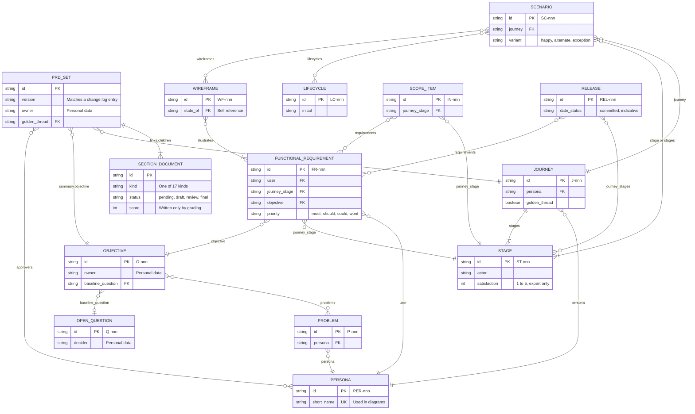
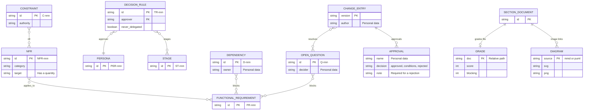
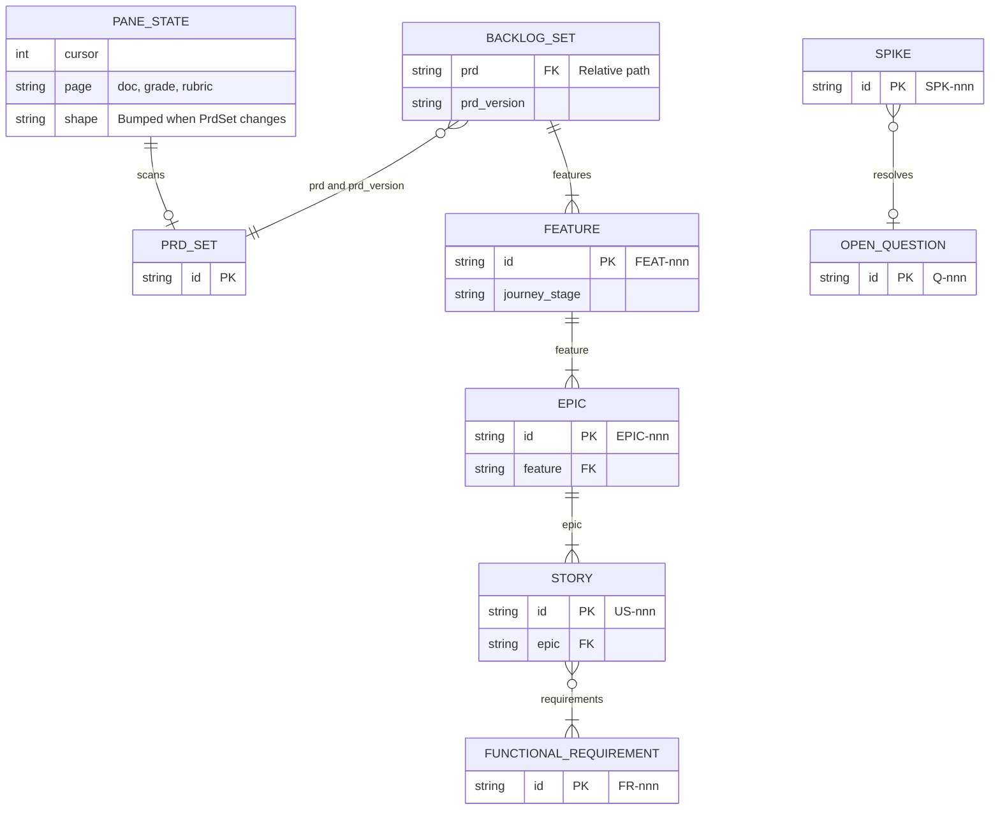

# Data model: prd-forge

> **Template Origin**: Official | **ArcKit Version**: 6.18.3 | **Command**: `/arckit:data-model`

## Document control

| Field | Value |
|-------|-------|
| **Document ID** | ARC-001-DATA-v1.0 |
| **Document Type** | Data Model |
| **Project** | prd-forge (Project 001) |
| **Classification** | PUBLIC |
| **Status** | DRAFT |
| **Version** | 1.0 |
| **Created Date** | 2026-10-27 |
| **Last Modified** | 2026-10-27 |
| **Review Cycle** | Monthly |
| **Next Review Date** | 2026-11-26 |
| **Owner** | Richard Hightower, product owner |
| **Reviewed By** | [PENDING] |
| **Approved By** | [PENDING] |
| **Distribution** | Project Team, Architecture Team |

## Revision history

| Version | Date | Author | Changes | Approved By | Approval Date |
|---------|------|--------|---------|-------------|---------------|
| 1.0 | 2026-10-27 | ArcKit AI | Initial creation from `/arckit:data-model` command | [PENDING] | [PENDING] |

---

## Executive summary

### Overview

prd-forge has no database. A PRD is one folder of markdown documents, and each document's YAML front matter is its record [REQ-C1]. A JSON Schema per document kind in `schemas/` defines the fields, and `scripts/prd-validate.mjs` checks every document against its schema and every id reference across documents. This data model describes that store as entities, attributes, and relationships.

The entity catalog below is generated from the schemas by a script, so each attribute, type, required flag, and validation rule matches `schemas/*.json` at the v0.8.0 tag. Where this document says "table", "key", or "index", read "list in front matter", "id", and "lookup the validator or the pane builds in memory".

The model covers three groups: the PRD set and its section items, the derived backlog set, and the files beside a set (grades and diagrams). The pane's session state is a fourth group that is never written to disk.

### Model statistics

- **Total Entities**: 34 entities defined (E-001 through E-034)
- **Total Attributes**: 323 attributes across all entities, most of them generated from the schemas
- **Total Relationships**: 36 relationship entries in the catalog, many covering several id fields; the validator checks each unless the entry says otherwise
- **Data Classification**:
  - 🟢 Public: 34 entities in the reference set; a customer's set takes the customer's own classification
  - 🟡 Internal: Set by the customer
  - 🟠 Confidential: Set by the customer (10 entities hold a person's name)
  - 🔴 Restricted: None. No payment, health, or special-category data is modeled.

### Compliance summary

- **GDPR/DPA 2018 Status**: COMPLIANT for the product, which processes no personal data outside the customer's own files. GAPS_IDENTIFIED for one integration: CF-3 in the requirements.
- **PII Entities**: 10 entities hold a person's name in a free-text field
- **Data Protection Impact Assessment (DPIA)**: NOT_REQUIRED for the product. A customer may need one for their own use.
- **Data Retention**: No expiry imposed by the product (NFR-C-002)
- **Cross-Border Transfers**: NO by the product. The host session's own transfers are the customer's to assess.

### Key data governance stakeholders

- **Data Owner (Business)**: The domain expert (PER-001), for every PRD item; the delivery lead (PER-004), for backlog items
- **Data Steward**: The `prd-wizard` skill and `scripts/prd-validate.mjs`, which enforce the schemas and the cross-references
- **Data Custodian (Technical)**: The customer, who stores the folder (C-002)
- **Data Protection Officer**: The customer's own. prd-forge has none, because it holds no data.

---

## Visual Entity-Relationship Diagram (ERD)

The model is split into three diagrams, so that each stays readable.

### ERD 1: The PRD set and its core items

### ERD 2: Governance items and the files beside a set

### ERD 3: The derived backlog and the pane's session state

---

## Entity catalog

### Entity E-002: Section document

**Description**: The fields every document shares, from `common.json`'s `base` and `section` definitions. Each of the 17 section kinds adds its own lists, modeled as the entities that follow.

**Source Requirements**:

- DR-001: every document is checked against its kind

**Business Context**: One file per section, such as `08-functional-requirements.md`. The pane, the validator, and the export navigate by these fields alone.

**Data Ownership**:

- **Business Owner**: Domain expert (PER-001)
- **Technical Owner**: prd-forge maintainers (`schemas/common.json`)
- **Data Steward**: The interview skill and the validator

**Data Classification**: Set by the customer

**Volume Estimates**:

- **Initial Volume**: Up to 17 per set
- **Growth Rate**: Fixed by the document kinds
- **Peak Volume**: 17
- **Average Record Size**: Under 1 KB of front matter, plus the body

**Data Retention**:

- **Active Period**: As long as the customer keeps the set
- **Archive Period**: The customer's own policy
- **Total Retention**: No expiry imposed by the product
- **Deletion Policy**: Hard delete, by the customer

#### Attributes

| Attribute | Type | Required | PII | Description | Validation Rules | Source Req |
|-----------|------|----------|-----|-------------|------------------|------------|
| `id` | String | Yes | No | (no description in schema) | pattern `^[a-z0-9][a-z0-9-]*$` | DR-001 |
| `kind` | Enum | Yes | No | (no description in schema) | one of `prd`, `problem-opportunity`, `customer-market`, `objectives-metrics`, `personas`, `journeys`, `scenarios`, `scope`, `functional-requirements`, `wireframes`, `nonfunctional-requirements`, `constraints`, `decision-rights`, `assumptions-risks-dependencies`, `open-questions`, `release-plan`, `glossary`, `change-log`, `backlog`, `features`, `epics`, `stories`, `spikes` | DR-001 |
| `schema` | String | Yes | No | Which schema validates this front matter, e.g. prd-forge/journeys@1. | pattern `^prd-forge/[a-z0-9-]+@\d+$` | DR-001 |
| `title` | String | Yes | No | (no description in schema) | not empty | DR-001 |
| `status` | Enum | Yes | No | pending: not interviewed yet. draft: written. review: with reviewers. final: approved. | one of `pending`, `draft`, `review`, `final` | DR-001 |
| `updated` | String | Yes | No | (no description in schema) | pattern `^\d{4}-\d{2}-\d{2}$`; ISO date | DR-001 |
| `links` | Object | Yes | No | How this document reaches the rest of the set. The whole set is navigable from these fields alone. | none | DR-001 |
| `score` | Integer | No | No | The last adversarial grade of this document, 0-100. Written by the grading pass, never by hand. | 0 to 100 | DR-001 |
| `blocking` | Integer | No | No | How many blocking defects the last grading pass found. A document reaches status final only at 0. | 0 to | DR-001 |
| `graded` | String | No | No | When the last grading pass ran. | pattern `^\d{4}-\d{2}-\d{2}$`; ISO date | DR-001 |
| `domain` | String | No | No | The business domain this document is written in: auditing, transportation, claims, whatever the expert's is. | none | DR-001 |
| `section` | Integer | Yes | No | (no description in schema) | 1 to 15 | DR-001 |
| `order` | Integer | Yes | No | (no description in schema) | 0 to | DR-001 |

**Attribute Notes**:

- **PII Attributes**: None
- **Encrypted Attributes**: None by the product
- **Derived Attributes**: `score`, `blocking`, and `graded`, written only by the grading pass [REQ-C2]
- **Audit Attributes**: `updated`, and the change log

#### Relationships

- `links.parent`, `links.prev`, `links.next` → E-002 or E-001 (many-to-one). The `prev` and `next` chain must be unbroken.
- `links.related` → E-002 (many-to-many)
- One-to-one with E-027, its grade reasons file

#### Indexes

**Primary Key**:

- `id`, unique in the set

**Foreign Keys**:

- Each link's `path` must resolve to a file whose `id` matches the link's `id`

**Unique Constraints**:

- `order` is unique in the set

**Performance Indexes**:

- The pane builds `PrdSet.docs`, sorted by `order`

#### Privacy & Compliance

**GDPR/DPA 2018 Considerations**:

- **Contains PII**: NO
- **PII Attributes**: None
- **Legal Basis for Processing**: Not applicable
- **Data Subject Rights**: Not applicable

---

### Entity E-001: PRD set (root)

**Description**: The root document `prd.md` of one PRD: the product, its summary, and the links to every section.

**Source Requirements**:

- DR-001: every document is checked against its kind
- DR-002: identifiers are stable and resolve

**Business Context**: Stored in `prd.md`. Schema `schemas/prd-root.json`.

**Data Ownership**:

- **Business Owner**: Domain expert (PER-001)
- **Technical Owner**: prd-forge maintainers (the schema)
- **Data Steward**: The interview skill and the validator

**Data Classification**: Set by the customer (the reference set is PUBLIC)

**Volume Estimates**:

- **Initial Volume**: One per product
- **Growth Rate**: Grows only while the set is being written
- **Peak Volume**: The NFR-S-001 limits
- **Average Record Size**: Under 2 KB of YAML

**Data Retention**:

- **Active Period**: As long as the customer keeps the set
- **Archive Period**: The customer's own policy
- **Total Retention**: No expiry imposed by the product (NFR-C-002)
- **Deletion Policy**: Hard delete, by the customer deleting the file

#### Attributes

| Attribute | Type | Required | PII | Description | Validation Rules | Source Req |
|-----------|------|----------|-----|-------------|------------------|------------|
| `id` | String | Yes | No | (no description in schema) | pattern `^[a-z0-9][a-z0-9-]*$` | DR-001 |
| `kind` | Enum | Yes | No | (no description in schema) | one of `prd`, `problem-opportunity`, `customer-market`, `objectives-metrics`, `personas`, `journeys`, `scenarios`, `scope`, `functional-requirements`, `wireframes`, `nonfunctional-requirements`, `constraints`, `decision-rights`, `assumptions-risks-dependencies`, `open-questions`, `release-plan`, `glossary`, `change-log`, `backlog`, `features`, `epics`, `stories`, `spikes` | DR-001 |
| `schema` | String | Yes | No | Which schema validates this front matter, e.g. prd-forge/journeys@1. | pattern `^prd-forge/[a-z0-9-]+@\d+$` | DR-001 |
| `title` | String | Yes | No | (no description in schema) | not empty | DR-001 |
| `status` | Enum | Yes | No | pending: not interviewed yet. draft: written. review: with reviewers. final: approved. | one of `pending`, `draft`, `review`, `final` | DR-001 |
| `updated` | String | Yes | No | (no description in schema) | pattern `^\d{4}-\d{2}-\d{2}$`; ISO date | DR-001 |
| `links` | Object | Yes | No | How this document reaches the rest of the set. The whole set is navigable from these fields alone. | none | DR-001 |
| `score` | Integer | No | No | The last adversarial grade of this document, 0-100. Written by the grading pass, never by hand. | 0 to 100 | DR-001 |
| `blocking` | Integer | No | No | How many blocking defects the last grading pass found. A document reaches status final only at 0. | 0 to | DR-001 |
| `graded` | String | No | No | When the last grading pass ran. | pattern `^\d{4}-\d{2}-\d{2}$`; ISO date | DR-001 |
| `domain` | String | No | No | The business domain this document is written in: auditing, transportation, claims, whatever the expert's is. | none | DR-001 |
| `product` | String | Yes | No | (no description in schema) | not empty | DR-001 |
| `slug` | String | Yes | No | (no description in schema) | pattern `^[a-z0-9][a-z0-9-]*$` | DR-001 |
| `version` | String | Yes | No | (no description in schema) | pattern `^\d+\.\d+(\.\d+)?$` | DR-001 |
| `owner` | String | Yes | Yes | The one person accountable for this PRD. | not empty | DR-001 |
| `stakeholders` | List of String or Object | Yes | No | (no description in schema) | at least 1 | DR-001 |
| `created` | String | Yes | No | (no description in schema) | pattern `^\d{4}-\d{2}-\d{2}$`; ISO date | DR-001 |
| `summary` | Object | Yes | No | The executive summary, in five answers. This is the only place the PRD repeats itself, and it is worth it. | none | DR-001 |
| `golden_thread` | String | No | No | The id of the one journey release 1 must deliver end to end. | none | DR-001 |
| `primary_persona` | String | No | No | The persona the product serves first. | pattern `^PER-\d{3}$` | DR-001 |
| `approvers` | List of String | No | No | The roles whose approval section 15 must record before the set is final. | each `^PER-\d{3}$` | DR-001 |

**Attribute Notes**:

- **PII Attributes**: `owner`
- **Encrypted Attributes**: None by the product; the customer's storage applies its own
- **Derived Attributes**: `score`, `blocking`, `graded`, written only by the grading pass
- **Audit Attributes**: The set's change log and the customer's version control

#### Relationships

- `links.children` → E-002 Section document (one-to-many). Each path must exist.
- `golden_thread` → E-009 Journey (many-to-one). Required once section 5 has a journey.
- `summary.objective` → E-006 Objective (many-to-one). Checked to exist.
- `primary_persona`, `approvers` → E-008 Persona (many-to-one, many-to-many). Checked to exist.

#### Indexes

**Primary Key**:

- `id`, unique within the set

**Foreign Keys**:

- The id references listed under Relationships, resolved by `structural()` in `scripts/prd-validate.mjs`

**Unique Constraints**:

- `id` is never reused or renumbered

**Performance Indexes**:

- The pane builds an `ids` map from each id to its document (`PrdSet.ids` in `types/index.d.ts`)

#### Privacy & Compliance

**GDPR/DPA 2018 Considerations**:

- **Contains PII**: YES
- **PII Attributes**: owner
- **Legal Basis for Processing**: Legitimate interests of the customer, who is the controller
- **Data Subject Rights**: The customer edits or deletes the file. The product keeps no copy.

---

### Entity E-003: Problem

**Description**: A problem the product addresses, with its sufferer, evidence, and cost of inaction.

**Source Requirements**:

- DR-001: every document is checked against its kind
- DR-002: identifiers are stable and resolve

**Business Context**: Stored in `01-problem-opportunity.md`. Schema `schemas/problem-opportunity.json`.

**Data Ownership**:

- **Business Owner**: Domain expert
- **Technical Owner**: prd-forge maintainers (the schema)
- **Data Steward**: The interview skill and the validator

**Data Classification**: Set by the customer (the reference set is PUBLIC)

**Volume Estimates**:

- **Initial Volume**: 1 to 8 per set
- **Growth Rate**: Grows only while the set is being written
- **Peak Volume**: The NFR-S-001 limits
- **Average Record Size**: Under 2 KB of YAML

**Data Retention**:

- **Active Period**: As long as the customer keeps the set
- **Archive Period**: The customer's own policy
- **Total Retention**: No expiry imposed by the product (NFR-C-002)
- **Deletion Policy**: Hard delete, by the customer deleting the file

#### Attributes

| Attribute | Type | Required | PII | Description | Validation Rules | Source Req |
|-----------|------|----------|-----|-------------|------------------|------------|
| `id` | String | Yes | No | Stable identifier; never reused or renumbered. | pattern `^P-\d{3}$` | DR-001 |
| `statement` | String | Yes | No | The problem in the user's words, with no solution in it. | not empty | DR-001 |
| `who` | String | Yes | No | (no description in schema) | not empty | DR-001 |
| `persona` | String | No | No | The persona in section 4 who has this problem. | pattern `^PER-\d{3}$` | DR-001 |
| `evidence` | List of String or Object | Yes | No | What makes this more than an opinion. | at least 1 | DR-001 |
| `why_now` | String | Yes | No | (no description in schema) | not empty | DR-001 |
| `cost_of_inaction` | String | No | No | (no description in schema) | not empty | DR-001 |
| `status_quo` | String | No | No | What they do today instead, and why it fails. | not empty | DR-001 |
| `desired_outcome` | String | No | No | The outcome they want, with no solution in it. | not empty | DR-001 |

**Attribute Notes**:

- **PII Attributes**: None
- **Encrypted Attributes**: None by the product; the customer's storage applies its own
- **Derived Attributes**: None
- **Audit Attributes**: The set's change log and the customer's version control

#### Relationships

- `persona` → E-008 Persona (many-to-one). Checked to exist.
- Incoming: E-006 `problems` and E-008 `problems` cite it.

#### Indexes

**Primary Key**:

- `id`, unique within the set

**Foreign Keys**:

- The id references listed under Relationships, resolved by `structural()` in `scripts/prd-validate.mjs`

**Unique Constraints**:

- `id` is never reused or renumbered

**Performance Indexes**:

- The pane builds an `ids` map from each id to its document (`PrdSet.ids` in `types/index.d.ts`)

#### Privacy & Compliance

**GDPR/DPA 2018 Considerations**:

- **Contains PII**: NO
- **PII Attributes**: None
- **Legal Basis for Processing**: Not applicable
- **Data Subject Rights**: The customer edits or deletes the file. The product keeps no copy.

---

### Entity E-004: Segment

**Description**: A customer segment, with its buyer, user, and size.

**Source Requirements**:

- DR-001: every document is checked against its kind
- DR-002: identifiers are stable and resolve

**Business Context**: Stored in `02-customer-market.md`. Schema `schemas/customer-market.json`.

**Data Ownership**:

- **Business Owner**: Domain expert
- **Technical Owner**: prd-forge maintainers (the schema)
- **Data Steward**: The interview skill and the validator

**Data Classification**: Set by the customer (the reference set is PUBLIC)

**Volume Estimates**:

- **Initial Volume**: 1 to 5 per set
- **Growth Rate**: Grows only while the set is being written
- **Peak Volume**: The NFR-S-001 limits
- **Average Record Size**: Under 2 KB of YAML

**Data Retention**:

- **Active Period**: As long as the customer keeps the set
- **Archive Period**: The customer's own policy
- **Total Retention**: No expiry imposed by the product (NFR-C-002)
- **Deletion Policy**: Hard delete, by the customer deleting the file

#### Attributes

| Attribute | Type | Required | PII | Description | Validation Rules | Source Req |
|-----------|------|----------|-----|-------------|------------------|------------|
| `id` | String | Yes | No | Stable identifier; never reused or renumbered. | pattern `^S-\d{3}$` | DR-001 |
| `name` | String | Yes | No | (no description in schema) | not empty | DR-001 |
| `buyer` | String | Yes | No | (no description in schema) | not empty | DR-001 |
| `user` | String | Yes | No | (no description in schema) | not empty | DR-001 |
| `size` | String | No | No | (no description in schema) | none | DR-001 |
| `willingness_to_pay` | String | No | No | (no description in schema) | none | DR-001 |
| `user_personas` | List of String | No | No | The personas in section 4 who use the product in this segment. | each `^PER-\d{3}$` | DR-001 |
| `buyer_persona` | String | No | No | The persona who buys, when the buyer is also a persona. | pattern `^PER-\d{3}$` | DR-001 |
| `size_source` | String | No | No | Where the size comes from. | not empty | DR-001 |
| `size_as_of` | String | No | No | (no description in schema) | pattern `^\d{4}-\d{2}-\d{2}$`; ISO date | DR-001 |
| `size_method` | Enum | No | No | How the size was reached. | one of `top-down`, `bottom-up` | DR-001 |
| `size_unit` | Enum | No | No | What the size counts. | one of `organizations`, `people` | DR-001 |
| `adoption_barriers` | List of String | No | No | What stops this segment from adopting, in the customer's words: switching cost, approval, habit, or trust. | none | DR-001 |

**Attribute Notes**:

- **PII Attributes**: None
- **Encrypted Attributes**: None by the product; the customer's storage applies its own
- **Derived Attributes**: None
- **Audit Attributes**: The set's change log and the customer's version control

#### Relationships

- `user_personas`, `buyer_persona` → E-008 Persona. Checked to exist.

#### Indexes

**Primary Key**:

- `id`, unique within the set

**Foreign Keys**:

- The id references listed under Relationships, resolved by `structural()` in `scripts/prd-validate.mjs`

**Unique Constraints**:

- `id` is never reused or renumbered

**Performance Indexes**:

- The pane builds an `ids` map from each id to its document (`PrdSet.ids` in `types/index.d.ts`)

#### Privacy & Compliance

**GDPR/DPA 2018 Considerations**:

- **Contains PII**: NO
- **PII Attributes**: None
- **Legal Basis for Processing**: Not applicable
- **Data Subject Rights**: The customer edits or deletes the file. The product keeps no copy.

---

### Entity E-005: Competitor

**Description**: An alternative the customer has, including the status quo.

**Source Requirements**:

- DR-001: every document is checked against its kind
- DR-002: identifiers are stable and resolve

**Business Context**: Stored in `02-customer-market.md`. Schema `schemas/customer-market.json`.

**Data Ownership**:

- **Business Owner**: Domain expert
- **Technical Owner**: prd-forge maintainers (the schema)
- **Data Steward**: The interview skill and the validator

**Data Classification**: Set by the customer (the reference set is PUBLIC)

**Volume Estimates**:

- **Initial Volume**: 1 to 10 per set
- **Growth Rate**: Grows only while the set is being written
- **Peak Volume**: The NFR-S-001 limits
- **Average Record Size**: Under 2 KB of YAML

**Data Retention**:

- **Active Period**: As long as the customer keeps the set
- **Archive Period**: The customer's own policy
- **Total Retention**: No expiry imposed by the product (NFR-C-002)
- **Deletion Policy**: Hard delete, by the customer deleting the file

#### Attributes

| Attribute | Type | Required | PII | Description | Validation Rules | Source Req |
|-----------|------|----------|-----|-------------|------------------|------------|
| `name` | String | Yes | No | (no description in schema) | not empty | DR-001 |
| `kind` | Enum | No | No | What kind of alternative it is. At least one competitor is the status quo: what customers do today. | one of `direct`, `indirect`, `status-quo`, `build-in-house` | DR-001 |
| `offer` | String | Yes | No | (no description in schema) | not empty | DR-001 |
| `our_edge` | String | Yes | No | (no description in schema) | not empty | DR-001 |

**Attribute Notes**:

- **PII Attributes**: None
- **Encrypted Attributes**: None by the product; the customer's storage applies its own
- **Derived Attributes**: None
- **Audit Attributes**: The set's change log and the customer's version control

#### Relationships

- None. A competitor stands alone; `kind: status-quo` must appear once in the set.

#### Indexes

**Primary Key**:

- Position in its parent list

**Foreign Keys**:

- The id references listed under Relationships, resolved by `structural()` in `scripts/prd-validate.mjs`

**Unique Constraints**:

- None

**Performance Indexes**:

- The pane builds an `ids` map from each id to its document (`PrdSet.ids` in `types/index.d.ts`)

#### Privacy & Compliance

**GDPR/DPA 2018 Considerations**:

- **Contains PII**: NO
- **PII Attributes**: None
- **Legal Basis for Processing**: Not applicable
- **Data Subject Rights**: The customer edits or deletes the file. The product keeps no copy.

---

### Entity E-006: Objective

**Description**: A business objective with its metric, baseline, target, and owner.

**Source Requirements**:

- DR-001: every document is checked against its kind
- DR-002: identifiers are stable and resolve

**Business Context**: Stored in `03-objectives-metrics.md`. Schema `schemas/objectives-metrics.json`.

**Data Ownership**:

- **Business Owner**: Domain expert
- **Technical Owner**: prd-forge maintainers (the schema)
- **Data Steward**: The interview skill and the validator

**Data Classification**: Set by the customer (the reference set is PUBLIC)

**Volume Estimates**:

- **Initial Volume**: At most 8 per set
- **Growth Rate**: Grows only while the set is being written
- **Peak Volume**: The NFR-S-001 limits
- **Average Record Size**: Under 2 KB of YAML

**Data Retention**:

- **Active Period**: As long as the customer keeps the set
- **Archive Period**: The customer's own policy
- **Total Retention**: No expiry imposed by the product (NFR-C-002)
- **Deletion Policy**: Hard delete, by the customer deleting the file

#### Attributes

| Attribute | Type | Required | PII | Description | Validation Rules | Source Req |
|-----------|------|----------|-----|-------------|------------------|------------|
| `id` | String | Yes | No | Stable identifier; never reused or renumbered. | pattern `^O-\d{3}$` | DR-001 |
| `objective` | String | Yes | No | The business result, not the feature. | not empty | DR-001 |
| `problems` | List of String | No | No | The problems in section 1 this objective addresses. | each `^P-\d{3}$` | DR-001 |
| `metric` | String | Yes | No | (no description in schema) | not empty | DR-001 |
| `baseline` | String | Yes | No | What it measures today. 'unknown' is an open question, not a baseline. | not empty | DR-001 |
| `baseline_question` | String | No | No | The open question in section 12 that will establish an unknown baseline. | pattern `^Q-\d{3}$` | DR-001 |
| `target` | String | Yes | No | (no description in schema) | not empty | DR-001 |
| `by` | String | No | No | (no description in schema) | pattern `^\d{4}-\d{2}-\d{2}$`; ISO date | DR-001 |
| `owner` | String | Yes | Yes | (no description in schema) | not empty | DR-001 |
| `indicator` | Enum | No | No | Whether the metric moves before or after the outcome. | one of `leading`, `lagging` | DR-001 |
| `measurement` | String | No | No | Which record, who computes it, and how often. No tool names. | not empty | DR-001 |
| `baseline_as_of` | String | No | No | (no description in schema) | pattern `^\d{4}-\d{2}-\d{2}$`; ISO date | DR-001 |
| `baseline_source` | String | No | No | (no description in schema) | not empty | DR-001 |
| `primary` | Boolean | No | No | True for the one objective the root's summary.objective names. | none | DR-001 |

**Attribute Notes**:

- **PII Attributes**: `owner`
- **Encrypted Attributes**: None by the product; the customer's storage applies its own
- **Derived Attributes**: None
- **Audit Attributes**: The set's change log and the customer's version control

#### Relationships

- `problems` → E-003 Problem (many-to-many). Checked to exist.
- `baseline_question` → E-022 Open question (many-to-one). Required when the baseline has no number.
- Incoming: E-001 `summary.objective`, E-009 `objectives`, E-014 `objective`, and E-023 `objectives` cite it.

#### Indexes

**Primary Key**:

- `id`, unique within the set

**Foreign Keys**:

- The id references listed under Relationships, resolved by `structural()` in `scripts/prd-validate.mjs`

**Unique Constraints**:

- `id` is never reused or renumbered

**Performance Indexes**:

- The pane builds an `ids` map from each id to its document (`PrdSet.ids` in `types/index.d.ts`)

#### Privacy & Compliance

**GDPR/DPA 2018 Considerations**:

- **Contains PII**: YES
- **PII Attributes**: owner
- **Legal Basis for Processing**: Legitimate interests of the customer, who is the controller
- **Data Subject Rights**: The customer edits or deletes the file. The product keeps no copy.

---

### Entity E-007: Guardrail

**Description**: A metric that must not get worse.

**Source Requirements**:

- DR-001: every document is checked against its kind
- DR-002: identifiers are stable and resolve

**Business Context**: Stored in `03-objectives-metrics.md`. Schema `schemas/objectives-metrics.json`.

**Data Ownership**:

- **Business Owner**: Domain expert
- **Technical Owner**: prd-forge maintainers (the schema)
- **Data Steward**: The interview skill and the validator

**Data Classification**: Set by the customer (the reference set is PUBLIC)

**Volume Estimates**:

- **Initial Volume**: 0 to 5 per set
- **Growth Rate**: Grows only while the set is being written
- **Peak Volume**: The NFR-S-001 limits
- **Average Record Size**: Under 2 KB of YAML

**Data Retention**:

- **Active Period**: As long as the customer keeps the set
- **Archive Period**: The customer's own policy
- **Total Retention**: No expiry imposed by the product (NFR-C-002)
- **Deletion Policy**: Hard delete, by the customer deleting the file

#### Attributes

| Attribute | Type | Required | PII | Description | Validation Rules | Source Req |
|-----------|------|----------|-----|-------------|------------------|------------|
| `metric` | String | Yes | No | What must not get worse while the objectives move. | not empty | DR-001 |
| `threshold` | String | Yes | No | The level it must stay at, with a number. | not empty | DR-001 |
| `owner` | String | No | Yes | (no description in schema) | not empty | DR-001 |

**Attribute Notes**:

- **PII Attributes**: `owner`
- **Encrypted Attributes**: None by the product; the customer's storage applies its own
- **Derived Attributes**: None
- **Audit Attributes**: The set's change log and the customer's version control

#### Relationships

- None.

#### Indexes

**Primary Key**:

- Position in its parent list

**Foreign Keys**:

- The id references listed under Relationships, resolved by `structural()` in `scripts/prd-validate.mjs`

**Unique Constraints**:

- None

**Performance Indexes**:

- The pane builds an `ids` map from each id to its document (`PrdSet.ids` in `types/index.d.ts`)

#### Privacy & Compliance

**GDPR/DPA 2018 Considerations**:

- **Contains PII**: YES
- **PII Attributes**: owner
- **Legal Basis for Processing**: Legitimate interests of the customer, who is the controller
- **Data Subject Rights**: The customer edits or deletes the file. The product keeps no copy.

---

### Entity E-008: Persona

**Description**: A role that uses or decides about the product. A role, not a named person.

**Source Requirements**:

- DR-001: every document is checked against its kind
- DR-002: identifiers are stable and resolve

**Business Context**: Stored in `04-personas.md`. Schema `schemas/personas.json`.

**Data Ownership**:

- **Business Owner**: Domain expert
- **Technical Owner**: prd-forge maintainers (the schema)
- **Data Steward**: The interview skill and the validator

**Data Classification**: Set by the customer (the reference set is PUBLIC)

**Volume Estimates**:

- **Initial Volume**: 2 to 8 per set
- **Growth Rate**: Grows only while the set is being written
- **Peak Volume**: The NFR-S-001 limits
- **Average Record Size**: Under 2 KB of YAML

**Data Retention**:

- **Active Period**: As long as the customer keeps the set
- **Archive Period**: The customer's own policy
- **Total Retention**: No expiry imposed by the product (NFR-C-002)
- **Deletion Policy**: Hard delete, by the customer deleting the file

#### Attributes

| Attribute | Type | Required | PII | Description | Validation Rules | Source Req |
|-----------|------|----------|-----|-------------|------------------|------------|
| `id` | String | Yes | No | Stable identifier; never reused or renumbered. | pattern `^PER-\d{3}$` | DR-001 |
| `name` | String | Yes | No | The role, not a person's name: 'Discharge coordinator at a district hospital'. | not empty | DR-001 |
| `short_name` | String | Yes | No | The role in one or two words with no spaces, such as DomainExpert. Diagrams use it in place of the persona id. | pattern `^[A-Z][A-Za-z0-9]*$` | DR-001 |
| `goals` | List of String | Yes | No | (no description in schema) | at least 1 | DR-001 |
| `pains` | List of String | Yes | No | (no description in schema) | at least 1 | DR-001 |
| `frequency` | String | No | No | How often they use the product: daily, per engagement, once. | none | DR-001 |
| `authority` | String | No | No | What they may approve. Feeds section 10. | none | DR-001 |
| `proficiency` | String | No | No | (no description in schema) | none | DR-001 |
| `primary` | Boolean | No | No | The persona the product serves first. At most one. | none | DR-001 |
| `external` | Boolean | No | No | Outside the organization that owns the product. | none | DR-001 |
| `population` | String | No | No | How many people hold this role, per organization. | not empty | DR-001 |
| `context` | String | No | No | The conditions of use, such as interruptions or noise. No device or platform. | not empty | DR-001 |
| `basis` | String | No | No | Research, with its source, or assumed. | not empty | DR-001 |
| `problems` | List of String | No | No | The problems in section 1 this persona has. | each `^P-\d{3}$` | DR-001 |

**Attribute Notes**:

- **PII Attributes**: None
- **Encrypted Attributes**: None by the product; the customer's storage applies its own
- **Derived Attributes**: None
- **Audit Attributes**: The set's change log and the customer's version control

#### Relationships

- `problems` → E-003 Problem (many-to-many). Checked to exist.
- Incoming: nearly every item names a persona: journeys, stages (by role), scenarios, requirements, wireframes, decision rules, lifecycle transitions, and the root.

#### Indexes

**Primary Key**:

- `id`, unique within the set

**Foreign Keys**:

- The id references listed under Relationships, resolved by `structural()` in `scripts/prd-validate.mjs`

**Unique Constraints**:

- `id` is never reused or renumbered

**Performance Indexes**:

- The pane builds an `ids` map from each id to its document (`PrdSet.ids` in `types/index.d.ts`)

#### Privacy & Compliance

**GDPR/DPA 2018 Considerations**:

- **Contains PII**: NO
- **PII Attributes**: None
- **Legal Basis for Processing**: Not applicable
- **Data Subject Rights**: The customer edits or deletes the file. The product keeps no copy.

---

### Entity E-009: Journey

**Description**: A journey one persona takes to a goal. One journey is the golden thread.

**Source Requirements**:

- DR-001: every document is checked against its kind
- DR-002: identifiers are stable and resolve

**Business Context**: Stored in `05-user-journeys.md`. Schema `schemas/journeys.json`.

**Data Ownership**:

- **Business Owner**: Domain expert
- **Technical Owner**: prd-forge maintainers (the schema)
- **Data Steward**: The interview skill and the validator

**Data Classification**: Set by the customer (the reference set is PUBLIC)

**Volume Estimates**:

- **Initial Volume**: Up to 10 per set
- **Growth Rate**: Grows only while the set is being written
- **Peak Volume**: The NFR-S-001 limits
- **Average Record Size**: Under 2 KB of YAML

**Data Retention**:

- **Active Period**: As long as the customer keeps the set
- **Archive Period**: The customer's own policy
- **Total Retention**: No expiry imposed by the product (NFR-C-002)
- **Deletion Policy**: Hard delete, by the customer deleting the file

#### Attributes

| Attribute | Type | Required | PII | Description | Validation Rules | Source Req |
|-----------|------|----------|-----|-------------|------------------|------------|
| `id` | String | Yes | No | Stable identifier; never reused or renumbered. | pattern `^J-\d{3}$` | DR-001 |
| `persona` | String | Yes | No | The persona id or name from section 4. | not empty | DR-001 |
| `goal` | String | Yes | No | What the user wants at the end. | not empty | DR-001 |
| `trigger` | String | Yes | No | What starts the journey. | not empty | DR-001 |
| `golden_thread` | Boolean | No | No | True for the one journey release 1 must deliver end to end. | none | DR-001 |
| `stages` | List of Object | Yes | No | (no description in schema) | at least 2 | DR-001 |
| `pain_points` | List of String or Object | Yes | No | What is hard today. | at least 1 | DR-001 |
| `needs` | List of String | Yes | No | What the product must fix. | at least 1 | DR-001 |
| `end_state` | String | Yes | No | How the user knows they are done. | not empty | DR-001 |
| `objectives` | List of String | No | No | The objectives in section 3 that show this journey works. | each `^O-\d{3}$` | DR-001 |

**Attribute Notes**:

- **PII Attributes**: None
- **Encrypted Attributes**: None by the product; the customer's storage applies its own
- **Derived Attributes**: None
- **Audit Attributes**: The set's change log and the customer's version control

#### Relationships

- `persona` → E-008 Persona (many-to-one). Checked; a mismatch is an error.
- `stages` → E-010 Stage (one-to-many, nested).
- `objectives` → E-006 Objective (many-to-many). Checked to exist.

#### Indexes

**Primary Key**:

- `id`, unique within the set

**Foreign Keys**:

- The id references listed under Relationships, resolved by `structural()` in `scripts/prd-validate.mjs`

**Unique Constraints**:

- `id` is never reused or renumbered

**Performance Indexes**:

- The pane builds an `ids` map from each id to its document (`PrdSet.ids` in `types/index.d.ts`)

#### Privacy & Compliance

**GDPR/DPA 2018 Considerations**:

- **Contains PII**: NO
- **PII Attributes**: None
- **Legal Basis for Processing**: Not applicable
- **Data Subject Rights**: The customer edits or deletes the file. The product keeps no copy.

---

### Entity E-010: Stage

**Description**: One stage of a journey, with its actor, decision, and Given/When/Then acceptance.

**Source Requirements**:

- DR-001: every document is checked against its kind
- DR-002: identifiers are stable and resolve

**Business Context**: Stored in `05-user-journeys.md`. Schema `schemas/journeys.json`.

**Data Ownership**:

- **Business Owner**: Domain expert
- **Technical Owner**: prd-forge maintainers (the schema)
- **Data Steward**: The interview skill and the validator

**Data Classification**: Set by the customer (the reference set is PUBLIC)

**Volume Estimates**:

- **Initial Volume**: Up to 10 per journey
- **Growth Rate**: Grows only while the set is being written
- **Peak Volume**: The NFR-S-001 limits
- **Average Record Size**: Under 2 KB of YAML

**Data Retention**:

- **Active Period**: As long as the customer keeps the set
- **Archive Period**: The customer's own policy
- **Total Retention**: No expiry imposed by the product (NFR-C-002)
- **Deletion Policy**: Hard delete, by the customer deleting the file

#### Attributes

| Attribute | Type | Required | PII | Description | Validation Rules | Source Req |
|-----------|------|----------|-----|-------------|------------------|------------|
| `id` | String | Yes | No | Stable identifier; never reused or renumbered. | pattern `^ST-\d{3}$` | DR-001 |
| `name` | String | Yes | No | (no description in schema) | not empty | DR-001 |
| `actor` | String | Yes | No | The person who acts in this stage. | not empty | DR-001 |
| `steps` | List of String | Yes | No | What the user does, sees and decides, in order. | at least 1 | DR-001 |
| `inputs` | List of String | No | No | What the user gives. | none | DR-001 |
| `outputs` | List of String | No | No | What the user gets back. | none | DR-001 |
| `decision` | String | Yes | No | What the user decides here. | none | DR-001 |
| `acceptance` | List of String | Yes | No | When this stage is done, from the actor's side: pass-or-fail statements a person can observe. Each becomes acceptance for the feature derived from this stage. | each `^Given\b.*\b[Ww]hen\b.*\b[Tt]hen\b`; at least 1 | DR-001 |
| `handoff` | String | No | No | Who takes over after this stage, when anyone does. | none | DR-001 |
| `satisfaction` | Integer | No | No | How this stage feels to the person today, 1 (worst) to 5 (best), as the domain expert scores it. Never estimated by the wizard. Drawn as the journey's satisfaction diagram. | 1 to 5 | DR-001 |
| `moment_of_truth` | Boolean | No | No | True for the stage where the person decides whether the product is worth it. | none | DR-001 |

**Attribute Notes**:

- **PII Attributes**: None
- **Encrypted Attributes**: None by the product; the customer's storage applies its own
- **Derived Attributes**: None
- **Audit Attributes**: The set's change log and the customer's version control

#### Relationships

- Owned by E-009 Journey (many-to-one, nested).
- Incoming: E-011 `stage`/`stages`, E-013 `journey_stage`, E-014 `journey_stage`, E-015 `journey_stage`, E-018 `stages`, E-023 `journey_stages`, and backlog features and stories cite it.

#### Indexes

**Primary Key**:

- `id`, unique within the set

**Foreign Keys**:

- The id references listed under Relationships, resolved by `structural()` in `scripts/prd-validate.mjs`

**Unique Constraints**:

- `id` is never reused or renumbered

**Performance Indexes**:

- The pane builds an `ids` map from each id to its document (`PrdSet.ids` in `types/index.d.ts`)

#### Privacy & Compliance

**GDPR/DPA 2018 Considerations**:

- **Contains PII**: NO
- **PII Attributes**: None
- **Legal Basis for Processing**: Not applicable
- **Data Subject Rights**: The customer edits or deletes the file. The product keeps no copy.

---

### Entity E-011: Scenario

**Description**: A concrete run through a journey: happy, alternate, or exception.

**Source Requirements**:

- DR-001: every document is checked against its kind
- DR-002: identifiers are stable and resolve

**Business Context**: Stored in `06-scenarios.md`. Schema `schemas/scenarios.json`.

**Data Ownership**:

- **Business Owner**: Domain expert
- **Technical Owner**: prd-forge maintainers (the schema)
- **Data Steward**: The interview skill and the validator

**Data Classification**: Set by the customer (the reference set is PUBLIC)

**Volume Estimates**:

- **Initial Volume**: 3 to 15 per set
- **Growth Rate**: Grows only while the set is being written
- **Peak Volume**: The NFR-S-001 limits
- **Average Record Size**: Under 2 KB of YAML

**Data Retention**:

- **Active Period**: As long as the customer keeps the set
- **Archive Period**: The customer's own policy
- **Total Retention**: No expiry imposed by the product (NFR-C-002)
- **Deletion Policy**: Hard delete, by the customer deleting the file

#### Attributes

| Attribute | Type | Required | PII | Description | Validation Rules | Source Req |
|-----------|------|----------|-----|-------------|------------------|------------|
| `id` | String | Yes | No | Stable identifier; never reused or renumbered. | pattern `^SC-\d{3}$` | DR-001 |
| `journey` | String | Yes | No | (no description in schema) | pattern `^J-\d{3}$` | DR-001 |
| `stage` | String | No | No | (no description in schema) | pattern `^ST-\d{3}$` | DR-001 |
| `stages` | List of String | No | No | The stages an end-to-end scenario spans, in order. | each `^ST-\d{3}$` | DR-001 |
| `persona` | String | Yes | No | (no description in schema) | not empty | DR-001 |
| `variant` | Enum | Yes | No | (no description in schema) | one of `happy`, `alternate`, `exception` | DR-001 |
| `priority` | Enum | No | No | Whether release 1 must handle this scenario. A must scenario sits on a release-line stage. | one of `must`, `should`, `could`, `wont` | DR-001 |
| `context` | String | Yes | No | The state of the world when this starts. | not empty | DR-001 |
| `trigger` | String | Yes | No | (no description in schema) | not empty | DR-001 |
| `course` | List of String | Yes | No | What happens, in order. | at least 1 | DR-001 |
| `expected_outcome` | String | Yes | No | What the user sees at the end. A pass or fail statement. | not empty | DR-001 |
| `shown_in` | Enum | No | No | Where the user meets this scenario. A screen or report scenario links at least one wireframe. | one of `screen`, `report`, `conversation`, `none` | DR-001 |
| `wireframes` | List of String | No | No | The wireframes that show what the user sees in this scenario, by id. | each `^WF-\d{3}$` | DR-001 |
| `lifecycles` | List of String | No | No | The lifecycles this scenario moves through, by id. | each `^LC-\d{3}$` | DR-001 |
| `branches_from` | Object | No | No | The happy-path step this alternate or exception branches from. | none | DR-001 |
| `situation` | Enum | No | No | Whether the person meets this for the first time, comes back to it, or meets it while someone else works on the same thing. | one of `first-use`, `return`, `concurrent` | DR-001 |

**Attribute Notes**:

- **PII Attributes**: None
- **Encrypted Attributes**: None by the product; the customer's storage applies its own
- **Derived Attributes**: None
- **Audit Attributes**: The set's change log and the customer's version control

#### Relationships

- `journey` → E-009, `stage` and `stages` → E-010, `persona` → E-008. Checked to exist.
- `wireframes` → E-015 and `lifecycles` → E-012 (many-to-many). Checked to exist.
- `branches_from.scenario` → E-011 (self, many-to-one). Checked, with the step number.

#### Indexes

**Primary Key**:

- `id`, unique within the set

**Foreign Keys**:

- The id references listed under Relationships, resolved by `structural()` in `scripts/prd-validate.mjs`

**Unique Constraints**:

- `id` is never reused or renumbered

**Performance Indexes**:

- The pane builds an `ids` map from each id to its document (`PrdSet.ids` in `types/index.d.ts`)

#### Privacy & Compliance

**GDPR/DPA 2018 Considerations**:

- **Contains PII**: NO
- **PII Attributes**: None
- **Legal Basis for Processing**: Not applicable
- **Data Subject Rights**: The customer edits or deletes the file. The product keeps no copy.

---

### Entity E-012: Lifecycle

**Description**: The states a thing in the domain moves through, and the rules for each move.

**Source Requirements**:

- DR-001: every document is checked against its kind
- DR-002: identifiers are stable and resolve

**Business Context**: Stored in `06-scenarios.md`. Schema `schemas/scenarios.json`.

**Data Ownership**:

- **Business Owner**: Domain expert
- **Technical Owner**: prd-forge maintainers (the schema)
- **Data Steward**: The interview skill and the validator

**Data Classification**: Set by the customer (the reference set is PUBLIC)

**Volume Estimates**:

- **Initial Volume**: 0 to 5 per set
- **Growth Rate**: Grows only while the set is being written
- **Peak Volume**: The NFR-S-001 limits
- **Average Record Size**: Under 2 KB of YAML

**Data Retention**:

- **Active Period**: As long as the customer keeps the set
- **Archive Period**: The customer's own policy
- **Total Retention**: No expiry imposed by the product (NFR-C-002)
- **Deletion Policy**: Hard delete, by the customer deleting the file

#### Attributes

| Attribute | Type | Required | PII | Description | Validation Rules | Source Req |
|-----------|------|----------|-----|-------------|------------------|------------|
| `id` | String | Yes | No | (no description in schema) | pattern `^LC-\d{3}$` | DR-001 |
| `subject` | String | Yes | No | The thing the user works on, in the domain's words. | not empty | DR-001 |
| `states` | List of Object | Yes | No | (no description in schema) | at least 2 | DR-001 |
| `initial` | String | Yes | No | (no description in schema) | not empty | DR-001 |
| `final` | List of String | No | No | (no description in schema) | none | DR-001 |
| `transitions` | List of Object | Yes | No | (no description in schema) | at least 1 | DR-001 |

**Attribute Notes**:

- **PII Attributes**: None
- **Encrypted Attributes**: None by the product; the customer's storage applies its own
- **Derived Attributes**: None
- **Audit Attributes**: The set's change log and the customer's version control

#### Relationships

- `transitions[].by` → E-008 Persona. Checked to exist.
- `states` and `transitions` are nested lists; every state must be reachable from `initial` (a warning).

#### Indexes

**Primary Key**:

- `id`, unique within the set

**Foreign Keys**:

- The id references listed under Relationships, resolved by `structural()` in `scripts/prd-validate.mjs`

**Unique Constraints**:

- `id` is never reused or renumbered

**Performance Indexes**:

- The pane builds an `ids` map from each id to its document (`PrdSet.ids` in `types/index.d.ts`)

#### Privacy & Compliance

**GDPR/DPA 2018 Considerations**:

- **Contains PII**: NO
- **PII Attributes**: None
- **Legal Basis for Processing**: Not applicable
- **Data Subject Rights**: The customer edits or deletes the file. The product keeps no copy.

---

### Entity E-013: Scope item

**Description**: An in-scope item of the release line. Out-of-scope items have `id`, `summary`, and `revisit`.

**Source Requirements**:

- DR-001: every document is checked against its kind
- DR-002: identifiers are stable and resolve

**Business Context**: Stored in `07-scope.md`. Schema `schemas/scope.json`.

**Data Ownership**:

- **Business Owner**: Domain expert
- **Technical Owner**: prd-forge maintainers (the schema)
- **Data Steward**: The interview skill and the validator

**Data Classification**: Set by the customer (the reference set is PUBLIC)

**Volume Estimates**:

- **Initial Volume**: 3 to 15 per set
- **Growth Rate**: Grows only while the set is being written
- **Peak Volume**: The NFR-S-001 limits
- **Average Record Size**: Under 2 KB of YAML

**Data Retention**:

- **Active Period**: As long as the customer keeps the set
- **Archive Period**: The customer's own policy
- **Total Retention**: No expiry imposed by the product (NFR-C-002)
- **Deletion Policy**: Hard delete, by the customer deleting the file

#### Attributes

| Attribute | Type | Required | PII | Description | Validation Rules | Source Req |
|-----------|------|----------|-----|-------------|------------------|------------|
| `id` | String | Yes | No | Stable identifier; never reused or renumbered. | pattern `^IN-\d{3}$` | DR-001 |
| `summary` | String | Yes | No | (no description in schema) | not empty | DR-001 |
| `journey_stage` | String | No | No | (no description in schema) | pattern `^ST-\d{3}$` | DR-001 |
| `requirements` | List of String | No | No | (no description in schema) | none | DR-001 |

**Attribute Notes**:

- **PII Attributes**: None
- **Encrypted Attributes**: None by the product; the customer's storage applies its own
- **Derived Attributes**: None
- **Audit Attributes**: The set's change log and the customer's version control

#### Relationships

- `journey_stage` → E-010 Stage, and `requirements` → E-014 (many-to-many). Every `must` requirement must sit in one in-scope item.
- Out-of-scope items and `outside_product[].stage` → E-010 belong to the same document.

#### Indexes

**Primary Key**:

- `id`, unique within the set

**Foreign Keys**:

- The id references listed under Relationships, resolved by `structural()` in `scripts/prd-validate.mjs`

**Unique Constraints**:

- `id` is never reused or renumbered

**Performance Indexes**:

- The pane builds an `ids` map from each id to its document (`PrdSet.ids` in `types/index.d.ts`)

#### Privacy & Compliance

**GDPR/DPA 2018 Considerations**:

- **Contains PII**: NO
- **PII Attributes**: None
- **Legal Basis for Processing**: Not applicable
- **Data Subject Rights**: The customer edits or deletes the file. The product keeps no copy.

---

### Entity E-014: Functional requirement

**Description**: A capability a persona needs, with its outcome, acceptance, and priority.

**Source Requirements**:

- DR-001: every document is checked against its kind
- DR-002: identifiers are stable and resolve

**Business Context**: Stored in `08-functional-requirements.md`. Schema `schemas/functional-requirements.json`.

**Data Ownership**:

- **Business Owner**: Domain expert
- **Technical Owner**: prd-forge maintainers (the schema)
- **Data Steward**: The interview skill and the validator

**Data Classification**: Set by the customer (the reference set is PUBLIC)

**Volume Estimates**:

- **Initial Volume**: Up to 120 per set (NFR-S-001)
- **Growth Rate**: Grows only while the set is being written
- **Peak Volume**: The NFR-S-001 limits
- **Average Record Size**: Under 2 KB of YAML

**Data Retention**:

- **Active Period**: As long as the customer keeps the set
- **Archive Period**: The customer's own policy
- **Total Retention**: No expiry imposed by the product (NFR-C-002)
- **Deletion Policy**: Hard delete, by the customer deleting the file

#### Attributes

| Attribute | Type | Required | PII | Description | Validation Rules | Source Req |
|-----------|------|----------|-----|-------------|------------------|------------|
| `id` | String | Yes | No | Stable identifier; never reused or renumbered. | pattern `^FR-\d{3}$` | DR-001 |
| `user` | String | Yes | No | Test 1: the user or stakeholder, by persona id or role. | not empty | DR-001 |
| `capability` | String | Yes | No | What they can do. | not empty | DR-001 |
| `outcome` | String | Yes | No | Test 2: the result a person can see. | not empty | DR-001 |
| `shown_in` | Enum | No | No | Where the user meets the outcome. A screen or a report needs a wireframe in the wireframes document that illustrates this requirement. | one of `screen`, `report`, `conversation`, `none` | DR-001 |
| `acceptance` | List of String | Yes | No | Test 3: Given/When/Then statements that pass or fail. | at least 1 | DR-001 |
| `priority` | Enum | Yes | No | MoSCoW priority. Every requirement has one (test 4 of five). | one of `must`, `should`, `could`, `wont` | DR-001 |
| `journey_stage` | String | Yes | No | Which journey stage this serves. Feeds the feature it lands in. | pattern `^ST-\d{3}$` | DR-001 |
| `objective` | String | No | No | Which business objective this serves. | pattern `^O-\d{3}$` | DR-001 |
| `source` | String | No | No | Where it came from: a workshop, an interview, a regulation. | none | DR-001 |

**Attribute Notes**:

- **PII Attributes**: None
- **Encrypted Attributes**: None by the product; the customer's storage applies its own
- **Derived Attributes**: None
- **Audit Attributes**: The set's change log and the customer's version control

#### Relationships

- `user` → E-008, `journey_stage` → E-010, `objective` → E-006 (many-to-one). All checked.
- Incoming: E-013 and E-023 `requirements`, E-015 `illustrates`, and backlog stories cite it.

#### Indexes

**Primary Key**:

- `id`, unique within the set

**Foreign Keys**:

- The id references listed under Relationships, resolved by `structural()` in `scripts/prd-validate.mjs`

**Unique Constraints**:

- `id` is never reused or renumbered

**Performance Indexes**:

- The pane builds an `ids` map from each id to its document (`PrdSet.ids` in `types/index.d.ts`)

#### Privacy & Compliance

**GDPR/DPA 2018 Considerations**:

- **Contains PII**: NO
- **PII Attributes**: None
- **Legal Basis for Processing**: Not applicable
- **Data Subject Rights**: The customer edits or deletes the file. The product keeps no copy.

---

### Entity E-015: Wireframe

**Description**: A text sketch of a screen or report, with numbered marks and a Salt drawing.

**Source Requirements**:

- DR-001: every document is checked against its kind
- DR-002: identifiers are stable and resolve

**Business Context**: Stored in `08-wireframes.md` and `diagrams/WF-nnn.puml`. Schema `schemas/wireframes.json`.

**Data Ownership**:

- **Business Owner**: Domain expert
- **Technical Owner**: prd-forge maintainers (the schema)
- **Data Steward**: The interview skill and the validator

**Data Classification**: Set by the customer (the reference set is PUBLIC)

**Volume Estimates**:

- **Initial Volume**: One per screen or report
- **Growth Rate**: Grows only while the set is being written
- **Peak Volume**: The NFR-S-001 limits
- **Average Record Size**: Under 2 KB of YAML

**Data Retention**:

- **Active Period**: As long as the customer keeps the set
- **Archive Period**: The customer's own policy
- **Total Retention**: No expiry imposed by the product (NFR-C-002)
- **Deletion Policy**: Hard delete, by the customer deleting the file

#### Attributes

| Attribute | Type | Required | PII | Description | Validation Rules | Source Req |
|-----------|------|----------|-----|-------------|------------------|------------|
| `id` | String | Yes | No | Stable identifier; never reused or renumbered. The body holds a heading with this id and a wireframe fence under it. | pattern `^WF-\d{3}$` | DR-001 |
| `title` | String | Yes | No | What the person is looking at, in their words. | not empty | DR-001 |
| `type` | Enum | Yes | No | A screen the person works in, or a report the person reads. | one of `screen`, `report` | DR-001 |
| `persona` | String | Yes | No | Who looks at it. | pattern `^PER-\d{3}$` | DR-001 |
| `journey_stage` | String | No | No | The journey stage where they look at it. | pattern `^ST-\d{3}$` | DR-001 |
| `illustrates` | List of String | Yes | No | The requirements this sketch makes concrete. | each `^(FR\|NFR)-\d{3}$`; at least 1 | DR-001 |
| `shows` | List of String | Yes | No | What each marked part of the sketch is for, in the order the marks appear. | at least 1 | DR-001 |
| `state_of` | String | No | No | The screen or report this sketch is an empty, loading, or error state of. | pattern `^WF-\d{3}$` | DR-001 |

**Attribute Notes**:

- **PII Attributes**: None
- **Encrypted Attributes**: None by the product; the customer's storage applies its own
- **Derived Attributes**: None
- **Audit Attributes**: The set's change log and the customer's version control

#### Relationships

- `illustrates` → E-014 or E-016 (many-to-many), `persona` → E-008, `journey_stage` → E-010. Checked.
- `state_of` → E-015 (self). Checked to exist and not to be itself.

#### Indexes

**Primary Key**:

- `id`, unique within the set

**Foreign Keys**:

- The id references listed under Relationships, resolved by `structural()` in `scripts/prd-validate.mjs`

**Unique Constraints**:

- `id` is never reused or renumbered

**Performance Indexes**:

- The pane builds an `ids` map from each id to its document (`PrdSet.ids` in `types/index.d.ts`)

#### Privacy & Compliance

**GDPR/DPA 2018 Considerations**:

- **Contains PII**: NO
- **PII Attributes**: None
- **Legal Basis for Processing**: Not applicable
- **Data Subject Rights**: The customer edits or deletes the file. The product keeps no copy.

---

### Entity E-016: Non-functional requirement

**Description**: A quality the product must have, with a metric, target, and measurement.

**Source Requirements**:

- DR-001: every document is checked against its kind
- DR-002: identifiers are stable and resolve

**Business Context**: Stored in `09-nonfunctional-requirements.md`. Schema `schemas/nonfunctional-requirements.json`.

**Data Ownership**:

- **Business Owner**: Domain expert
- **Technical Owner**: prd-forge maintainers (the schema)
- **Data Steward**: The interview skill and the validator

**Data Classification**: Set by the customer (the reference set is PUBLIC)

**Volume Estimates**:

- **Initial Volume**: 8 to 20 per set
- **Growth Rate**: Grows only while the set is being written
- **Peak Volume**: The NFR-S-001 limits
- **Average Record Size**: Under 2 KB of YAML

**Data Retention**:

- **Active Period**: As long as the customer keeps the set
- **Archive Period**: The customer's own policy
- **Total Retention**: No expiry imposed by the product (NFR-C-002)
- **Deletion Policy**: Hard delete, by the customer deleting the file

#### Attributes

| Attribute | Type | Required | PII | Description | Validation Rules | Source Req |
|-----------|------|----------|-----|-------------|------------------|------------|
| `id` | String | Yes | No | Stable identifier; never reused or renumbered. | pattern `^NFR-\d{3}$` | DR-001 |
| `category` | Enum | Yes | No | (no description in schema) | one of `performance`, `scale`, `availability`, `durability`, `security`, `privacy`, `accessibility`, `retention`, `observability`, `usability`, `localisation`, `supportability`, `accuracy`, `safety` | DR-001 |
| `statement` | String | Yes | No | (no description in schema) | not empty | DR-001 |
| `metric` | String | Yes | No | What is measured. | not empty | DR-001 |
| `target` | String | Yes | No | The number. A target with no quantity in it is not a target. 'zero' and 'none' count: an absolute of nought is a number, and is often the right target for violations, data loss or leaked destinations. | pattern `(\d\|[Zz]ero\|[Nn]one)`; not empty | DR-001 |
| `measurement` | String | Yes | No | How it is measured, and where. | not empty | DR-001 |
| `priority` | Enum | Yes | No | MoSCoW priority. Every requirement has one (test 4 of five). | one of `must`, `should`, `could`, `wont` | DR-001 |
| `applies_to` | List of String | No | No | Requirement or stage ids this holds for; absent means all. | none | DR-001 |
| `source` | String | No | No | Where the number comes from: a persona, a segment, an expert answer, an open question, or a constraint. | not empty | DR-001 |

**Attribute Notes**:

- **PII Attributes**: None
- **Encrypted Attributes**: None by the product; the customer's storage applies its own
- **Derived Attributes**: None
- **Audit Attributes**: The set's change log and the customer's version control

#### Relationships

- `applies_to` → any id in the set, or `all`. Checked to exist.

#### Indexes

**Primary Key**:

- `id`, unique within the set

**Foreign Keys**:

- The id references listed under Relationships, resolved by `structural()` in `scripts/prd-validate.mjs`

**Unique Constraints**:

- `id` is never reused or renumbered

**Performance Indexes**:

- The pane builds an `ids` map from each id to its document (`PrdSet.ids` in `types/index.d.ts`)

#### Privacy & Compliance

**GDPR/DPA 2018 Considerations**:

- **Contains PII**: NO
- **PII Attributes**: None
- **Legal Basis for Processing**: Not applicable
- **Data Subject Rights**: The customer edits or deletes the file. The product keeps no copy.

---

### Entity E-017: Constraint

**Description**: A rule imposed from outside, with its authority and verification.

**Source Requirements**:

- DR-001: every document is checked against its kind
- DR-002: identifiers are stable and resolve

**Business Context**: Stored in `10-constraints.md`. Schema `schemas/constraints.json`.

**Data Ownership**:

- **Business Owner**: Domain expert
- **Technical Owner**: prd-forge maintainers (the schema)
- **Data Steward**: The interview skill and the validator

**Data Classification**: Set by the customer (the reference set is PUBLIC)

**Volume Estimates**:

- **Initial Volume**: 0 to 10 per set
- **Growth Rate**: Grows only while the set is being written
- **Peak Volume**: The NFR-S-001 limits
- **Average Record Size**: Under 2 KB of YAML

**Data Retention**:

- **Active Period**: As long as the customer keeps the set
- **Archive Period**: The customer's own policy
- **Total Retention**: No expiry imposed by the product (NFR-C-002)
- **Deletion Policy**: Hard delete, by the customer deleting the file

#### Attributes

| Attribute | Type | Required | PII | Description | Validation Rules | Source Req |
|-----------|------|----------|-----|-------------|------------------|------------|
| `id` | String | Yes | No | Stable identifier; never reused or renumbered. | pattern `^C-\d{3}$` | DR-001 |
| `category` | Enum | Yes | No | (no description in schema) | one of `legal`, `regulatory`, `contractual`, `policy`, `firm`, `standard` | DR-001 |
| `statement` | String | Yes | No | (no description in schema) | not empty | DR-001 |
| `authority` | String | Yes | No | Who imposes it: the regulation, the contract, the firm's policy, by name. | not empty | DR-001 |
| `applies_to` | List of String | No | No | Requirement, stage or journey ids; absent means all. | none | DR-001 |
| `verification` | String | Yes | No | How compliance is shown. | none | DR-001 |
| `nfr` | List of String | No | No | The non-functional requirements that make this constraint measurable. | each `^NFR-\d{3}$` | DR-001 |

**Attribute Notes**:

- **PII Attributes**: None
- **Encrypted Attributes**: None by the product; the customer's storage applies its own
- **Derived Attributes**: None
- **Audit Attributes**: The set's change log and the customer's version control

#### Relationships

- `applies_to` → any id, or `all`; `nfr` → E-016. Checked to exist.

#### Indexes

**Primary Key**:

- `id`, unique within the set

**Foreign Keys**:

- The id references listed under Relationships, resolved by `structural()` in `scripts/prd-validate.mjs`

**Unique Constraints**:

- `id` is never reused or renumbered

**Performance Indexes**:

- The pane builds an `ids` map from each id to its document (`PrdSet.ids` in `types/index.d.ts`)

#### Privacy & Compliance

**GDPR/DPA 2018 Considerations**:

- **Contains PII**: NO
- **PII Attributes**: None
- **Legal Basis for Processing**: Not applicable
- **Data Subject Rights**: The customer edits or deletes the file. The product keeps no copy.

---

### Entity E-018: Decision rule

**Description**: Who decides a decision, and whether an agent may.

**Source Requirements**:

- DR-001: every document is checked against its kind
- DR-002: identifiers are stable and resolve

**Business Context**: Stored in `11-decision-rights.md`. Schema `schemas/decision-rights.json`.

**Data Ownership**:

- **Business Owner**: Domain expert
- **Technical Owner**: prd-forge maintainers (the schema)
- **Data Steward**: The interview skill and the validator

**Data Classification**: Set by the customer (the reference set is PUBLIC)

**Volume Estimates**:

- **Initial Volume**: One per stage decision
- **Growth Rate**: Grows only while the set is being written
- **Peak Volume**: The NFR-S-001 limits
- **Average Record Size**: Under 2 KB of YAML

**Data Retention**:

- **Active Period**: As long as the customer keeps the set
- **Archive Period**: The customer's own policy
- **Total Retention**: No expiry imposed by the product (NFR-C-002)
- **Deletion Policy**: Hard delete, by the customer deleting the file

#### Attributes

| Attribute | Type | Required | PII | Description | Validation Rules | Source Req |
|-----------|------|----------|-----|-------------|------------------|------------|
| `id` | String | Yes | No | Stable identifier; never reused or renumbered. | pattern `^TR-\d{3}$` | DR-001 |
| `decision` | String | Yes | No | The decision being made. | not empty | DR-001 |
| `stages` | List of String | No | No | The journey stages whose decision this rule governs. | each `^ST-\d{3}$` | DR-001 |
| `approver` | String | Yes | No | The role that may approve it. | not empty | DR-001 |
| `delegable_to_agent` | Boolean | Yes | No | Whether an agent may make this decision unaided. | none | DR-001 |
| `never_delegated` | Boolean | Yes | No | True when a person must decide, always, whatever the confidence. | none | DR-001 |
| `evidence_required` | String | No | No | What the approver must be shown before deciding. | none | DR-001 |
| `escalation` | String | No | No | What happens when the approver is unavailable or disagrees. | none | DR-001 |
| `acceptance` | List of String | No | No | Given/When/Then statements that prove the rule holds. | none | DR-001 |
| `agent_role` | Enum | No | No | What an agent does for this decision. | one of `none`, `proposes`, `acts-person-may-reverse`, `acts` | DR-001 |
| `second_approver` | String | No | No | A second role that must also agree, for a four-eyes decision. Not the same as the approver. | not empty | DR-001 |

**Attribute Notes**:

- **PII Attributes**: None
- **Encrypted Attributes**: None by the product; the customer's storage applies its own
- **Derived Attributes**: None
- **Audit Attributes**: The set's change log and the customer's version control

#### Relationships

- `approver`, `second_approver` → E-008 Persona; `stages` → E-010. Checked to exist.

#### Indexes

**Primary Key**:

- `id`, unique within the set

**Foreign Keys**:

- The id references listed under Relationships, resolved by `structural()` in `scripts/prd-validate.mjs`

**Unique Constraints**:

- `id` is never reused or renumbered

**Performance Indexes**:

- The pane builds an `ids` map from each id to its document (`PrdSet.ids` in `types/index.d.ts`)

#### Privacy & Compliance

**GDPR/DPA 2018 Considerations**:

- **Contains PII**: NO
- **PII Attributes**: None
- **Legal Basis for Processing**: Not applicable
- **Data Subject Rights**: The customer edits or deletes the file. The product keeps no copy.

---

### Entity E-019: Assumption

**Description**: Something taken as true, with what changes if it is false.

**Source Requirements**:

- DR-001: every document is checked against its kind
- DR-002: identifiers are stable and resolve

**Business Context**: Stored in `12-assumptions-risks-dependencies.md`. Schema `schemas/assumptions-risks-dependencies.json`.

**Data Ownership**:

- **Business Owner**: Domain expert
- **Technical Owner**: prd-forge maintainers (the schema)
- **Data Steward**: The interview skill and the validator

**Data Classification**: Set by the customer (the reference set is PUBLIC)

**Volume Estimates**:

- **Initial Volume**: 2 to 10 per set
- **Growth Rate**: Grows only while the set is being written
- **Peak Volume**: The NFR-S-001 limits
- **Average Record Size**: Under 2 KB of YAML

**Data Retention**:

- **Active Period**: As long as the customer keeps the set
- **Archive Period**: The customer's own policy
- **Total Retention**: No expiry imposed by the product (NFR-C-002)
- **Deletion Policy**: Hard delete, by the customer deleting the file

#### Attributes

| Attribute | Type | Required | PII | Description | Validation Rules | Source Req |
|-----------|------|----------|-----|-------------|------------------|------------|
| `id` | String | Yes | No | Stable identifier; never reused or renumbered. | pattern `^A-\d{3}$` | DR-001 |
| `assumption` | String | Yes | No | (no description in schema) | not empty | DR-001 |
| `if_false` | String | Yes | No | What breaks if this is wrong. | not empty | DR-001 |
| `validated_by` | String | No | No | (no description in schema) | none | DR-001 |
| `owner` | String | No | Yes | (no description in schema) | none | DR-001 |
| `category` | Enum | No | No | Which of the four product risks it is. | one of `value`, `usability`, `feasibility`, `viability` | DR-001 |
| `evidence` | Enum | No | No | How much evidence supports it today. | one of `none`, `some`, `strong` | DR-001 |
| `validate_by` | String | No | No | (no description in schema) | pattern `^\d{4}-\d{2}-\d{2}$`; ISO date | DR-001 |

**Attribute Notes**:

- **PII Attributes**: `owner`
- **Encrypted Attributes**: None by the product; the customer's storage applies its own
- **Derived Attributes**: None
- **Audit Attributes**: The set's change log and the customer's version control

#### Relationships

- None by id. `if_false` names the sections that change, in prose.

#### Indexes

**Primary Key**:

- `id`, unique within the set

**Foreign Keys**:

- The id references listed under Relationships, resolved by `structural()` in `scripts/prd-validate.mjs`

**Unique Constraints**:

- `id` is never reused or renumbered

**Performance Indexes**:

- The pane builds an `ids` map from each id to its document (`PrdSet.ids` in `types/index.d.ts`)

#### Privacy & Compliance

**GDPR/DPA 2018 Considerations**:

- **Contains PII**: YES
- **PII Attributes**: owner
- **Legal Basis for Processing**: Legitimate interests of the customer, who is the controller
- **Data Subject Rights**: The customer edits or deletes the file. The product keeps no copy.

---

### Entity E-020: Risk

**Description**: A risk with likelihood, impact, owner, and mitigation.

**Source Requirements**:

- DR-001: every document is checked against its kind
- DR-002: identifiers are stable and resolve

**Business Context**: Stored in `12-assumptions-risks-dependencies.md`. Schema `schemas/assumptions-risks-dependencies.json`.

**Data Ownership**:

- **Business Owner**: Domain expert
- **Technical Owner**: prd-forge maintainers (the schema)
- **Data Steward**: The interview skill and the validator

**Data Classification**: Set by the customer (the reference set is PUBLIC)

**Volume Estimates**:

- **Initial Volume**: 2 to 10 per set
- **Growth Rate**: Grows only while the set is being written
- **Peak Volume**: The NFR-S-001 limits
- **Average Record Size**: Under 2 KB of YAML

**Data Retention**:

- **Active Period**: As long as the customer keeps the set
- **Archive Period**: The customer's own policy
- **Total Retention**: No expiry imposed by the product (NFR-C-002)
- **Deletion Policy**: Hard delete, by the customer deleting the file

#### Attributes

| Attribute | Type | Required | PII | Description | Validation Rules | Source Req |
|-----------|------|----------|-----|-------------|------------------|------------|
| `id` | String | Yes | No | Stable identifier; never reused or renumbered. | pattern `^R-\d{3}$` | DR-001 |
| `risk` | String | Yes | No | (no description in schema) | not empty | DR-001 |
| `likelihood` | Enum | Yes | No | (no description in schema) | one of `low`, `medium`, `high` | DR-001 |
| `impact` | Enum | Yes | No | (no description in schema) | one of `low`, `medium`, `high` | DR-001 |
| `mitigation` | String | Yes | No | (no description in schema) | not empty | DR-001 |
| `owner` | String | Yes | Yes | (no description in schema) | not empty | DR-001 |
| `trigger` | String | No | No | What shows the risk is happening. | not empty | DR-001 |
| `response` | Enum | No | No | How the risk is handled. | one of `avoid`, `reduce`, `transfer`, `share`, `accept` | DR-001 |
| `mitigation_by` | String | No | No | (no description in schema) | pattern `^\d{4}-\d{2}-\d{2}$`; ISO date | DR-001 |
| `status` | Enum | No | No | Where the risk stands. | one of `open`, `occurred`, `closed` | DR-001 |

**Attribute Notes**:

- **PII Attributes**: `owner`
- **Encrypted Attributes**: None by the product; the customer's storage applies its own
- **Derived Attributes**: None
- **Audit Attributes**: The set's change log and the customer's version control

#### Relationships

- None by id. The mitigation cites requirements in prose.

#### Indexes

**Primary Key**:

- `id`, unique within the set

**Foreign Keys**:

- The id references listed under Relationships, resolved by `structural()` in `scripts/prd-validate.mjs`

**Unique Constraints**:

- `id` is never reused or renumbered

**Performance Indexes**:

- The pane builds an `ids` map from each id to its document (`PrdSet.ids` in `types/index.d.ts`)

#### Privacy & Compliance

**GDPR/DPA 2018 Considerations**:

- **Contains PII**: YES
- **PII Attributes**: owner
- **Legal Basis for Processing**: Legitimate interests of the customer, who is the controller
- **Data Subject Rights**: The customer edits or deletes the file. The product keeps no copy.

---

### Entity E-021: Dependency

**Description**: Something the product needs from someone else, by a date.

**Source Requirements**:

- DR-001: every document is checked against its kind
- DR-002: identifiers are stable and resolve

**Business Context**: Stored in `12-assumptions-risks-dependencies.md`. Schema `schemas/assumptions-risks-dependencies.json`.

**Data Ownership**:

- **Business Owner**: Domain expert
- **Technical Owner**: prd-forge maintainers (the schema)
- **Data Steward**: The interview skill and the validator

**Data Classification**: Set by the customer (the reference set is PUBLIC)

**Volume Estimates**:

- **Initial Volume**: 0 to 10 per set
- **Growth Rate**: Grows only while the set is being written
- **Peak Volume**: The NFR-S-001 limits
- **Average Record Size**: Under 2 KB of YAML

**Data Retention**:

- **Active Period**: As long as the customer keeps the set
- **Archive Period**: The customer's own policy
- **Total Retention**: No expiry imposed by the product (NFR-C-002)
- **Deletion Policy**: Hard delete, by the customer deleting the file

#### Attributes

| Attribute | Type | Required | PII | Description | Validation Rules | Source Req |
|-----------|------|----------|-----|-------------|------------------|------------|
| `id` | String | Yes | No | Stable identifier; never reused or renumbered. | pattern `^D-\d{3}$` | DR-001 |
| `need` | String | Yes | No | (no description in schema) | not empty | DR-001 |
| `from` | String | Yes | No | The team, vendor or person we need it from. | not empty | DR-001 |
| `by` | String | Yes | No | (no description in schema) | pattern `^\d{4}-\d{2}-\d{2}$`; ISO date | DR-001 |
| `status` | Enum | Yes | No | (no description in schema) | one of `requested`, `committed`, `at-risk`, `delivered` | DR-001 |
| `blocks` | List of String | No | No | (no description in schema) | none | DR-001 |
| `owner` | String | No | Yes | The person on our side who chases it. | not empty | DR-001 |

**Attribute Notes**:

- **PII Attributes**: `owner`
- **Encrypted Attributes**: None by the product; the customer's storage applies its own
- **Derived Attributes**: None
- **Audit Attributes**: The set's change log and the customer's version control

#### Relationships

- `blocks` → any id (many-to-many). Checked to exist, and `by` must not fall after the target of a release that needs it.

#### Indexes

**Primary Key**:

- `id`, unique within the set

**Foreign Keys**:

- The id references listed under Relationships, resolved by `structural()` in `scripts/prd-validate.mjs`

**Unique Constraints**:

- `id` is never reused or renumbered

**Performance Indexes**:

- The pane builds an `ids` map from each id to its document (`PrdSet.ids` in `types/index.d.ts`)

#### Privacy & Compliance

**GDPR/DPA 2018 Considerations**:

- **Contains PII**: YES
- **PII Attributes**: owner
- **Legal Basis for Processing**: Legitimate interests of the customer, who is the controller
- **Data Subject Rights**: The customer edits or deletes the file. The product keeps no copy.

---

### Entity E-022: Open question

**Description**: An unknown with one decider and a date.

**Source Requirements**:

- DR-001: every document is checked against its kind
- DR-002: identifiers are stable and resolve

**Business Context**: Stored in `13-open-questions.md`. Schema `schemas/open-questions.json`.

**Data Ownership**:

- **Business Owner**: Domain expert
- **Technical Owner**: prd-forge maintainers (the schema)
- **Data Steward**: The interview skill and the validator

**Data Classification**: Set by the customer (the reference set is PUBLIC)

**Volume Estimates**:

- **Initial Volume**: 0 to 20 per set
- **Growth Rate**: Grows only while the set is being written
- **Peak Volume**: The NFR-S-001 limits
- **Average Record Size**: Under 2 KB of YAML

**Data Retention**:

- **Active Period**: As long as the customer keeps the set
- **Archive Period**: The customer's own policy
- **Total Retention**: No expiry imposed by the product (NFR-C-002)
- **Deletion Policy**: Hard delete, by the customer deleting the file

#### Attributes

| Attribute | Type | Required | PII | Description | Validation Rules | Source Req |
|-----------|------|----------|-----|-------------|------------------|------------|
| `id` | String | Yes | No | Stable identifier; never reused or renumbered. | pattern `^Q-\d{3}$` | DR-001 |
| `question` | String | Yes | No | (no description in schema) | not empty | DR-001 |
| `decider` | String | Yes | Yes | The one person or role who decides. | not empty | DR-001 |
| `by` | String | Yes | No | (no description in schema) | pattern `^\d{4}-\d{2}-\d{2}$`; ISO date | DR-001 |
| `blocks` | List of String | No | No | Requirement, stage or release ids that cannot be settled until this is. | none | DR-001 |
| `spike` | String | No | No | The time-boxed story that answers it. | none | DR-001 |
| `answer` | String | No | No | Filled in when decided; the question then moves to the change log. | none | DR-001 |
| `answered` | String | No | No | When the question was answered. | pattern `^\d{4}-\d{2}-\d{2}$`; ISO date | DR-001 |
| `consulted` | String | No | Yes | Who the decider asks before deciding. They advise; the decider decides. | not empty | DR-001 |
| `options` | List of String | No | No | The candidate answers known so far. | none | DR-001 |

**Attribute Notes**:

- **PII Attributes**: `decider`, `consulted`
- **Encrypted Attributes**: None by the product; the customer's storage applies its own
- **Derived Attributes**: None
- **Audit Attributes**: The set's change log and the customer's version control

#### Relationships

- `blocks` → any id (many-to-many). Checked to exist, with the same date rule.
- Incoming: E-006 `baseline_question` and E-025 `resolves` cite it.

#### Indexes

**Primary Key**:

- `id`, unique within the set

**Foreign Keys**:

- The id references listed under Relationships, resolved by `structural()` in `scripts/prd-validate.mjs`

**Unique Constraints**:

- `id` is never reused or renumbered

**Performance Indexes**:

- The pane builds an `ids` map from each id to its document (`PrdSet.ids` in `types/index.d.ts`)

#### Privacy & Compliance

**GDPR/DPA 2018 Considerations**:

- **Contains PII**: YES
- **PII Attributes**: decider, consulted
- **Legal Basis for Processing**: Legitimate interests of the customer, who is the controller
- **Data Subject Rights**: The customer edits or deletes the file. The product keeps no copy.

---

### Entity E-023: Release

**Description**: A release with its stages, requirements, outcomes, and exit criteria.

**Source Requirements**:

- DR-001: every document is checked against its kind
- DR-002: identifiers are stable and resolve

**Business Context**: Stored in `14-release-plan.md`. Schema `schemas/release-plan.json`.

**Data Ownership**:

- **Business Owner**: Domain expert
- **Technical Owner**: prd-forge maintainers (the schema)
- **Data Steward**: The interview skill and the validator

**Data Classification**: Set by the customer (the reference set is PUBLIC)

**Volume Estimates**:

- **Initial Volume**: 1 to 5 per set
- **Growth Rate**: Grows only while the set is being written
- **Peak Volume**: The NFR-S-001 limits
- **Average Record Size**: Under 2 KB of YAML

**Data Retention**:

- **Active Period**: As long as the customer keeps the set
- **Archive Period**: The customer's own policy
- **Total Retention**: No expiry imposed by the product (NFR-C-002)
- **Deletion Policy**: Hard delete, by the customer deleting the file

#### Attributes

| Attribute | Type | Required | PII | Description | Validation Rules | Source Req |
|-----------|------|----------|-----|-------------|------------------|------------|
| `id` | String | Yes | No | Stable identifier; never reused or renumbered. | pattern `^REL-\d{3}$` | DR-001 |
| `name` | String | Yes | No | (no description in schema) | not empty | DR-001 |
| `outcomes` | List of String | Yes | No | What a user can do after this release that they could not before. | at least 1 | DR-001 |
| `journey_stages` | List of String | No | No | Stage ids this release completes. | none | DR-001 |
| `requirements` | List of String | No | No | Requirement ids in this release. | none | DR-001 |
| `objectives` | List of String | No | No | Objective ids this release moves. | none | DR-001 |
| `target_date` | String | No | No | (no description in schema) | pattern `^\d{4}-\d{2}-\d{2}$`; ISO date | DR-001 |
| `exit_criteria` | List of String | No | No | Pass-or-fail conditions that show the release did what it promised, ideally an objective threshold. | none | DR-001 |
| `date_status` | Enum | No | No | Whether the target date is a commitment. | one of `committed`, `indicative` | DR-001 |
| `depends_on` | List of String | No | No | The assumptions, dependencies, risks, and questions this release waits on. | each `^(A\|D\|R\|Q)-\d{3}$` | DR-001 |
| `readiness` | List of String | No | No | What must be true outside the build team at launch: support, training, communications, legal sign-off. | none | DR-001 |

**Attribute Notes**:

- **PII Attributes**: None
- **Encrypted Attributes**: None by the product; the customer's storage applies its own
- **Derived Attributes**: None
- **Audit Attributes**: The set's change log and the customer's version control

#### Relationships

- `journey_stages` → E-010, `requirements` → E-014, `objectives` → E-006, `depends_on` → any id. Checked; the first release must hold exactly the release line.

#### Indexes

**Primary Key**:

- `id`, unique within the set

**Foreign Keys**:

- The id references listed under Relationships, resolved by `structural()` in `scripts/prd-validate.mjs`

**Unique Constraints**:

- `id` is never reused or renumbered

**Performance Indexes**:

- The pane builds an `ids` map from each id to its document (`PrdSet.ids` in `types/index.d.ts`)

#### Privacy & Compliance

**GDPR/DPA 2018 Considerations**:

- **Contains PII**: NO
- **PII Attributes**: None
- **Legal Basis for Processing**: Not applicable
- **Data Subject Rights**: The customer edits or deletes the file. The product keeps no copy.

---

### Entity E-024: Glossary term

**Description**: A domain term with the expert's meaning.

**Source Requirements**:

- DR-001: every document is checked against its kind
- DR-002: identifiers are stable and resolve

**Business Context**: Stored in `15-glossary.md`. Schema `schemas/glossary.json`.

**Data Ownership**:

- **Business Owner**: Domain expert
- **Technical Owner**: prd-forge maintainers (the schema)
- **Data Steward**: The interview skill and the validator

**Data Classification**: Set by the customer (the reference set is PUBLIC)

**Volume Estimates**:

- **Initial Volume**: Up to 200 per set (NFR-S-001)
- **Growth Rate**: Grows only while the set is being written
- **Peak Volume**: The NFR-S-001 limits
- **Average Record Size**: Under 2 KB of YAML

**Data Retention**:

- **Active Period**: As long as the customer keeps the set
- **Archive Period**: The customer's own policy
- **Total Retention**: No expiry imposed by the product (NFR-C-002)
- **Deletion Policy**: Hard delete, by the customer deleting the file

#### Attributes

| Attribute | Type | Required | PII | Description | Validation Rules | Source Req |
|-----------|------|----------|-----|-------------|------------------|------------|
| `term` | String | Yes | No | (no description in schema) | not empty | DR-001 |
| `meaning` | String | Yes | No | (no description in schema) | not empty | DR-001 |
| `see_also` | List of String | No | No | (no description in schema) | none | DR-001 |
| `not` | String | No | No | What the term does not mean, where it is confused. | none | DR-001 |
| `source` | String | No | No | The standard or authority that defines the term. | not empty | DR-001 |
| `unverified` | Boolean | No | No | The source was checked and could not be confirmed. | none | DR-001 |
| `avoid` | List of String | No | No | Synonyms not to use for this term. | none | DR-001 |
| `abbreviation` | String | No | No | The short form, when the domain uses one. | not empty | DR-001 |

**Attribute Notes**:

- **PII Attributes**: None
- **Encrypted Attributes**: None by the product; the customer's storage applies its own
- **Derived Attributes**: None
- **Audit Attributes**: The set's change log and the customer's version control

#### Relationships

- `see_also` → E-024 (self) by term. `avoid` words are checked against every other document.

#### Indexes

**Primary Key**:

- Position in its parent list

**Foreign Keys**:

- The id references listed under Relationships, resolved by `structural()` in `scripts/prd-validate.mjs`

**Unique Constraints**:

- None

**Performance Indexes**:

- The pane builds an `ids` map from each id to its document (`PrdSet.ids` in `types/index.d.ts`)

#### Privacy & Compliance

**GDPR/DPA 2018 Considerations**:

- **Contains PII**: NO
- **PII Attributes**: None
- **Legal Basis for Processing**: Not applicable
- **Data Subject Rights**: The customer edits or deletes the file. The product keeps no copy.

---

### Entity E-025: Change entry

**Description**: One version of the set: what changed, and the approvals given to it.

**Source Requirements**:

- DR-001: every document is checked against its kind
- DR-002: identifiers are stable and resolve

**Business Context**: Stored in `16-change-log.md`. Schema `schemas/change-log.json`.

**Data Ownership**:

- **Business Owner**: Domain expert
- **Technical Owner**: prd-forge maintainers (the schema)
- **Data Steward**: The interview skill and the validator

**Data Classification**: Set by the customer (the reference set is PUBLIC)

**Volume Estimates**:

- **Initial Volume**: One per version
- **Growth Rate**: Grows only while the set is being written
- **Peak Volume**: The NFR-S-001 limits
- **Average Record Size**: Under 2 KB of YAML

**Data Retention**:

- **Active Period**: As long as the customer keeps the set
- **Archive Period**: The customer's own policy
- **Total Retention**: No expiry imposed by the product (NFR-C-002)
- **Deletion Policy**: Hard delete, by the customer deleting the file

#### Attributes

| Attribute | Type | Required | PII | Description | Validation Rules | Source Req |
|-----------|------|----------|-----|-------------|------------------|------------|
| `version` | String | Yes | No | (no description in schema) | pattern `^\d+\.\d+(\.\d+)?$` | DR-001 |
| `date` | String | Yes | No | (no description in schema) | pattern `^\d{4}-\d{2}-\d{2}$`; ISO date | DR-001 |
| `author` | String | Yes | Yes | (no description in schema) | not empty | DR-001 |
| `summary` | String | Yes | No | (no description in schema) | not empty | DR-001 |
| `sections` | List of Integer | No | No | (no description in schema) | none | DR-001 |
| `approvals` | List of Object | No | No | (no description in schema) | none | DR-001 |
| `resolves` | List of String | No | No | The open questions this change answers. | each `^Q-\d{3}$` | DR-001 |
| `overrides` | List of Object | No | No | Gates the expert overrode, with the score at the time. | none | DR-001 |

**Attribute Notes**:

- **PII Attributes**: `author`
- **Encrypted Attributes**: None by the product; the customer's storage applies its own
- **Derived Attributes**: None
- **Audit Attributes**: The set's change log and the customer's version control

#### Relationships

- `approvals` → E-026 (one-to-many, nested). `resolves` → E-022 (many-to-many). Checked to exist.
- The root's `version` must have an entry here.

#### Indexes

**Primary Key**:

- Position in its parent list

**Foreign Keys**:

- The id references listed under Relationships, resolved by `structural()` in `scripts/prd-validate.mjs`

**Unique Constraints**:

- None

**Performance Indexes**:

- The pane builds an `ids` map from each id to its document (`PrdSet.ids` in `types/index.d.ts`)

#### Privacy & Compliance

**GDPR/DPA 2018 Considerations**:

- **Contains PII**: YES
- **PII Attributes**: author
- **Legal Basis for Processing**: Legitimate interests of the customer, who is the controller
- **Data Subject Rights**: The customer edits or deletes the file. The product keeps no copy.

---

### Entity E-026: Approval

**Description**: An approver's decision on a version, with any conditions.

**Source Requirements**:

- DR-001: every document is checked against its kind
- DR-002: identifiers are stable and resolve

**Business Context**: Stored in `16-change-log.md`. Schema `schemas/change-log.json`.

**Data Ownership**:

- **Business Owner**: Sponsor (PER-003)
- **Technical Owner**: prd-forge maintainers (the schema)
- **Data Steward**: The interview skill and the validator

**Data Classification**: Set by the customer (the reference set is PUBLIC)

**Volume Estimates**:

- **Initial Volume**: 0 to 3 per version
- **Growth Rate**: Grows only while the set is being written
- **Peak Volume**: The NFR-S-001 limits
- **Average Record Size**: Under 2 KB of YAML

**Data Retention**:

- **Active Period**: As long as the customer keeps the set
- **Archive Period**: The customer's own policy
- **Total Retention**: No expiry imposed by the product (NFR-C-002)
- **Deletion Policy**: Hard delete, by the customer deleting the file

#### Attributes

| Attribute | Type | Required | PII | Description | Validation Rules | Source Req |
|-----------|------|----------|-----|-------------|------------------|------------|
| `name` | String | Yes | Yes | (no description in schema) | not empty | DR-001 |
| `role` | String | Yes | No | (no description in schema) | not empty | DR-001 |
| `date` | String | Yes | No | (no description in schema) | pattern `^\d{4}-\d{2}-\d{2}$`; ISO date | DR-001 |
| `decision` | Enum | Yes | No | (no description in schema) | one of `approved`, `approved-with-conditions`, `rejected` | DR-001 |
| `conditions` | List of Object | No | No | The conditions of an approval with conditions: each names what it depends on and a date. | none | DR-001 |
| `note` | String | No | No | Why the approver decided as they did. Required for a rejection. | not empty | DR-001 |

**Attribute Notes**:

- **PII Attributes**: `name`
- **Encrypted Attributes**: None by the product; the customer's storage applies its own
- **Derived Attributes**: None
- **Audit Attributes**: The set's change log and the customer's version control

#### Relationships

- Owned by E-025. `conditions[].depends_on` → any id.

#### Indexes

**Primary Key**:

- Position in its parent list

**Foreign Keys**:

- The id references listed under Relationships, resolved by `structural()` in `scripts/prd-validate.mjs`

**Unique Constraints**:

- None

**Performance Indexes**:

- The pane builds an `ids` map from each id to its document (`PrdSet.ids` in `types/index.d.ts`)

#### Privacy & Compliance

**GDPR/DPA 2018 Considerations**:

- **Contains PII**: YES
- **PII Attributes**: name
- **Legal Basis for Processing**: Legitimate interests of the customer, who is the controller
- **Data Subject Rights**: The customer edits or deletes the file. The product keeps no copy.

---

### Entity E-029: Backlog set (root)

**Description**: The root document of a backlog derived from one PRD, with the PRD version it was derived from.

**Source Requirements**:

- DR-001: every document is checked against its kind
- DR-002: identifiers are stable and resolve

**Business Context**: Stored in `<slug>-backlog/backlog.md`. Schema `schemas/backlog-root.json`.

**Data Ownership**:

- **Business Owner**: Delivery lead (PER-004)
- **Technical Owner**: prd-forge maintainers (the schema)
- **Data Steward**: The interview skill and the validator

**Data Classification**: Set by the customer (the reference set is PUBLIC)

**Volume Estimates**:

- **Initial Volume**: One per derived backlog
- **Growth Rate**: Grows only while the set is being written
- **Peak Volume**: The NFR-S-001 limits
- **Average Record Size**: Under 2 KB of YAML

**Data Retention**:

- **Active Period**: As long as the customer keeps the set
- **Archive Period**: The customer's own policy
- **Total Retention**: No expiry imposed by the product (NFR-C-002)
- **Deletion Policy**: Hard delete, by the customer deleting the file

#### Attributes

| Attribute | Type | Required | PII | Description | Validation Rules | Source Req |
|-----------|------|----------|-----|-------------|------------------|------------|
| `id` | String | Yes | No | (no description in schema) | pattern `^[a-z0-9][a-z0-9-]*$` | DR-001 |
| `kind` | Enum | Yes | No | (no description in schema) | one of `prd`, `problem-opportunity`, `customer-market`, `objectives-metrics`, `personas`, `journeys`, `scenarios`, `scope`, `functional-requirements`, `wireframes`, `nonfunctional-requirements`, `constraints`, `decision-rights`, `assumptions-risks-dependencies`, `open-questions`, `release-plan`, `glossary`, `change-log`, `backlog`, `features`, `epics`, `stories`, `spikes` | DR-001 |
| `schema` | String | Yes | No | Which schema validates this front matter, e.g. prd-forge/journeys@1. | pattern `^prd-forge/[a-z0-9-]+@\d+$` | DR-001 |
| `title` | String | Yes | No | (no description in schema) | not empty | DR-001 |
| `status` | Enum | Yes | No | pending: not interviewed yet. draft: written. review: with reviewers. final: approved. | one of `pending`, `draft`, `review`, `final` | DR-001 |
| `updated` | String | Yes | No | (no description in schema) | pattern `^\d{4}-\d{2}-\d{2}$`; ISO date | DR-001 |
| `links` | Object | Yes | No | How this document reaches the rest of the set. The whole set is navigable from these fields alone. | none | DR-001 |
| `score` | Integer | No | No | The last adversarial grade of this document, 0-100. Written by the grading pass, never by hand. | 0 to 100 | DR-001 |
| `blocking` | Integer | No | No | How many blocking defects the last grading pass found. A document reaches status final only at 0. | 0 to | DR-001 |
| `graded` | String | No | No | When the last grading pass ran. | pattern `^\d{4}-\d{2}-\d{2}$`; ISO date | DR-001 |
| `domain` | String | No | No | The business domain this document is written in: auditing, transportation, claims, whatever the expert's is. | none | DR-001 |
| `product` | String | Yes | No | (no description in schema) | not empty | DR-001 |
| `slug` | String | Yes | No | (no description in schema) | pattern `^[a-z0-9][a-z0-9-]*$` | DR-001 |
| `prd` | String | Yes | No | Relative path to the PRD root document this set was derived from. | not empty | DR-001 |
| `prd_version` | String | Yes | No | The PRD version this backlog was derived from. Re-derive when it changes. | pattern `^\d+\.\d+(\.\d+)?$` | DR-001 |
| `release` | String | Yes | No | (no description in schema) | not empty | DR-001 |
| `derived` | String | Yes | No | (no description in schema) | pattern `^\d{4}-\d{2}-\d{2}$`; ISO date | DR-001 |
| `golden_thread` | String | No | No | The PRD journey id this release delivers end to end. | none | DR-001 |

**Attribute Notes**:

- **PII Attributes**: None
- **Encrypted Attributes**: None by the product; the customer's storage applies its own
- **Derived Attributes**: None
- **Audit Attributes**: The set's change log and the customer's version control

#### Relationships

- `prd` → E-001 by relative path, with `prd_version`.

#### Indexes

**Primary Key**:

- `id`, unique within the set

**Foreign Keys**:

- The id references listed under Relationships, resolved by `structural()` in `scripts/prd-validate.mjs`

**Unique Constraints**:

- `id` is never reused or renumbered

**Performance Indexes**:

- The pane builds an `ids` map from each id to its document (`PrdSet.ids` in `types/index.d.ts`)

#### Privacy & Compliance

**GDPR/DPA 2018 Considerations**:

- **Contains PII**: NO
- **PII Attributes**: None
- **Legal Basis for Processing**: Not applicable
- **Data Subject Rights**: The customer edits or deletes the file. The product keeps no copy.

---

### Entity E-030: Feature

**Description**: A backlog feature, one per journey stage.

**Source Requirements**:

- DR-001: every document is checked against its kind
- DR-002: identifiers are stable and resolve

**Business Context**: Stored in `<slug>-backlog/01-features.md`. Schema `schemas/features.json`.

**Data Ownership**:

- **Business Owner**: Delivery lead (PER-004)
- **Technical Owner**: prd-forge maintainers (the schema)
- **Data Steward**: The interview skill and the validator

**Data Classification**: Set by the customer (the reference set is PUBLIC)

**Volume Estimates**:

- **Initial Volume**: One per stage
- **Growth Rate**: Grows only while the set is being written
- **Peak Volume**: The NFR-S-001 limits
- **Average Record Size**: Under 2 KB of YAML

**Data Retention**:

- **Active Period**: As long as the customer keeps the set
- **Archive Period**: The customer's own policy
- **Total Retention**: No expiry imposed by the product (NFR-C-002)
- **Deletion Policy**: Hard delete, by the customer deleting the file

#### Attributes

| Attribute | Type | Required | PII | Description | Validation Rules | Source Req |
|-----------|------|----------|-----|-------------|------------------|------------|
| `id` | String | Yes | No | (no description in schema) | pattern `^FEAT-\d{3}$` | DR-001 |
| `name` | String | Yes | No | (no description in schema) | not empty | DR-001 |
| `journey_stage` | String | Yes | No | The PRD journey stage this feature is. | pattern `^ST-\d{3}$` | DR-001 |
| `users` | List of String | Yes | No | PRD persona ids. | at least 1 | DR-001 |
| `outcome` | String | Yes | No | What a user can do once this feature exists. | not empty | DR-001 |
| `success_metric` | String | Yes | No | Derived from the PRD objective this feature serves. | not empty | DR-001 |
| `acceptance` | List of String | No | No | The journey stage's Given/When/Then acceptance, copied as written: when the feature is done. | each `^Given\b.*\b[Ww]hen\b.*\b[Tt]hen\b` | DR-001 |
| `objectives` | List of String | No | No | PRD objective ids. | none | DR-001 |
| `requirements` | List of String | Yes | No | PRD requirement ids this feature carries. | at least 1 | DR-001 |

**Attribute Notes**:

- **PII Attributes**: None
- **Encrypted Attributes**: None by the product; the customer's storage applies its own
- **Derived Attributes**: None
- **Audit Attributes**: The set's change log and the customer's version control

#### Relationships

- `journey_stage` → E-010 and `requirements` → E-014 in the source PRD.

#### Indexes

**Primary Key**:

- `id`, unique within the set

**Foreign Keys**:

- The id references listed under Relationships, resolved by `structural()` in `scripts/prd-validate.mjs`

**Unique Constraints**:

- `id` is never reused or renumbered

**Performance Indexes**:

- The pane builds an `ids` map from each id to its document (`PrdSet.ids` in `types/index.d.ts`)

#### Privacy & Compliance

**GDPR/DPA 2018 Considerations**:

- **Contains PII**: NO
- **PII Attributes**: None
- **Legal Basis for Processing**: Not applicable
- **Data Subject Rights**: The customer edits or deletes the file. The product keeps no copy.

---

### Entity E-031: Epic

**Description**: The in-scope part of a feature for one release.

**Source Requirements**:

- DR-001: every document is checked against its kind
- DR-002: identifiers are stable and resolve

**Business Context**: Stored in `<slug>-backlog/02-epics.md`. Schema `schemas/epics.json`.

**Data Ownership**:

- **Business Owner**: Delivery lead
- **Technical Owner**: prd-forge maintainers (the schema)
- **Data Steward**: The interview skill and the validator

**Data Classification**: Set by the customer (the reference set is PUBLIC)

**Volume Estimates**:

- **Initial Volume**: One per feature per release
- **Growth Rate**: Grows only while the set is being written
- **Peak Volume**: The NFR-S-001 limits
- **Average Record Size**: Under 2 KB of YAML

**Data Retention**:

- **Active Period**: As long as the customer keeps the set
- **Archive Period**: The customer's own policy
- **Total Retention**: No expiry imposed by the product (NFR-C-002)
- **Deletion Policy**: Hard delete, by the customer deleting the file

#### Attributes

| Attribute | Type | Required | PII | Description | Validation Rules | Source Req |
|-----------|------|----------|-----|-------------|------------------|------------|
| `id` | String | Yes | No | (no description in schema) | pattern `^EPIC-\d{3}$` | DR-001 |
| `feature` | String | Yes | No | (no description in schema) | pattern `^FEAT-\d{3}$` | DR-001 |
| `release` | String | Yes | No | (no description in schema) | not empty | DR-001 |
| `goal` | String | Yes | No | (no description in schema) | not empty | DR-001 |
| `in_scope` | List of String | Yes | No | (no description in schema) | at least 1 | DR-001 |
| `out_of_scope` | List of String | No | No | (no description in schema) | none | DR-001 |
| `acceptance` | List of String | Yes | No | Epic-level acceptance: what proves the epic is done. | at least 1 | DR-001 |
| `stories` | List of String | No | No | Story ids in this epic. | none | DR-001 |
| `measures` | List of String | No | No | PRD objective ids checked after release. | none | DR-001 |

**Attribute Notes**:

- **PII Attributes**: None
- **Encrypted Attributes**: None by the product; the customer's storage applies its own
- **Derived Attributes**: None
- **Audit Attributes**: The set's change log and the customer's version control

#### Relationships

- `feature` → E-030 (many-to-one).

#### Indexes

**Primary Key**:

- `id`, unique within the set

**Foreign Keys**:

- The id references listed under Relationships, resolved by `structural()` in `scripts/prd-validate.mjs`

**Unique Constraints**:

- `id` is never reused or renumbered

**Performance Indexes**:

- The pane builds an `ids` map from each id to its document (`PrdSet.ids` in `types/index.d.ts`)

#### Privacy & Compliance

**GDPR/DPA 2018 Considerations**:

- **Contains PII**: NO
- **PII Attributes**: None
- **Legal Basis for Processing**: Not applicable
- **Data Subject Rights**: The customer edits or deletes the file. The product keeps no copy.

---

### Entity E-032: Story

**Description**: One journey step for one persona, citing PRD requirements.

**Source Requirements**:

- DR-001: every document is checked against its kind
- DR-002: identifiers are stable and resolve

**Business Context**: Stored in `<slug>-backlog/03-stories.md`. Schema `schemas/stories.json`.

**Data Ownership**:

- **Business Owner**: Delivery lead
- **Technical Owner**: prd-forge maintainers (the schema)
- **Data Steward**: The interview skill and the validator

**Data Classification**: Set by the customer (the reference set is PUBLIC)

**Volume Estimates**:

- **Initial Volume**: One or more per FR
- **Growth Rate**: Grows only while the set is being written
- **Peak Volume**: The NFR-S-001 limits
- **Average Record Size**: Under 2 KB of YAML

**Data Retention**:

- **Active Period**: As long as the customer keeps the set
- **Archive Period**: The customer's own policy
- **Total Retention**: No expiry imposed by the product (NFR-C-002)
- **Deletion Policy**: Hard delete, by the customer deleting the file

#### Attributes

| Attribute | Type | Required | PII | Description | Validation Rules | Source Req |
|-----------|------|----------|-----|-------------|------------------|------------|
| `id` | String | Yes | No | (no description in schema) | pattern `^US-\d{3}$` | DR-001 |
| `epic` | String | Yes | No | (no description in schema) | pattern `^EPIC-\d{3}$` | DR-001 |
| `persona` | String | Yes | No | PRD persona id: the 'As a' of the story. | not empty | DR-001 |
| `capability` | String | Yes | No | The 'I want'. | not empty | DR-001 |
| `outcome` | String | Yes | No | The 'so that'. | not empty | DR-001 |
| `acceptance` | List of String | Yes | No | Given/When/Then, from the PRD requirement's acceptance criteria. | at least 1 | DR-001 |
| `priority` | Enum | Yes | No | (no description in schema) | one of `must`, `should`, `could`, `wont` | DR-001 |
| `requirements` | List of String | Yes | No | PRD requirement ids this story implements. | at least 1 | DR-001 |
| `definition_of_done` | List of String | No | No | Items from PRD constraints and non-functional requirements that apply here. | none | DR-001 |
| `journey_stage` | String | No | No | (no description in schema) | pattern `^ST-\d{3}$` | DR-001 |

**Attribute Notes**:

- **PII Attributes**: None
- **Encrypted Attributes**: None by the product; the customer's storage applies its own
- **Derived Attributes**: None
- **Audit Attributes**: The set's change log and the customer's version control

#### Relationships

- `epic` → E-031 (many-to-one); `requirements` → E-014 and `journey_stage` → E-010 in the source PRD.

#### Indexes

**Primary Key**:

- `id`, unique within the set

**Foreign Keys**:

- The id references listed under Relationships, resolved by `structural()` in `scripts/prd-validate.mjs`

**Unique Constraints**:

- `id` is never reused or renumbered

**Performance Indexes**:

- The pane builds an `ids` map from each id to its document (`PrdSet.ids` in `types/index.d.ts`)

#### Privacy & Compliance

**GDPR/DPA 2018 Considerations**:

- **Contains PII**: NO
- **PII Attributes**: None
- **Legal Basis for Processing**: Not applicable
- **Data Subject Rights**: The customer edits or deletes the file. The product keeps no copy.

---

### Entity E-033: Spike

**Description**: A time-boxed investigation for an open question or a risk.

**Source Requirements**:

- DR-001: every document is checked against its kind
- DR-002: identifiers are stable and resolve

**Business Context**: Stored in `<slug>-backlog/04-spikes.md`. Schema `schemas/spikes.json`.

**Data Ownership**:

- **Business Owner**: Delivery lead
- **Technical Owner**: prd-forge maintainers (the schema)
- **Data Steward**: The interview skill and the validator

**Data Classification**: Set by the customer (the reference set is PUBLIC)

**Volume Estimates**:

- **Initial Volume**: One per blocking question
- **Growth Rate**: Grows only while the set is being written
- **Peak Volume**: The NFR-S-001 limits
- **Average Record Size**: Under 2 KB of YAML

**Data Retention**:

- **Active Period**: As long as the customer keeps the set
- **Archive Period**: The customer's own policy
- **Total Retention**: No expiry imposed by the product (NFR-C-002)
- **Deletion Policy**: Hard delete, by the customer deleting the file

#### Attributes

| Attribute | Type | Required | PII | Description | Validation Rules | Source Req |
|-----------|------|----------|-----|-------------|------------------|------------|
| `id` | String | Yes | No | (no description in schema) | pattern `^SPK-\d{3}$` | DR-001 |
| `question` | String | Yes | No | (no description in schema) | not empty | DR-001 |
| `source` | String | Yes | No | The PRD open question (Q-nnn), risk (R-nnn) or dependency (D-nnn) id. | not empty | DR-001 |
| `timebox_days` | Number | Yes | No | (no description in schema) | 0.5 to 15 | DR-001 |
| `ends_in` | Enum | Yes | No | (no description in schema) | one of `answer`, `adr`, `prototype`, `decision` | DR-001 |
| `decider` | String | Yes | Yes | (no description in schema) | not empty | DR-001 |
| `blocks` | List of String | No | No | Story or requirement ids that cannot proceed until this is answered. | none | DR-001 |

**Attribute Notes**:

- **PII Attributes**: `decider`
- **Encrypted Attributes**: None by the product; the customer's storage applies its own
- **Derived Attributes**: None
- **Audit Attributes**: The set's change log and the customer's version control

#### Relationships

- Cites the PRD open question (E-022) or risk (E-020) it resolves.

#### Indexes

**Primary Key**:

- `id`, unique within the set

**Foreign Keys**:

- The id references listed under Relationships, resolved by `structural()` in `scripts/prd-validate.mjs`

**Unique Constraints**:

- `id` is never reused or renumbered

**Performance Indexes**:

- The pane builds an `ids` map from each id to its document (`PrdSet.ids` in `types/index.d.ts`)

#### Privacy & Compliance

**GDPR/DPA 2018 Considerations**:

- **Contains PII**: YES
- **PII Attributes**: decider
- **Legal Basis for Processing**: Legitimate interests of the customer, who is the controller
- **Data Subject Rights**: The customer edits or deletes the file. The product keeps no copy.

---

### Entity E-027: Grade reasons

**Description**: The reasons for one document's grade, in `grades/<file>` beside the set, in the shape `skills/prd-wizard/reference/grading.md` gives.

**Source Requirements**:

- DR-004: derived data is regenerated, never edited

**Business Context**: The pane opens this file when the expert opens a grade (PRD NFR-007).

**Data Ownership**:

- **Business Owner**: Domain expert, who may refute any finding
- **Technical Owner**: The grading pass (`prd-forge:prd-adversary`)
- **Data Steward**: The interview skill, which writes it

**Data Classification**: As the set

**Volume Estimates**:

- **Initial Volume**: One per graded document
- **Growth Rate**: Replaced at each regrade
- **Peak Volume**: 18 per set
- **Average Record Size**: 2 to 5 KB

**Data Retention**:

- **Active Period**: Until the next grade replaces it
- **Archive Period**: The customer's version control
- **Total Retention**: As the set
- **Deletion Policy**: Replaced in place

#### Attributes

| Attribute | Type | Required | PII | Description | Validation Rules | Source Req |
|-----------|------|----------|-----|-------------|------------------|------------|
| `doc` | String | Yes | No | Relative path of the graded document | Resolves to a document | DR-004 |
| `score` | Integer | Yes | No | The grade | 0 to 100; equals the document's `score` | DR-004 |
| `blocking` | Integer | Yes | No | Blocking defects found | 0 or more | DR-004 |
| `graded` | String | Yes | No | Date of the grade | ISO date | DR-004 |
| `grader` | String | Yes | No | The agent that graded | Such as `prd-forge:prd-adversary` | DR-004 |
| `previous_score` | Integer | No | No | The grade this one replaced | 0 to 100 | DR-004 |
| Body | Markdown | Yes | No | One row per rubric dimension, the blocking defects, and how to raise the grade | Each reason quotes the document | DR-004 |

**Attribute Notes**:

- **PII Attributes**: None
- **Encrypted Attributes**: None
- **Derived Attributes**: All. A grade derives from the document and its rubric.
- **Audit Attributes**: `graded`, `previous_score`

#### Relationships

- `doc` → E-002 or E-001 (one-to-one)

#### Indexes

**Primary Key**:

- The file name, which equals the graded document's file name

**Foreign Keys**:

- `doc`

**Unique Constraints**:

- One file per document

**Performance Indexes**:

- None

#### Privacy & Compliance

**GDPR/DPA 2018 Considerations**:

- **Contains PII**: NO
- **PII Attributes**: None
- **Legal Basis for Processing**: Not applicable
- **Data Subject Rights**: Not applicable

---

### Entity E-028: Diagram

**Description**: One diagram in a set's `diagrams/` folder: a Mermaid `.mmd` source generated from the front matter, or a hand-written PlantUML Salt `.puml` wireframe, with its `.svg` and `.png` renderings.

**Source Requirements**:

- DR-004: derived data is regenerated, never edited

**Business Context**: `scripts/prd-diagrams.mjs` writes the Mermaid sources, renders every source, and links the images into the documents. The export embeds each `.png`.

**Data Ownership**:

- **Business Owner**: Domain expert
- **Technical Owner**: `scripts/prd-diagrams.mjs`
- **Data Steward**: The generator's `--check` mode

**Data Classification**: As the set

**Volume Estimates**:

- **Initial Volume**: About 30 sources in the reference set
- **Growth Rate**: One per journey, scenario, lifecycle, and wireframe, plus satisfaction curves
- **Peak Volume**: About 100 sources at the NFR-S-001 limits
- **Average Record Size**: 2 KB source; 20 to 200 KB per image

**Data Retention**:

- **Active Period**: Until regenerated
- **Archive Period**: The customer's version control
- **Total Retention**: As the set
- **Deletion Policy**: Regenerated in place

#### Attributes

| Attribute | Type | Required | PII | Description | Validation Rules | Source Req |
|-----------|------|----------|-----|-------------|------------------|------------|
| Source file | Text | Yes | No | `J-nnn.mmd`, `J-nnn-satisfaction.mmd`, `SC-nnn.mmd`, `LC-nnn.mmd`, `release-line.mmd`, `decision-rights.mmd`, or `WF-nnn.puml` | Generated `.mmd` files are never edited | DR-004 |
| `.svg` rendering | Image | Yes | No | Linked from the documents | Rendered from the source | DR-004 |
| `.png` rendering | Image | Yes | No | Embedded in the export | Rendered from the source | DR-004 |

**Attribute Notes**:

- **PII Attributes**: None. Diagrams name personas by `short_name`, never by a person's name.
- **Encrypted Attributes**: None
- **Derived Attributes**: Every `.mmd`, `.svg`, and `.png`
- **Audit Attributes**: None

#### Relationships

- Each source derives from one journey, scenario, lifecycle, or wireframe (E-009, E-011, E-012, E-015), or from the release plan or decision rights
- E-002 documents link the images

#### Indexes

**Primary Key**:

- The file name, from the source item's id

**Foreign Keys**:

- The source item's id

**Unique Constraints**:

- One source per item

**Performance Indexes**:

- None

#### Privacy & Compliance

**GDPR/DPA 2018 Considerations**:

- **Contains PII**: NO
- **PII Attributes**: None
- **Legal Basis for Processing**: Not applicable
- **Data Subject Rights**: Not applicable

---

### Entity E-034: Pane session state

**Description**: What the PRD pane draws: the scanned set, which document it shows, which page, the Back history, and a notice. Declared in `types/index.d.ts` and held in five session atoms by `hooks/register.tsx`.

**Source Requirements**:

- DR-003: personal data stays minimal and in the set

**Business Context**: Rebuilt by a scan of `docs_dir` at session start, on `/prd`, and after every Write or Edit under `docs_dir`. Never written to disk.

**Data Ownership**:

- **Business Owner**: Domain expert
- **Technical Owner**: prd-forge maintainers (the `prd-forge` state contract)
- **Data Steward**: The `shape` tag on the `set` atom

**Data Classification**: Not persisted

**Volume Estimates**:

- **Initial Volume**: One per session
- **Growth Rate**: None
- **Peak Volume**: One
- **Average Record Size**: The front matter fields of up to 18 documents

**Data Retention**:

- **Active Period**: The session
- **Archive Period**: None
- **Total Retention**: The session
- **Deletion Policy**: Discarded when the session ends

#### Attributes

| Attribute | Type | Required | PII | Description | Validation Rules | Source Req |
|-----------|------|----------|-----|-------------|------------------|------------|
| `set` | PrdSet or null | Yes | No | The set the pane steps through: `dir`, `root`, `product`, `docs`, and the `ids` map | Shaped; the tag changes when `PrdSet` changes | DR-003 |
| `set.docs[]` | List of PrdDocRef | Yes | No | Per document: `path`, `id`, `kind`, `title`, `section`, `order`, `status`, `score`, `blocking`, `graded` | Root first, then by `order` | DR-003 |
| `set.ids` | Map | Yes | No | Each id a document defines, to that document's path | Built by the scan | DR-003 |
| `cursor` | Integer | Yes | No | Which document the pane shows | 0 to the last document | DR-003 |
| `page` | Enum | Yes | No | Which page of that document | one of `doc`, `grade`, `rubric` | DR-003 |
| `history` | List of PrdView | Yes | No | Screens shown before, oldest first, for Back | Each `{at, page}` | DR-003 |
| `notice` | String or null | Yes | No | A message, such as the set changed while the pane was open | None | DR-003 |

**Attribute Notes**:

- **PII Attributes**: None held. `title` and `product` come from the set.
- **Encrypted Attributes**: None
- **Derived Attributes**: All of `set`
- **Audit Attributes**: None

#### Relationships

- `set` derives from E-001 and every E-002 by a read-only scan. The pane never writes a set.

#### Indexes

**Primary Key**:

- The atom key, `prd-forge/set` and so on

**Foreign Keys**:

- `set.docs[].path` → a document file

**Unique Constraints**:

- None

**Performance Indexes**:

- `set.ids`, which resolves an id to its document for the pane's blue links

#### Privacy & Compliance

**GDPR/DPA 2018 Considerations**:

- **Contains PII**: NO
- **PII Attributes**: None
- **Legal Basis for Processing**: Not applicable
- **Data Subject Rights**: Not applicable

---

## Data governance matrix

| Entity | Business Owner | Data Steward | Technical Custodian | Sensitivity | Compliance | Quality SLA | Access Control |
|--------|----------------|--------------|---------------------|-------------|------------|-------------|----------------|
| E-001 to E-026: PRD items | Domain expert (PER-001) | Interview skill and validator | The customer's storage | Customer's own; reference set PUBLIC | Customer's policy; C-003 | 0 validator errors | The folder's own permissions |
| E-026: Approval | Sponsor (PER-003) | Validator | The customer's storage | As the set | Customer's policy | Name, role, date, and decision on every approval | The folder's own permissions |
| E-027: Grade reasons | Domain expert | Grading pass | The customer's storage | As the set | None | One file per graded document | The folder's own permissions |
| E-028: Diagram | Domain expert | `prd-diagrams.mjs --check` | The customer's storage | As the set | None | 0 gaps in check mode | The folder's own permissions |
| E-029 to E-033: Backlog items | Delivery lead (PER-004) | `prd-to-backlog` skill and validator | The customer's storage | As the source PRD | Customer's policy | Every story cites a PRD requirement | The folder's own permissions |
| E-034: Pane state | Domain expert | `shape` tag | The host session | Not persisted | None | Rescanned after each write | The session only |

**Governance Notes**:

- The product holds no copy of any entity, so the customer is the custodian of everything that persists.
- `score`, `blocking`, and `graded` have one writer, the grading pass. No other component may set them.

---

## CRUD matrix

**Purpose**: Which component may create, read, update, or delete each entity.

| Entity | `prd-wizard` skill | Grading agents | `prd-validate.mjs` | `prd-diagrams.mjs` | `prd_export.py` | Pane (`register.tsx`) | `prd-to-backlog` skill |
|--------|--------------------|----------------|--------------------|--------------------|-----------------|-----------------------|------------------------|
| E-001: PRD set | CRU- | -R-- | -R-- | -RU- | -R-- | -R-- | -R-- |
| E-002 to E-026: Section items | CRU- | -R-- | -R-- | -RU- (image links only) | -R-- | -R-- | -R-- |
| E-027: Grade reasons | CRU- | -R-- (they propose the content) | ---- | ---- | ---- | -R-- | ---- |
| E-028: Diagram | -R-- | ---- | -R-- (`.puml` marks) | CRUD | -R-- | ---- | ---- |
| E-029 to E-033: Backlog items | ---- | ---- | -R-- | ---- | ---- | -R-- | CRU- |
| E-034: Pane state | ---- | ---- | ---- | ---- | ---- | CRUD | ---- |

**Legend**:

- **C** = Create
- **R** = Read
- **U** = Update
- **D** = Delete
- **-** = No access

**Access Control Implications**:

- The grading agents have only Read, Grep, and Glob, so they cannot write (NFR-SEC-002). The skill writes what they report, after the expert accepts it.
- No component deletes a PRD item. A removed item's id is retired, never reused.
- The pane reads only. A set changed outside the pane shows a notice and a Refresh control.

**Security Considerations**:

- **Least Privilege**: Reviewers are read-only; scripts write only inside the set they were given, plus the export's own output beside it.
- **Separation of Duties**: Only the grading pass writes grades; only the expert sets `final` (TR-002).
- **Audit Trail**: The change log per version, and the customer's version control.

---

## Data integration mapping

### Upstream systems (data sources)

#### Integration INT-001: The Claude Code plugin host

**Source System**: The host session, through the `prd-wizard` skill

**Integration Pattern**: The model turn writes documents with the host's Write and Edit tools

**Data Flow Direction**: The expert's answers → E-001 to E-026

**Entities Affected**:

- **E-001 to E-026**: Created and updated from the interview

**Data Mapping**:

| Source | Target Entity | Target Attribute | Transformation | Validation |
|--------|---------------|------------------|----------------|------------|
| The expert's answer | E-014 | `capability`, `outcome`, `acceptance` | Converted to the five tests; technology converted to the need | `prd-validate.mjs` |
| The expert's unknown | E-022 | `question`, `decider`, `by` | Recorded, never invented | `prd-validate.mjs` |

**Data Quality SLA**: 0 validator errors before a section is offered for review

**Error Handling**: The validator lists every error; the interview fixes them

**Owner**: Domain expert

---

#### Integration INT-007: Web search and fetch (`prd-domain-voice`)

**Source System**: The host's web tools

**Integration Pattern**: Agent tool calls

**Data Flow Direction**: Section terms → the web; findings → the expert

**Entities Affected**:

- **E-024 Glossary term**: Read; terms may leave the session in a query

**Data Mapping**:

| Source | Target Entity | Target Attribute | Transformation | Validation |
|--------|---------------|------------------|----------------|------------|
| A term in a section | Search query | The query text | None | None |

**Data Quality SLA**: Unverified terms are marked unverified

**Error Handling**: The finding says the term could not be verified

**Owner**: Product owner, pending CF-3

---

### Downstream systems (data consumers)

#### Integration INT-008: The customer's file store

**Target System**: The folder under `docs_dir`, in the customer's own store and version control

**Integration Pattern**: Files written in place

**Data Flow Direction**: Every persistent entity → the customer's store

**Entities Affected**:

- **E-001 to E-033**: All persistent entities

**Data Mapping**:

| Source Entity | Source Attribute | Target | Transformation |
|---------------|------------------|--------|----------------|
| E-001 to E-026 | Front matter and body | Markdown files | None |
| E-027, E-028 | Files | `grades/`, `diagrams/` | None |

**Sync Frequency**: On every write

**Data Quality SLA**: The set validates

**Owner**: The customer

---

#### Integration INT-005 and INT-006: The export

**Target System**: `<slug>-prd.docx` and `<slug>-prd.pdf` beside the set

**Integration Pattern**: Batch, on demand

**Data Flow Direction**: E-001 to E-028 → one Word file and one PDF

**Entities Affected**:

- **E-001 to E-026**: Read; each item list becomes a section
- **E-028**: Each `.png` is embedded

**Data Mapping**:

| Source Entity | Source Attribute | Target | Transformation |
|---------------|------------------|--------|----------------|
| E-015 | Sketch, Salt drawing | Document page | The drawing replaces the sketch |
| E-001 | `stakeholders` | Cover page | A stakeholder object prints its `role` |

**Sync Frequency**: On demand

**Data Quality SLA**: Both files written for a valid set

**Owner**: The person who runs the export

---

### Master data management (MDM)

| Data Domain | System of Record | Derived Copies | Sync |
|-------------|------------------|----------------|------|
| A PRD | The set's markdown files (E-001 to E-026) | The Word and PDF export; the pane state | Regenerated on demand; rescanned after each write |
| A grade | `grades/<file>` (E-027), mirrored in the document's `score` fields | None | Written together by the grading pass |
| A diagram | The set's front matter | `diagrams/*.mmd`, `.svg`, `.png` (E-028) | `prd-diagrams.mjs` |
| A backlog | The backlog set (E-029 to E-033) | None | Derived again when the PRD changes |

The set is the single source of truth (principle 6 [PRIN-C1]). No synchronization runs both ways.

---

## Privacy & Compliance

### GDPR / UK Data Protection Act 2018 Compliance

#### PII inventory

| Entity | PII Attributes | Category | Purpose |
|--------|----------------|----------|---------|
| E-001 PRD set | `owner` | Name and role | Accountability for the PRD |
| E-006 Objective | `owner` | Name | Accountability for the objective |
| E-007 Guardrail | `owner` | Name | Accountability for the guardrail |
| E-019 Assumption | `owner` | Name | Who validates the assumption |
| E-020 Risk | `owner` | Name | Accountability for the risk |
| E-021 Dependency | `owner` | Name | Who chases the dependency |
| E-022 Open question | `decider`, `consulted` | Name | Who decides, and who is asked |
| E-025 Change entry | `author` | Name | Who made the change |
| E-026 Approval | `name` | Name | Who approved |
| E-033 Spike | `decider` | Name | Who takes the decision |

No special-category data is modeled. Personas are roles, not people.

#### Legal basis for processing

The customer is the controller of every set. The product is not a processor: it keeps no copy and sends nothing outside the host session, except under CF-3. The customer's lawful basis for recording staff names in its own documents is legitimate interests, which the customer documents.

#### Data subject rights implementation

| Right | How it is met |
|-------|---------------|
| Access | The person reads the set's files in the customer's store |
| Rectification | Edit the field; the validator checks the result |
| Erasure | Replace the name with a role; the customer's version control holds history under its own policy |
| Portability | The set is plain text (NFR-I-001) |

#### Data retention schedule

| Entity | Retention | Driver |
|--------|-----------|--------|
| E-001 to E-033 | As long as the customer keeps the set | PRD NFR-010 (NFR-C-002) |
| E-034 | The session | Not persisted |

#### Cross-Border data transfers

The product makes no transfer. The host session's own data handling is the customer's to assess (PRD A-004, D-001).

#### Data protection impact assessment (DPIA)

Not required for the product, which processes no personal data of its own. A customer that writes a PRD about personal data, such as a health service, may need a DPIA for that product. That DPIA is outside this model.

#### ICO registration & notifications

Not applicable to prd-forge, which holds no data.

### Sector-Specific compliance

#### PCI-DSS (payment card industry data security standard)

Not applicable. No payment data is modeled.

#### HIPAA (health insurance portability and accountability act)

Not applicable. No health data is modeled.

#### FCA regulations (financial conduct authority - UK)

Not applicable.

#### Government security classifications (UK public sector)

Not applicable. A public-sector customer applies its own marking to the folder.

---

## Data quality framework

### Quality dimensions

#### Accuracy

- No domain fact without a source (PRD C-004); an unknown baseline names its open question.
- **Target**: 0 baselines without a number or a `baseline_question`.

#### Completeness

- Required fields are schema errors. Fields a guide requires at review are warnings at draft and errors at review.
- **Target**: 0 validator errors; 0 warnings before review.

#### Consistency

- Every id reference resolves; the plugin version equals the reference set's version; the first release equals the release line.
- **Target**: 0 broken references.

#### Timeliness

- The pane rescans after every Write or Edit under `docs_dir`.
- **Target**: The pane shows the change on its next render.

#### Uniqueness

- Every id is unique in the set and never reused; persona `short_name` is unique.
- **Target**: 0 duplicate ids.

#### Validity

- Patterns such as `^FR-\d{3}$`, enums such as `priority`, and Given/When/Then acceptance on stages.
- **Target**: 100% of fields valid against the schema.

### Data quality metrics

| Metric | Target | Measured by |
|--------|--------|-------------|
| Validator errors on a set offered for review | 0 | `prd-validate.mjs` |
| Front matter read identically by `parseYaml()` and PyYAML | 100% of shipped documents | `prd-validate.test.mjs` |
| Diagram gaps | 0 | `prd-diagrams.mjs --check` |
| Graded documents with a reasons file | 100% | Inspection of `grades/` |

### Data quality issue resolution

1. The validator names the file, the item, and the rule.
2. The interview fixes the field with the expert, or records an open question.
3. The validator runs again before the section is offered for review.

---

## Requirements traceability

| Requirement | Entity | Attributes | Rationale |
|-------------|--------|------------|-----------|
| DR-001 | E-001 to E-033 | `kind`, `schema`, and every schema field | Every document checked against its kind |
| DR-002 | E-001 to E-033 | `id` and every id reference | Ids stable and resolving |
| DR-003 | E-001, E-006, E-007, E-019, E-020, E-021, E-022, E-025, E-026, E-033, E-034 | `owner`, `decider`, `consulted`, `author`, `name` | Personal data minimal and in the set |
| DR-004 | E-027, E-028 | Grade and diagram files | Derived data regenerated |
| NFR-SEC-002 | E-027 | Written only after the expert accepts the reviewer's report | Reviewers read-only |
| NFR-I-001 | E-001 to E-033 | All front matter | Readable by any YAML reader |
| NFR-C-002 | All persistent entities | None | No expiry imposed |

**Gaps**: None of DR-001 to DR-004 is unmodeled. One gap is outside the data requirements: answers given before a section is drafted have no entity, because they live only in the conversation (PRD Q-010, NFR-A-002 in the requirements).

---

## Implementation guidance

### Database technology recommendation

No database. The store is markdown with YAML front matter in the customer's own folder, by constraint (PRD C-002) and principle 6. A database would make the product the system of record, which the PRD rules out.

### Schema migration strategy

- Schemas evolve within a major version by adding optional fields.
- A field that becomes required is a recorded breaking change, such as `journey_stage` at 0.8.0.
- The validator is the migration check: a set that validates under the new schemas has migrated.

### Backup and Recovery

The customer's own storage and version control. The product holds nothing to back up. Diagrams and exports regenerate from the set.

### Data archival

The customer's own policy. A set needs no archive step, because nothing in it expires.

### Testing data strategy

- The reference set, `docs/prd/prd-forge/`, and the example, `examples/acme-returns/`, are the test data. Both are public and hold no real customer content.
- Each validator test edits a copy of the reference set in a temporary folder, so the shipped data never changes during a test.

---

## Appendix

### Glossary

- **Set**: One PRD, as a folder of markdown documents.
- **Front matter**: The YAML block at the top of each document, which holds its record.
- **Item**: An identified entry in a front-matter list, such as a persona or a requirement.

### References

- Requirements: `docs/projects/001-prd-forge/ARC-001-REQ-v1.0.md`
- Stakeholders: `docs/projects/001-prd-forge/ARC-001-STKE-v1.0.md`
- Principles: `docs/projects/000-global/ARC-000-PRIN-v1.0.md`
- Schemas: `schemas/*.json`; validator: `scripts/prd-validate.mjs`; state contract: `types/index.d.ts`

## External references

### Document register

| Doc ID | Filename | Type | Source Location | Description |
|--------|----------|------|-----------------|-------------|
| REQ | ARC-001-REQ-v1.0.md | Requirements | `docs/projects/001-prd-forge/` | DR-001 to DR-004, INT-001 to INT-008 |
| PRIN | ARC-000-PRIN-v1.0.md | Principles | `docs/projects/000-global/` | Data principles 6 to 9 |
| SCH | schemas/*.json | JSON Schemas | Repository | The source of the entity catalog |

### Citations

| Citation ID | Doc ID | Page/Section | Category | Quoted Passage |
|-------------|--------|--------------|----------|----------------|
| REQ-C1 | REQ | INT-008 | Data | "Hold every set as plain files where the organization already keeps documents (C-002)." |
| REQ-C2 | REQ | Entity 2 | Data | "Written only by the grading pass" |
| PRIN-C1 | PRIN | Principle 6 | Data | "A PRD MUST be one folder of plain-text documents that the customer owns" |

### Unreferenced documents

| Filename | Source Location | Reason |
|----------|-----------------|--------|
| ARC-001-STKE-v1.0.md | `docs/projects/001-prd-forge/` | Used for data owners; not quoted |

---

**Generated by**: ArcKit `/arckit:data-model` command
**Generated on**: 2026-10-27
**ArcKit Version**: 6.18.3
**Project**: prd-forge (Project 001)
**AI Model**: Claude Opus 5.5 (claude-opus-5-5)
