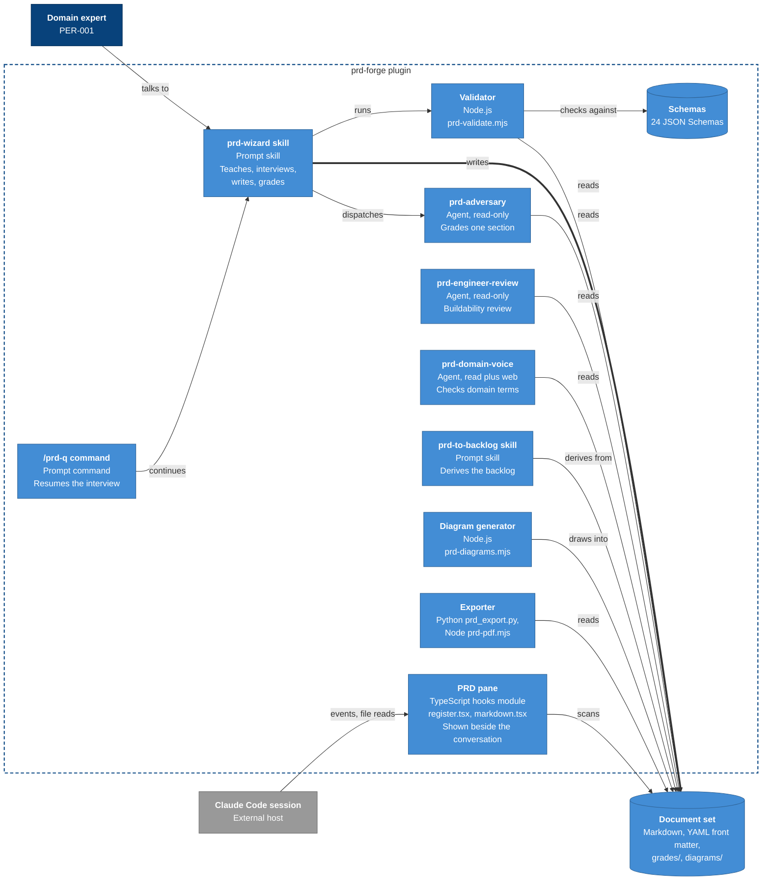

# Architecture diagram: prd-forge containers

> **Template Origin**: Official | **ArcKit Version**: 6.18.3 | **Command**: `/arckit:diagram`

## Document Control

| Field | Value |
|-------|-------|
| **Document ID** | ARC-001-DIAG-002-v1.0 |
| **Document Type** | Architecture Diagram |
| **Project** | prd-forge (Project 001) |
| **Classification** | PUBLIC |
| **Status** | DRAFT |
| **Version** | 1.0 |
| **Created Date** | 2026-10-27 |
| **Last Modified** | 2026-10-27 |
| **Review Cycle** | Monthly |
| **Next Review Date** | 2026-11-26 |
| **Owner** | Richard Hightower, product owner |
| **Reviewed By** | [PENDING] |
| **Approved By** | [PENDING] |
| **Distribution** | Project Team, Architecture Team |

## Revision History

| Version | Date | Author | Changes | Approved By | Approval Date |
|---------|------|--------|---------|-------------|---------------|
| 1.0 | 2026-10-27 | ArcKit AI | Initial creation from `/arckit:diagram` command | [PENDING] | [PENDING] |

---

## Diagram

**Type**: C4 Container (Level 2)

**Purpose**: Show the parts prd-forge is built from, what each runs as, and how each reaches the document set.

**Notation**: A Mermaid flowchart in C4 notation and C4 colors. Mermaid's native `C4Context` renderer stacked every element in one column with overlapping labels, which failed the quality gate, so the command's remediation applies: a flowchart with the C4 palette.

### Mermaid Format

**Legend**:

- Dark blue: a person
- Mid blue: prd-forge, or one of its containers
- Light blue: a component
- Gray: an external system
- Red border: an open conflict (CF-3 in the requirements)
- Cylinder: a store of files
- Dashed box: a boundary
- Dotted arrow: an optional or disputed flow
- Thick arrow: the main write path

---

## Component Inventory

| Component | Type | Technology | Responsibility | Source |
|-----------|------|------------|----------------|--------|
| prd-wizard skill | Prompt container | Markdown skill run as a model turn | Teaches, interviews, writes, dispatches grading | `skills/prd-wizard/SKILL.md` |
| /prd-q command | Prompt container | Markdown command | Resumes the interview | `commands/prd-q.md` |
| prd-to-backlog skill | Prompt container | Markdown skill | Derives the backlog | `skills/prd-to-backlog/SKILL.md` |
| prd-adversary | Agent | Read, Grep, Glob | Grades one section | `agents/prd-adversary.md` |
| prd-engineer-review | Agent | Read, Grep, Glob | Buildability review of the set | `agents/prd-engineer-review.md` |
| prd-domain-voice | Agent | Read, Grep, Glob, WebSearch, WebFetch | Checks domain terms | `agents/prd-domain-voice.md` |
| Validator | Script | Node.js | Schema and cross-section checks | `scripts/prd-validate.mjs` |
| Diagram generator | Script | Node.js | Draws, renders, links diagrams | `scripts/prd-diagrams.mjs` |
| Exporter | Script | Python, Node.js | Word and PDF | `scripts/prd_export.py`, `scripts/prd-pdf.mjs` |
| PRD pane | Hooks module | TypeScript | Steps through the set beside the conversation | `hooks/register.tsx`, `hooks/markdown.tsx` |
| Schemas | Store | JSON Schema | One per document kind | `schemas/` |
| Document set | Store | Markdown, YAML | The PRD | `docs_dir` |

---

## Architecture Decisions

### Key Design Decisions

1. Prompt containers hold the method as text that the host model follows, so the method changes without code.
2. Reviewers are separate agents with read-only tools, so a grade is independent of the writer (principle 3).
3. Every part communicates through the document set and its schemas, not with each other directly (principle 10).
4. The pane only reads; it rescans after a Write or Edit under `docs_dir`.

### Technology Choices

| Technology | Where | Why |
|------------|-------|-----|
| Markdown skills and agents | Interview and review | The host runs them with no build step |
| Node.js | Validator, generator, PDF driver | Ships with the host environment |
| Python with python-docx | Word export | The Word library the export needs |
| TypeScript hooks module | Pane | The host's mod API |

---

## Requirements Traceability

| Requirement | Component | Coverage |
|-------------|-----------|----------|
| FR-001 to FR-007, FR-015 | prd-wizard skill, /prd-q | Covered; FR-015 partly (Q-010) |
| FR-009 to FR-011, FR-016 | prd-wizard skill, prd-adversary | Covered |
| FR-012 | prd-engineer-review | Covered |
| FR-002, FR-008, FR-017, FR-018 | PRD pane | Covered |
| FR-019, FR-020, FR-021 | Validator, generator, exporter | Covered |
| FR-022 | prd-to-backlog skill | Covered |
| FR-023 | prd-domain-voice | Covered, with CF-3 |
| NFR-SEC-002 | Agents | Covered |

---

## Integration Points

### External Systems

| System | Requirement | Interface | Direction |
|--------|-------------|-----------|-----------|
| Claude Code session | INT-001, INT-002 | Plugin contract, hook events | Host to pane |
| Document set | INT-008 | Files | Both ways |

### APIs and Endpoints

prd-forge exposes no network API. Its interfaces are the host's plugin contract (INT-001, INT-002), command-line scripts, and files.

---

## Data Flow

### Data Sources

- The expert, through the prd-wizard skill.

### Data Sinks

- The document set: written by the skill, the generator's image links, and the grading reasons.

### PII Handling (UK GDPR / GDPR Compliance)

- The only personal data is names typed into `owner`, `decider`, `consulted`, `author`, and approval `name` fields (`ARC-001-DATA-v1.0`).
- It stays in the customer's set. The product keeps no copy (DR-003).

---

## Security Architecture

### Security Zones

| Zone | Contents | Trust |
|------|----------|-------|
| Host session | The model turn, the skills, the agents, the pane | The user's own session (C-001) |
| Customer store | The document set | The folder's own permissions (NFR-SEC-001) |
| Local tools | Validator, generator, exporter, renderers | Run by the user, on the user's machine |
| Outside | Web search, used only by `prd-domain-voice` | Untrusted; content leaves the session (CF-3) |

### Security Controls

- Reviewers are read-only: `prd-adversary` and `prd-engineer-review` have Read, Grep, and Glob (NFR-SEC-002).
- No credential or key in the plugin or a set (NFR-SEC-003).
- No outbound destination for domain content, except the open CF-3 (NFR-C-001).

### Authentication & Authorization

- prd-forge has no accounts and no login of its own (C-001).
- Who can read a set is decided by the customer's file permissions.
- Decision authority follows the PRD's decision rules TR-001 to TR-013, not a technical control.

---

## Deployment Architecture

### Cloud Provider

None. prd-forge is a plugin installed into the user's Claude Code from its GitHub repository. It runs on the user's machine and in the host session.

### Infrastructure Components

- The user's machine: Node.js for the scripts; optionally Python through `uv`, the Mermaid CLI, PlantUML, and Playwright or Chromium.

### Network Architecture

- No network calls by the plugin's own code. The host session makes its own calls, and `prd-domain-voice` may search the web (CF-3).

---

## Non-Functional Requirements

### Performance

- Next question under 20 seconds at p95 (NFR-P-001); grading under 90 seconds at p95 (NFR-P-002). Neither is measured yet.
- The validator checks the reference set in 0.05 seconds.

### Scalability

- Set size up to 120 FRs, 10 journeys of 10 stages, and 200 terms (NFR-S-001). Not measured at that size yet.

### Availability & Resilience

- A set is plain files and survives the product (NFR-A-001).
- Gap: answers before a section is drafted live only in the conversation (NFR-A-002, Q-010).

### Security & Compliance

- See Security Architecture above.

---

## UK Government Compliance (if applicable)

Not applicable. prd-forge is not a UK Government service.

---

## Wardley Map Integration

No Wardley map exists for this project yet. Run `/arckit:wardley` to position the interview method (custom-built) against the host session and the renderers (commodity, used as they are).

---

## Diagram Quality Gate

| # | Criterion | Target | Result | Status |
|---|-----------|--------|--------|--------|
| 1 | Edge crossings | Fewer than 5 | 0 through boxes; 8 edges fan into the set | PASS |
| 2 | Visual hierarchy | Boundary prominent | Dashed blue plugin boundary | PASS |
| 3 | Grouping | Related elements proximate | Reviewers and scripts stacked together | PASS |
| 4 | Flow direction | Consistent | Left to right | PASS |
| 5 | Relationship traceability | Lines followable | Fan-in lines distinct | PASS |
| 6 | Abstraction level | One C4 level | Container | PASS |
| 7 | Edge label readability | No overlaps | No overlaps | PASS |
| 8 | Node placement | No long edges | One long edge, /prd-q to the skill | PASS |
| 9 | Element count | 15 or fewer | 15 | PASS |

**Accepted trade-offs**:

- The expert's view of the pane is stated in the pane's label, not drawn, because that edge crossed the Exporter box.
- Two earlier layouts were rejected: subgraph rows made the diagram 1,550 by 450 pixels with unreadable text.

---

## Linked Artifacts

- Requirements: `../ARC-001-REQ-v1.0.md`
- Data model: `../ARC-001-DATA-v1.0.md`
- Stakeholders: `../ARC-001-STKE-v1.0.md`
- Principles: `../../000-global/ARC-000-PRIN-v1.0.md`
- Source PRD: `../../../prd/prd-forge/prd.md`

---

## Change Log

| Version | Date | Change |
|---------|------|--------|
| 1.0 | 2026-10-27 | First version, from the code at the v0.8.0 tag |

## External References

### Document Register

| Doc ID | Filename | Type | Source Location | Description |
|--------|----------|------|-----------------|-------------|
| REQ | ARC-001-REQ-v1.0.md | Requirements | `docs/projects/001-prd-forge/` | INT, FR, and NFR ids cited above |
| CODE | Repository | Source code | Repository root | Files named in the component inventory |

### Citations

| Citation ID | Doc ID | Page/Section | Category | Quoted Passage |
|-------------|--------|--------------|----------|----------------|
| REQ-C1 | REQ | Integration Requirements | Integration | INT-001 to INT-008 |

### Unreferenced Documents

| Filename | Source Location | Reason |
|----------|-----------------|--------|
| None | None | None |

---

**Generated by**: ArcKit `/arckit:diagram` command
**Generated on**: 2026-10-27
**ArcKit Version**: 6.18.3
**Project**: prd-forge (Project 001)
**AI Model**: Claude Opus 5.5 (claude-opus-5-5)
**Generation Context**: ARC-001-REQ-v1.0, ARC-001-DATA-v1.0, ARC-000-PRIN-v1.0, and the code at the v0.8.0 tag. Rendered with `mmdc` and checked by eye before writing.
