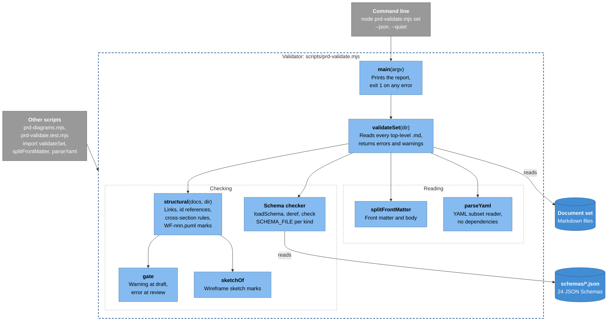

# Architecture diagram: prd-forge validator components

> **Template Origin**: Official | **ArcKit Version**: 6.18.3 | **Command**: `/arckit:diagram`

## Document Control

| Field | Value |
|-------|-------|
| **Document ID** | ARC-001-DIAG-003-v1.0 |
| **Document Type** | Architecture Diagram |
| **Project** | prd-forge (Project 001) |
| **Classification** | PUBLIC |
| **Status** | DRAFT |
| **Version** | 1.0 |
| **Created Date** | 2026-10-27 |
| **Last Modified** | 2026-10-27 |
| **Review Cycle** | Monthly |
| **Next Review Date** | 2026-11-26 |
| **Owner** | Richard Hightower, product owner |
| **Reviewed By** | [PENDING] |
| **Approved By** | [PENDING] |
| **Distribution** | Project Team, Architecture Team |

## Revision History

| Version | Date | Author | Changes | Approved By | Approval Date |
|---------|------|--------|---------|-------------|---------------|
| 1.0 | 2026-10-27 | ArcKit AI | Initial creation from `/arckit:diagram` command | [PENDING] | [PENDING] |

---

## Diagram

**Type**: C4 Component (Level 3)

**Purpose**: Show the parts inside `scripts/prd-validate.mjs` and the files they read.

**Notation**: A Mermaid flowchart in C4 notation and C4 colors, for the same reason as DIAG-001.

### Mermaid Format

**Legend**:

- Dark blue: a person
- Mid blue: prd-forge, or one of its containers
- Light blue: a component
- Gray: an external system
- Red border: an open conflict (CF-3 in the requirements)
- Cylinder: a store of files
- Dashed box: a boundary
- Dotted arrow: an optional or disputed flow
- Thick arrow: the main write path

---

## Component Inventory

| Component | Type | Technology | Responsibility | Source |
|-----------|------|------------|----------------|--------|
| main | Function | Node.js | Parses arguments, prints the report, exits 1 on any error | `scripts/prd-validate.mjs:1093` |
| validateSet | Function, exported | Node.js | Reads every top-level `.md`, runs the checks, returns errors and warnings | `scripts/prd-validate.mjs:1043` |
| splitFrontMatter | Function, exported | Node.js | Splits front matter from the body | `scripts/prd-validate.mjs:18` |
| parseYaml | Function, exported | Node.js | The YAML subset reader, no dependencies | `scripts/prd-validate.mjs:221` |
| Schema checker | Functions | Node.js | `loadSchema`, `deref`, `check`, with `SCHEMA_FILE` per kind | `scripts/prd-validate.mjs:234` |
| structural | Function | Node.js | Links, id references, and every cross-section rule | `scripts/prd-validate.mjs:365` |
| gate | Closure in structural | Node.js | Warning at draft, error at review | `scripts/prd-validate.mjs:624` |
| sketchOf | Function | Node.js | Finds a wireframe's sketch and its marks | `scripts/prd-validate.mjs:346` |

---

## Architecture Decisions

### Key Design Decisions

1. The YAML reader has no dependencies, and a test compares it with PyYAML on every shipped document (NFR-I-001).
2. Schema checks and cross-section checks are separate: the schema sees one document, `structural` sees the set.
3. `gate()` lets one rule be a warning while a section is a draft and an error once it is offered for review.
4. Each release adds its checks as a block inside `structural`, before the gates.

### Technology Choices

| Technology | Where | Why |
|------------|-------|-----|
| Node.js, standard library only | Whole validator | No install step; runs anywhere the scripts run |

---

## Requirements Traceability

| Requirement | Component | Coverage |
|-------------|-----------|----------|
| DR-001 | Schema checker | Covered |
| DR-002 | structural | Covered |
| FR-019 | validateSet, main | Covered |
| NFR-I-001 | parseYaml | Covered |

---

## Integration Points

### External Systems

| System | Requirement | Interface | Direction |
|--------|-------------|-----------|-----------|
| Document set | DR-001, DR-002 | File reads | In |
| schemas/*.json | DR-001 | File reads | In |

### APIs and Endpoints

prd-forge exposes no network API. Its interfaces are the host's plugin contract (INT-001, INT-002), command-line scripts, and files.

---

## Data Flow

### Data Sources

- The set's top-level markdown files, the schemas, and each wireframe's `.puml` drawing.

### Data Sinks

- Standard output, or JSON with `--json`. The validator writes no file.

### PII Handling (UK GDPR / GDPR Compliance)

- The only personal data is names typed into `owner`, `decider`, `consulted`, `author`, and approval `name` fields (`ARC-001-DATA-v1.0`).
- It stays in the customer's set. The product keeps no copy (DR-003).

---

## Security Architecture

### Security Zones

| Zone | Contents | Trust |
|------|----------|-------|
| Host session | The model turn, the skills, the agents, the pane | The user's own session (C-001) |
| Customer store | The document set | The folder's own permissions (NFR-SEC-001) |
| Local tools | Validator, generator, exporter, renderers | Run by the user, on the user's machine |
| Outside | Web search, used only by `prd-domain-voice` | Untrusted; content leaves the session (CF-3) |

### Security Controls

- Reviewers are read-only: `prd-adversary` and `prd-engineer-review` have Read, Grep, and Glob (NFR-SEC-002).
- No credential or key in the plugin or a set (NFR-SEC-003).
- No outbound destination for domain content, except the open CF-3 (NFR-C-001).

### Authentication & Authorization

- prd-forge has no accounts and no login of its own (C-001).
- Who can read a set is decided by the customer's file permissions.
- Decision authority follows the PRD's decision rules TR-001 to TR-013, not a technical control.

---

## Deployment Architecture

### Cloud Provider

None. prd-forge is a plugin installed into the user's Claude Code from its GitHub repository. It runs on the user's machine and in the host session.

### Infrastructure Components

- The user's machine: Node.js for the scripts; optionally Python through `uv`, the Mermaid CLI, PlantUML, and Playwright or Chromium.

### Network Architecture

- No network calls by the plugin's own code. The host session makes its own calls, and `prd-domain-voice` may search the web (CF-3).

---

## Non-Functional Requirements

### Performance

- Next question under 20 seconds at p95 (NFR-P-001); grading under 90 seconds at p95 (NFR-P-002). Neither is measured yet.
- The validator checks the reference set in 0.05 seconds.

### Scalability

- Set size up to 120 FRs, 10 journeys of 10 stages, and 200 terms (NFR-S-001). Not measured at that size yet.

### Availability & Resilience

- A set is plain files and survives the product (NFR-A-001).
- Gap: answers before a section is drafted live only in the conversation (NFR-A-002, Q-010).

### Security & Compliance

- See Security Architecture above.

---

## UK Government Compliance (if applicable)

Not applicable. prd-forge is not a UK Government service.

---

## Wardley Map Integration

No Wardley map exists for this project yet. Run `/arckit:wardley` to position the interview method (custom-built) against the host session and the renderers (commodity, used as they are).

---

## Diagram Quality Gate

| # | Criterion | Target | Result | Status |
|---|-----------|--------|--------|--------|
| 1 | Edge crossings | 0 for this size | 0 | PASS |
| 2 | Visual hierarchy | Boundary prominent | Dashed boundary around the file | PASS |
| 3 | Grouping | Related elements proximate | Reading and Checking groups | PASS |
| 4 | Flow direction | Consistent | Top to bottom | PASS |
| 5 | Relationship traceability | Lines followable | Yes | PASS |
| 6 | Abstraction level | One C4 level | Component | PASS |
| 7 | Edge label readability | No overlaps | No overlaps | PASS |
| 8 | Node placement | No long edges | The schema read is long | PASS |
| 9 | Element count | 12 or fewer | 11 | PASS |

**Accepted trade-offs**:

- The `.puml` read is named in the `structural` label, not drawn, because its edge crossed `gate`.
- The three imports by other scripts are one edge to the boundary, with the function names in the caller's box.

---

## Linked Artifacts

- Requirements: `../ARC-001-REQ-v1.0.md`
- Data model: `../ARC-001-DATA-v1.0.md`
- Stakeholders: `../ARC-001-STKE-v1.0.md`
- Principles: `../../000-global/ARC-000-PRIN-v1.0.md`
- Source PRD: `../../../prd/prd-forge/prd.md`

---

## Change Log

| Version | Date | Change |
|---------|------|--------|
| 1.0 | 2026-10-27 | First version, from the code at the v0.8.0 tag |

## External References

### Document Register

| Doc ID | Filename | Type | Source Location | Description |
|--------|----------|------|-----------------|-------------|
| REQ | ARC-001-REQ-v1.0.md | Requirements | `docs/projects/001-prd-forge/` | INT, FR, and NFR ids cited above |
| CODE | Repository | Source code | Repository root | Files named in the component inventory |

### Citations

| Citation ID | Doc ID | Page/Section | Category | Quoted Passage |
|-------------|--------|--------------|----------|----------------|
| REQ-C1 | REQ | Integration Requirements | Integration | INT-001 to INT-008 |

### Unreferenced Documents

| Filename | Source Location | Reason |
|----------|-----------------|--------|
| None | None | None |

---

**Generated by**: ArcKit `/arckit:diagram` command
**Generated on**: 2026-10-27
**ArcKit Version**: 6.18.3
**Project**: prd-forge (Project 001)
**AI Model**: Claude Opus 5.5 (claude-opus-5-5)
**Generation Context**: ARC-001-REQ-v1.0, ARC-001-DATA-v1.0, ARC-000-PRIN-v1.0, and the code at the v0.8.0 tag. Rendered with `mmdc` and checked by eye before writing.
