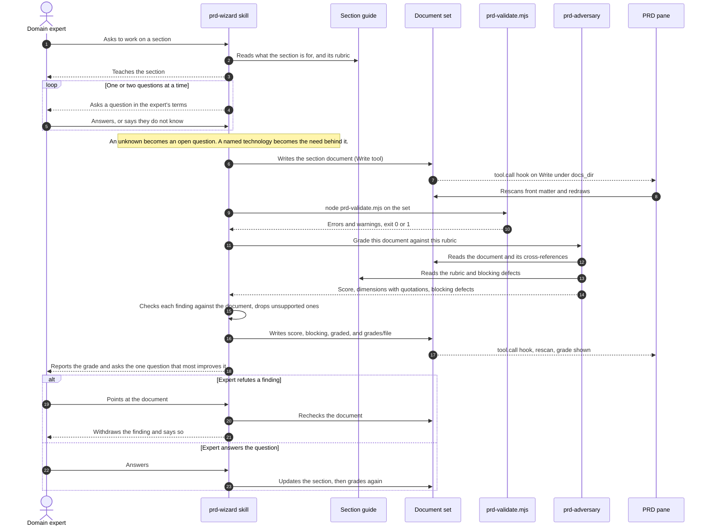

# Architecture diagram: Write and grade one section

> **Template Origin**: Official | **ArcKit Version**: 6.18.3 | **Command**: `/arckit:diagram`

## Document Control

| Field | Value |
|-------|-------|
| **Document ID** | ARC-001-DIAG-004-v1.0 |
| **Document Type** | Architecture Diagram |
| **Project** | prd-forge (Project 001) |
| **Classification** | PUBLIC |
| **Status** | DRAFT |
| **Version** | 1.0 |
| **Created Date** | 2026-10-27 |
| **Last Modified** | 2026-10-27 |
| **Review Cycle** | Monthly |
| **Next Review Date** | 2026-11-26 |
| **Owner** | Richard Hightower, product owner |
| **Reviewed By** | [PENDING] |
| **Approved By** | [PENDING] |
| **Distribution** | Project Team, Architecture Team |

## Revision History

| Version | Date | Author | Changes | Approved By | Approval Date |
|---------|------|--------|---------|-------------|---------------|
| 1.0 | 2026-10-27 | ArcKit AI | Initial creation from `/arckit:diagram` command | [PENDING] | [PENDING] |

---

## Diagram

**Type**: Sequence

**Purpose**: Show what happens, step by step, when the expert works on one section: teaching, interview, write, validation, grading, and the expert's reply.

**Notation**: A Mermaid sequence diagram, numbered with `autonumber`.

### Mermaid Format

**Legend**:

- Solid arrow: a call or an action
- Dashed arrow: a reply or an event
- loop: repeats until the section has enough material
- alt: the two ways the expert can reply to a grade

---

## Component Inventory

| Component | Type | Technology | Responsibility | Source |
|-----------|------|------------|----------------|--------|
| Domain expert | Actor | None | Answers and refutes | PER-001 |
| prd-wizard skill | Prompt container | Model turn | Runs the loop | `skills/prd-wizard/SKILL.md`, `reference/method.md`, `reference/grading.md` |
| Section guide | File | Markdown | Teaching text, rubric, blocking defects | `skills/prd-wizard/sections/` |
| Document set | Store | Markdown, YAML | The PRD | `docs_dir` |
| prd-validate.mjs | Script | Node.js | Validates the set | `scripts/prd-validate.mjs` |
| prd-adversary | Agent | Read-only | Grades the section | `agents/prd-adversary.md` |
| PRD pane | Hooks module | TypeScript | Redraws after each write | `hooks/register.tsx:282` |

---

## Architecture Decisions

### Key Design Decisions

1. Teach before asking (PRD FR-003), then one or two questions at a time (FR-004).
2. The grader gets only the document and rubric paths and the domain, never the writer's view (`reference/grading.md`).
3. The skill checks every finding against the document before reporting it, and drops what the document does not support (FR-016).
4. Only the grading pass writes `score`, `blocking`, and `graded`.

### Technology Choices

| Technology | Where | Why |
|------------|-------|-----|
| Host Write tool | Steps 6 and 16 | The pane's `tool.call` hook sees every write |

---

## Requirements Traceability

| Requirement | Component | Coverage |
|-------------|-----------|----------|
| FR-003, FR-004 | Steps 2 to 5 | Covered |
| FR-006, FR-007 | Note after step 5 | Covered |
| FR-009 | Steps 11 to 16 | Covered |
| FR-010 | Step 18 | Covered |
| FR-011 | Step 23 | Covered |
| FR-016 | Steps 19 to 21 | Covered |
| FR-018 | Steps 7, 8, 17 | Covered |
| FR-019 | Steps 9, 10 | Covered |
| NFR-A-002 | Steps 4 and 5 | Gap: answers held in the conversation until step 6 |

---

## Integration Points

### External Systems

| System | Requirement | Interface | Direction |
|--------|-------------|-----------|-----------|
| Claude Code session | INT-002 | `tool.call` hook on Write and Edit | Host to pane |

### APIs and Endpoints

prd-forge exposes no network API. Its interfaces are the host's plugin contract (INT-001, INT-002), command-line scripts, and files.

---

## Data Flow

### Data Sources

- The expert's answers (step 5); the section guide (step 2).

### Data Sinks

- The section document (step 6); its grade fields and `grades/<file>` (step 16).

### PII Handling (UK GDPR / GDPR Compliance)

- The only personal data is names typed into `owner`, `decider`, `consulted`, `author`, and approval `name` fields (`ARC-001-DATA-v1.0`).
- It stays in the customer's set. The product keeps no copy (DR-003).

---

## Security Architecture

### Security Zones

| Zone | Contents | Trust |
|------|----------|-------|
| Host session | The model turn, the skills, the agents, the pane | The user's own session (C-001) |
| Customer store | The document set | The folder's own permissions (NFR-SEC-001) |
| Local tools | Validator, generator, exporter, renderers | Run by the user, on the user's machine |
| Outside | Web search, used only by `prd-domain-voice` | Untrusted; content leaves the session (CF-3) |

### Security Controls

- Reviewers are read-only: `prd-adversary` and `prd-engineer-review` have Read, Grep, and Glob (NFR-SEC-002).
- No credential or key in the plugin or a set (NFR-SEC-003).
- No outbound destination for domain content, except the open CF-3 (NFR-C-001).

### Authentication & Authorization

- prd-forge has no accounts and no login of its own (C-001).
- Who can read a set is decided by the customer's file permissions.
- Decision authority follows the PRD's decision rules TR-001 to TR-013, not a technical control.

---

## Deployment Architecture

### Cloud Provider

None. prd-forge is a plugin installed into the user's Claude Code from its GitHub repository. It runs on the user's machine and in the host session.

### Infrastructure Components

- The user's machine: Node.js for the scripts; optionally Python through `uv`, the Mermaid CLI, PlantUML, and Playwright or Chromium.

### Network Architecture

- No network calls by the plugin's own code. The host session makes its own calls, and `prd-domain-voice` may search the web (CF-3).

---

## Non-Functional Requirements

### Performance

- Next question under 20 seconds at p95 (NFR-P-001); grading under 90 seconds at p95 (NFR-P-002). Neither is measured yet.
- The validator checks the reference set in 0.05 seconds.

### Scalability

- Set size up to 120 FRs, 10 journeys of 10 stages, and 200 terms (NFR-S-001). Not measured at that size yet.

### Availability & Resilience

- A set is plain files and survives the product (NFR-A-001).
- Gap: answers before a section is drafted live only in the conversation (NFR-A-002, Q-010).

### Security & Compliance

- See Security Architecture above.

---

## UK Government Compliance (if applicable)

Not applicable. prd-forge is not a UK Government service.

---

## Wardley Map Integration

No Wardley map exists for this project yet. Run `/arckit:wardley` to position the interview method (custom-built) against the host session and the renderers (commodity, used as they are).

---

## Diagram Quality Gate

| # | Criterion | Target | Result | Status |
|---|-----------|--------|--------|--------|
| 1 | Edge crossings | Not applicable to sequence diagrams | None | PASS |
| 2 | Visual hierarchy | Actor first | Expert leftmost | PASS |
| 3 | Grouping | Related lifelines adjacent | Skill beside guide and set | PASS |
| 4 | Flow direction | Top to bottom | Top to bottom | PASS |
| 5 | Relationship traceability | Messages numbered | 23 numbered messages | PASS |
| 6 | Abstraction level | One scenario | One section | PASS |
| 7 | Edge label readability | No overlaps | No overlaps | PASS |
| 8 | Node placement | Short messages | Pane is rightmost, so hook messages are long | PASS |
| 9 | Element count | 8 lifelines or fewer | 7 | PASS |

**Accepted trade-offs**:

- The `tool.call` hook is drawn from the document set to the pane, although the host fires it. The host is left out to stay within 8 lifelines.

---

## Linked Artifacts

- Requirements: `../ARC-001-REQ-v1.0.md`
- Data model: `../ARC-001-DATA-v1.0.md`
- Stakeholders: `../ARC-001-STKE-v1.0.md`
- Principles: `../../000-global/ARC-000-PRIN-v1.0.md`
- Source PRD: `../../../prd/prd-forge/prd.md`

---

## Change Log

| Version | Date | Change |
|---------|------|--------|
| 1.0 | 2026-10-27 | First version, from the code at the v0.8.0 tag |

## External References

### Document Register

| Doc ID | Filename | Type | Source Location | Description |
|--------|----------|------|-----------------|-------------|
| REQ | ARC-001-REQ-v1.0.md | Requirements | `docs/projects/001-prd-forge/` | INT, FR, and NFR ids cited above |
| CODE | Repository | Source code | Repository root | Files named in the component inventory |

### Citations

| Citation ID | Doc ID | Page/Section | Category | Quoted Passage |
|-------------|--------|--------------|----------|----------------|
| REQ-C1 | REQ | Integration Requirements | Integration | INT-001 to INT-008 |

### Unreferenced Documents

| Filename | Source Location | Reason |
|----------|-----------------|--------|
| None | None | None |

---

**Generated by**: ArcKit `/arckit:diagram` command
**Generated on**: 2026-10-27
**ArcKit Version**: 6.18.3
**Project**: prd-forge (Project 001)
**AI Model**: Claude Opus 5.5 (claude-opus-5-5)
**Generation Context**: ARC-001-REQ-v1.0, ARC-001-DATA-v1.0, ARC-000-PRIN-v1.0, and the code at the v0.8.0 tag. Rendered with `mmdc` and checked by eye before writing.
