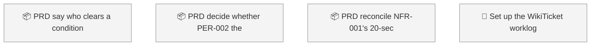
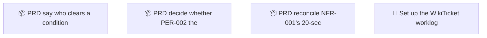

<!-- GENERATED by worklog roadmap-render. DO NOT EDIT. -->

> This file is generated from `.work/todo.jsonl`. Edits will be overwritten.
> To change the roadmap, change the work items: `worklog add|update|close`.

# Roadmap

_0 epic(s) in flight, 4 open item(s), 0 blocked, 0 unclassified._

## Now

_Nothing here._

## Next

### (no epic)

| # | Item | Type | Priority | Status | Blocked by |
|---|---|---|---|---|---|
| [25](https://github.com/SpillwaveSolutions/prd-forge/issues/25) | PRD: say who clears a condition when the sponsor who set it is gone | task | P2 | todo | — |
| [26](https://github.com/SpillwaveSolutions/prd-forge/issues/26) | PRD: decide whether PER-002, the engineering lead, is external | task | P2 | todo | — |
| [27](https://github.com/SpillwaveSolutions/prd-forge/issues/27) | PRD: reconcile NFR-001's 20-second target with its own rationale | task | P2 | todo | — |
| 01M67NBR | Set up the WikiTicket worklog for prd-forge | task | P2 | todo | — |

## Later

_Nothing here._

## Visual roadmap

### Dependency graph

### Hierarchy

