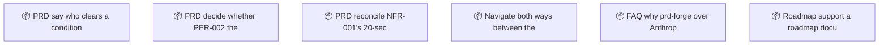

<!-- GENERATED by worklog roadmap-render. DO NOT EDIT. -->

> This file is generated from `.work/todo.jsonl`. Edits will be overwritten.
> To change the roadmap, change the work items: `worklog add|update|close`.

# Roadmap

_0 epic(s) in flight, 5 open item(s), 0 blocked, 0 unclassified._

## Now

_Nothing here._

## Next

### (no epic)

| # | Item | Type | Priority | Status | Blocked by |
|---|---|---|---|---|---|
| [25](https://github.com/SpillwaveSolutions/prd-forge/issues/25) | PRD: say who clears a condition when the sponsor who set it is gone | task | P2 | todo | — |
| [26](https://github.com/SpillwaveSolutions/prd-forge/issues/26) | PRD: decide whether PER-002, the engineering lead, is external | task | P2 | todo | — |
| [27](https://github.com/SpillwaveSolutions/prd-forge/issues/27) | PRD: reconcile NFR-001's 20-second target with its own rationale | task | P2 | todo | — |
| [22](https://github.com/SpillwaveSolutions/prd-forge/issues/22) | Navigate both ways between the PRD and its backlog | story | P2 | todo | — |

## Later

### (no epic)

| # | Item | Type | Priority | Status | Blocked by |
|---|---|---|---|---|---|
| [23](https://github.com/SpillwaveSolutions/prd-forge/issues/23) | FAQ: why prd-forge over Anthropic's product-management plugin | task | P3 | todo | — |

## Needs attention

- **[24](https://github.com/SpillwaveSolutions/prd-forge/issues/24)** Roadmap support: a roadmap document kind with /prd-roadmap — no open children left; close the epic.

## Visual roadmap

### Dependency graph

```mermaid
graph TD
    01M67NBJMD36KW0QP1S9D4SMAD["📦 PRD say who clears a condition"]
    01M67NBJQEWFPJ4YZADKC6ZXP7["📦 PRD decide whether PER-002 the"]
    01M67NBJTJAPJSEETE5YS6SVMT["📦 PRD reconcile NFR-001's 20-sec"]
    01M67NKWD871BPKRKQEH9G9FX7["📦 Navigate both ways between the"]
    01M67NKWK65A7E7T3HN3CQVZ4C["📦 FAQ why prd-forge over Anthrop"]
    01M67NKWT0E0CGYGZYJ8SV6ERN["📦 Roadmap support a roadmap docu"]
    classDef todo fill:#f4f4f4,stroke:#999999
    class 01M67NBJMD36KW0QP1S9D4SMAD,01M67NBJQEWFPJ4YZADKC6ZXP7,01M67NBJTJAPJSEETE5YS6SVMT,01M67NKWD871BPKRKQEH9G9FX7,01M67NKWK65A7E7T3HN3CQVZ4C,01M67NKWT0E0CGYGZYJ8SV6ERN todo
```

### Hierarchy

