# User journeys

## J-001 — A return resolved at the counter (golden thread)

Persona PER-001, store associate. Trigger: a customer arrives with an item.
Stages ST-001 to ST-004. End state: the customer has left knowing the outcome
and the reason, and the return is recorded with its reason.

<!-- prd-forge:details -->

## Details

Every item in this document, with each of its fields.

### J-001

**Goal:** A return resolved at the counter, with the customer told the outcome and the reason

**Persona:** PER-001

**Trigger:** A customer arrives at the counter with an item and asks to return it

**Golden thread:** yes

**Pain points:**

- Calling the contact centre with the customer watching
- No visible policy for this item and this purchase date
- Reasons are not recorded, so the hub cannot set disposition

**Needs:**

- A decision and its reason, visible at the counter
- An exception path that does not require a phone call
- The return reason captured once, where the hub can read it

**End state:** The customer has left knowing the outcome and the reason, and the return is recorded with its reason.

**Stages**

#### ST-001

**Name:** Associate identifies the purchase

**Actor:** Store associate

**Acceptance:**

1. Given a customer at the counter with a receipt, an order number, or the payment card, when the associate looks up the purchase, then they see the purchase, its date, and what was paid.

**Steps:**

1. Asks the customer for a receipt, an order number, or the card used
2. Sees the purchase, its date, and what was paid
3. Decides whether this is the right purchase before going further

**Inputs:** A receipt, an order number, or the payment card

**Outputs:** The purchase, its date and its price

**Decision:** Is this the purchase the customer means

#### ST-002

**Name:** Associate sees the returns decision

**Actor:** Store associate

**Acceptance:**

1. Given an identified purchase and the item in front of them, when the associate checks the return, then they see whether it may be returned, on what terms, and the reason when it may not.

**Steps:**

1. Sees whether the item may be returned, and on what terms
2. Sees the reason when it may not
3. Decides whether to accept, refuse, or ask for an exception

**Inputs:** The item and its condition

**Outputs:** A decision, its reason, and the refund method

**Decision:** Accept, refuse, or escalate

#### ST-003

**Name:** Agent decides an exception

**Actor:** Contact-centre agent

**Acceptance:**

1. Given a return the associate escalated with a reason, when the agent approves or refuses it, then the associate sees the decision and a reason to tell the customer.

**Steps:**

1. Sees the request, the purchase, and why the associate escalated
2. Approves or refuses, and records the reason

**Inputs:** The associate's reason for escalating

**Outputs:** An approval or a refusal, with a reason to tell the customer

**Decision:** Approve or refuse the exception

**Handoff:** Back to the store associate

#### ST-004

**Name:** Associate completes the return

**Actor:** Store associate

**Acceptance:**

1. Given an accepted return, when the associate confirms the refund method with the customer, then the return is complete and the reason it came back is recorded.

**Steps:**

1. Confirms the refund method with the customer
2. Records the reason the item came back
3. Tells the customer what happens next

**Outputs:** A completed return, with the reason recorded

**Decision:** Which refund method

**Handoff:** Returns-processing clerk at the hub

<!-- /prd-forge:details -->
