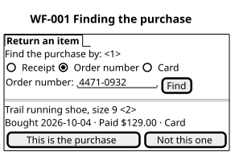
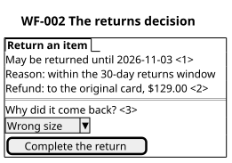
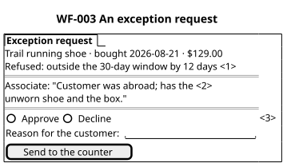

# Wireframes

Each sketch shows what a person sees and what they can do, with the example's
own content. None of them decides how anything looks or how it is built.

## WF-001 Finding the purchase

Illustration, not a design. Illustrates FR-001. PER-001 sees it at ST-001.

```wireframe
┌─ Return an item ─────────────────────────────────┐
│ Find the purchase by: <1>                        │
│   ( ) Receipt   (•) Order number   ( ) Card      │
│   Order number: [ 4471-0932        ] [ Find ]    │
├──────────────────────────────────────────────────┤
│ Trail running shoe, size 9 <2>                   │
│ Bought 2026-10-04 · Paid $129.00 · Card          │
│ [ This is the purchase ]  [ Not this one ]       │
└──────────────────────────────────────────────────┘
```



## WF-002 The returns decision

Illustration, not a design. Illustrates FR-002 and FR-004. PER-001 sees it at ST-002.

```wireframe
┌─ Return an item ─────────────────────────────────┐
│ May be returned until 2026-11-03 <1>             │
│ Reason: within the 30-day returns window         │
│ Refund: to the original card, $129.00 <2>        │
├──────────────────────────────────────────────────┤
│ Why did it come back? <3>                        │
│ [ Wrong size                              ▾ ]    │
│ [ Complete the return ]                          │
└──────────────────────────────────────────────────┘
```



## WF-003 An exception request

Illustration, not a design. Illustrates FR-003. PER-002 sees it at ST-003.

```wireframe
┌─ Exception request ──────────────────────────────┐
│ Trail running shoe · bought 2026-08-21 · $129.00 │
│ Refused: outside the 30-day window by 12 days <1>│
├──────────────────────────────────────────────────┤
│ Associate: "Customer was abroad; has the <2>     │
│ unworn shoe and the box."                        │
├──────────────────────────────────────────────────┤
│ ( ) Approve   ( ) Decline <3>                    │
│ Reason for the customer: [                   ]   │
│ [ Send to the counter ]                          │
└──────────────────────────────────────────────────┘
```



## WF-004 Items arriving at the hub today

Illustration, not a design. Illustrates FR-005. PER-003 reads it at ST-004.

```wireframe
┌─ Arriving today ─────────────────────────────────┐
│ Item                  From store   Reason <1>    │
│ Trail running shoe    Store 112    Wrong size    │
│ Rain jacket, M        Store 087    Faulty zip    │
│ Water bottle          Store 112    Changed mind  │
└──────────────────────────────────────────────────┘
```


